# 논문 정리 — 돼지 사료통 점유(visiting) 마릿수 추정: 포즈 기반 판정 4가지 vs YOLO 직접 검출

논문 작성용으로 **진행 방법(상세) · 지표 정의 · 결과 표 · 그래프**를 한 곳에 모은 문서임.
- 모든 수치는 **Random 5-fold · Time 5-fold의 fold 5개 평균 ± 표본 표준편차(ddof = 1)**임.
- test는 모든 fold에서 **test(000) 86장**으로 고정함.
- 수치의 원본은 자동 생성 파일임:
  - [paper_metrics.md](counting/reports/fold_study/paper/paper_metrics.md): 표 1\~11
  - [fold_study.md](counting/reports/fold_study/fold_study.md): fold별 값
  - [speed.md](counting/reports/speed/NVIDIA_RTX_6000_Ada_Generation/speed.md): 추론 시간
- 이 문서는 위 파일들의 값을 옮겨 정리한 것임. 설명이 더 긴 결과 해석은 [RESULTS.md](RESULTS.md)에 있음.

목차
1. 연구 요약
2. 데이터
3. 실험 설계 (분할)
4. 방법
5. 평가 방법
6. 결과
7. 논의에 쓸 내용
8. 한계점
9. 그림 목록
10. 재현 방법 · 파일 위치

---

## 1. 연구 요약

- **문제**: 돈방 CCTV 사진 한 장에서 사료통을 차지하고 먹는(visiting) 돼지가 몇 마리인지 셈. 1초에 1장씩 세면 사료통 점유 시간을 계측할 수 있음.
- **비교한 방법 5가지**:
  - 포즈 추정(YOLOv8m-pose, 관절 18개) 결과를 판정하는 방법 4가지:
    - **Geo**: 규칙
    - **RF**: RandomForest
    - **RF+Geo**: RF 특징 + Geo 값
    - **RF+Geo+Leg**: RF+Geo + 다리 특징
  - 사진에서 visiting / other를 바로 검출하는 방법 1가지: **YOLO** (YOLOv8m detect)
- **조건 통일**: 다섯 방법 모두 다음이 같음 (11/16 랩미팅 통일 기준).
  - 같은 train 사진(분할 목록 해시 일치)
  - 같은 학습 설정(epoch 200, seed 42, imgsz 640, batch 8, COCO 사전학습)
  - val로만 하는 선택
  - 같은 test(000)
  - 같은 채점 함수
- **분할 2가지**:
  - **Random 5-fold**: 사진 단위 무작위
  - **Time 5-fold**: 촬영 시간 구간 단위
  - 두 분할은 fold별 장수가 같고, valid를 고르는 방식만 다름.

**핵심 결과** (test(000), 사진당 visiting 마릿수 MAE, Random 5-fold / Time 5-fold)

| 방법 | MAE | 정확 일치 | 1분 총 점유량 오차 | GPU 추론 (중앙값) |
|---|---|---|---|---|
| Geo | 0.293 / 0.293 | 71.9% / 71.9% | −18.6% / −17.7% | 23.8 / 23.7 ms |
| RF | 0.114 / 0.116 | 88.8% / 88.4% | −2.3% / −1.2% | 28.0 / 27.8 ms |
| RF+Geo | 0.133 / 0.126 | 86.7% / 87.4% | −4.4% / −3.3% | 27.9 / 27.8 ms |
| **RF+Geo+Leg** (RF best) | 0.121 / **0.109** | 87.9% / **89.1%** | −3.3% / −1.4% | 27.9 / 27.8 ms |
| YOLO | 0.300 / 0.223 | 70.5% / 77.9% | −4.1% / −4.2% | 21.3 / 21.3 ms |

1. **RF 계열 3가지가 가장 정확함.** RF+Geo+Leg는 Geo · YOLO보다 test 사진 단위로 유의하게 좋음(Wilcoxon p ≤ 0.007).
2. **RF 계열 3가지 사이 차이는 유의하지 않음**(p > 0.3). 다만 val 기준으로는 RF+Geo+Leg가 두 분할 모두 가장 좋아 RF best로 선택됨.
3. **YOLO의 약점은 판정**임. 돼지는 잘 찾지만 visiting / other 판정 오류가 RF+Geo+Leg의 약 3.4배(Time 5-fold)이고, Random 5-fold에서는 conf 임계값 때문에 fold 간 편차가 큼.
4. **Geo 규칙은 약 18% 적게 셈.** 방향 조건(60°)에서 visiting을 탈락시키기 때문임.
5. **test(000) 성능은 분할 방식과 상관없음**(Geo · RF 계열 p > 0.69). 그러나 val은 Time 5-fold에서 크게 나빠짐. 즉 Random 5-fold val은 새 장면 성능을 낙관적으로 보여 줌.
6. **속도**: GPU에서 5가지 방법 모두 30 fps 가능(p95 ≤ 29 ms). CPU에서는 1 fps 가능(약 0.2초).

---

## 2. 데이터

### 2-1. 수집과 라벨

| task | 카메라 · 해상도 | 촬영 (KST) | 클립 | 사진 | 돼지 (visiting / other) | 용도 |
|---|---|---|---|---|---|---|
| 001 | CH005, 1920×1080 | 2026-07-08 06:15\~07:44 (약 1.5시간) | 4 | 90 | 899 (136 / 763) | train / valid |
| 002 | CH010, 1920×1080 | 2026-07-16 10:26\~18:32 (약 8시간) | 17 | 100 | 990 (179 / 811) | train / valid |
| 000 | 1분 샘플 영상, 960×720 | – | 1 | 86 | 860 (133 / 727) | **test(000)** |

**라벨링 도구와 형식**
- 사람이 CVAT로 모든 돼지에 **관절 18개 스켈레톤**과 **State 속성(visiting / other)**을 라벨링함.
- 관절 18개: tail_tip, tail, l_hip, r_hip, l_foot, r_foot, r_flank, l_flank, l_shoulder, r_shoulder, l_hand, neck, nose, l_ear, l_ear_tip, r_ear, r_ear_tip, r_hand.

**라벨 정의**
- **visiting**: 코가 빨간 사료통 뚜껑 안에 있고 누워 있지 않음.
- **other**: 나머지. 뚜껑에 머리만 얹고 누운 경우와 벽 급수기에 있는 경우도 포함함.

**영상 시각과 test 장면**
- DVR 파일명의 시각은 UTC라서 실제 KST = 파일명 시각 + 9시간임 ([time_distribution.md](training/reports/data/time_distribution.md)).
- test(000)는 학습 카메라(CH005 · CH010)와 다른 카메라 · 해상도임. 학습 · 선택에 한 번도 쓰지 않았고, 처음 보는 장면에서의 성능을 잼.

### 2-2. 사진당 visiting 마릿수 분포 (사람 라벨, paper Table 9)

| 세트 | 사진 | 0마리 | 1 | 2 | 3마리 이상 | 평균 ± SD | visiting 합 |
|---|---|---|---|---|---|---|---|
| 001 (CH005) | 90 | 26 | 23 | 23 | 18 | 1.51 ± 1.42 | 136 |
| 002 (CH010) | 100 | 19 | 33 | 19 | 29 | 1.79 ± 1.44 | 179 |
| 001 + 002 | 190 | 45 | 56 | 42 | 47 | 1.66 ± 1.44 | 315 |
| test(000) | 86 | 5 | 29 | 52 | 0 | 1.55 ± 0.61 | 133 |

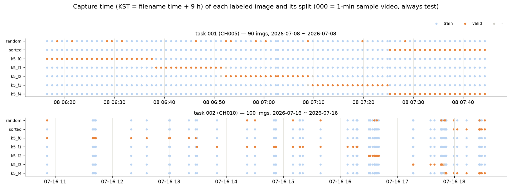

---

## 3. 실험 설계 — Random 5-fold · Time 5-fold

### 3-1. 공통 규칙

- test = test(000) 86장으로 모든 fold에서 고정함. 001 + 002의 190장만 train / valid로 나눔.
- 분할 목록은 YOLO와 포즈 · RF가 **같은 함수**로 만듦.
  - 함수 위치: `yolo_det/scripts/prepare_data.py`의 `split_kfold` · `split_random_kfold`
  - 포즈 · RF 쪽 `training/scripts/make_study_splits.py`가 이 함수를 import함.
- 같은 목록인지 확인한 방법: 정렬한 `<task>__<사진>` 목록의 SHA-256 앞 12자리가 10개 fold 모두에서 YOLO와 포즈 · RF가 같음.
- 001과 002는 **task별로 따로** 나눈 뒤 합침. 그래서 모든 fold의 train · valid에 두 카메라가 모두 들어감.

### 3-2. Time 5-fold (`k5_f0~f4`, `split_kfold`)

1. task마다 사진을 촬영 시각순으로 정렬함. 정렬 키는 (클립 시작 시각, 클립 안 위치)임.
2. 사진 n장을 5개의 연속 구간으로 나눔. 기본 경계는 round(j·n/5)임.
3. 기본 경계에서 tol = max(1, n // 20)장 안에 클립 경계가 있으면, 구간 경계를 그 클립 경계로 옮김.
4. fold i는 i번째 구간이 valid이고 나머지가 train임.
5. 그래도 경계가 클립 중간이면 valid 바로 옆의 같은 클립 사진 1장(gap = 1)을 train에서 뺌. 거의 같은 프레임이 train에 남지 않게 하기 위함임.

→ valid는 **학습 때 보지 못한 시간대**가 됨.

### 3-3. Random 5-fold (`rk5_f0~f4`, `split_random_kfold`)

1. task마다 사진을 이름순으로 정렬한 뒤 `random.Random(42)`로 섞음. 001과 002에 같은 rng를 차례로 씀.
2. fold i의 valid 장수를 같은 task · 같은 fold의 Time 5-fold valid 장수와 같게 맞춤. 섞인 순서에서 연속으로 잘라 valid로 씀.
   - 그래서 fold 5개의 valid가 겹치지 않고 190장을 정확히 한 번씩 덮음.
3. train 장수도 Time 5-fold와 같게 맞춤. Time 5-fold에서 경계 때문에 뺀 장수만큼, 섞인 순서에서 valid 바로 뒤의 사진을 뺌.
4. **클립 묶기(group)나 클래스 비율 맞추기(stratify)는 하지 않음.** scikit-learn StratifiedGroupKFold가 아니라 이미지 단위의 단순 무작위 분할임.
   - 그래서 같은 클립의 비슷한 프레임이 train과 valid에 갈릴 수 있음.
   - fold별 valid의 visiting 수도 다름(76 / 56 / 73 / 54 / 56마리).

→ 두 분할은 장수 · 학습 설정 · 평가가 모두 같고 **valid를 고르는 방식만 다름**.

### 3-4. fold별 장수 (Random 5-fold = Time 5-fold)

| fold | train (001 / 002) | valid (001 / 002) | 경계라 뺀 사진 |
|---|---|---|---|
| f0 | 148 (68 / 80) | 42 (22 / 20) | 0 |
| f1 | 155 (75 / 80) | 34 (14 / 20) | 1 |
| f2 | 151 (70 / 81) | 37 (18 / 19) | 2 |
| f3 | 151 (73 / 78) | 37 (16 / 21) | 2 |
| f4 | 149 (70 / 79) | 40 (20 / 20) | 1 |

### 3-5. 세트별 용도 (test는 어떤 선택에도 쓰지 않음)

| 모델 | train | valid | test(000) |
|---|---|---|---|
| 포즈 모델 (Geo · RF 계열이 사용) | 학습 | best.pt 선택 (val pose mAP50-95 최고 epoch) | 채점 |
| RandomForest (RF 계열) | 학습 (사람 관절 · 라벨) | RF 3종 중 **RF best** 선택 (5-fold 평균 val MAE 최소) | 채점 |
| YOLO | 학습 | best.pt 선택 (val box mAP50-95 최고) + conf 임계값 선택 (val 사진당 MAE 최소) | 채점 |

---

## 4. 방법

### 4-1. 전체 흐름

```
Geo · RF 계열:  사진 → 포즈 모델(YOLOv8m-pose) → 돼지마다 박스 + 관절 18개(x, y, conf)
                     → 특징 계산(사료통 원 · 구역 기준) → Geo 규칙 또는 RandomForest로 visiting / other
                     → visiting으로 판정된 돼지 수 = 사진당 마릿수
YOLO:          사진 → YOLOv8m detect (클래스 visiting / other) → conf ≥ 임계값인 visiting 박스 수 = 사진당 마릿수
```

### 4-2. 포즈 모델 (Geo · RF 계열 공통)

| 항목 | 값 |
|---|---|
| 모델 | YOLOv8m-pose (medium), 클래스 1개(pig), 관절 18개 (`kpt_shape [18, 3]`) |
| 학습 라벨 | 박스 = 스켈레톤 점(outside 제외)의 최소 · 최대 좌표, 관절 가시성 v = 2(보임) / 1(가려짐) / 0(outside) |
| 시작 가중치 | COCO 사전학습 `yolov8m-pose.pt`, fold마다 처음부터 학습 |
| epoch / 조기 종료 | 200 / 끔 (`patience 0`) |
| imgsz / batch / seed | 640 / 8 / 42 |
| optimizer | `auto` → AdamW (lr 0.002) |
| 증강 등 나머지 | Ultralytics 8.4.108 기본값 |
| best.pt | **valid pose mAP50-95 최고 epoch.** Ultralytics 기본은 pose + box 합인데, pose만 보도록 바꿈. 10개 모델 모두 best.pt에 저장된 지표가 `results.csv`의 pose mAP50-95 최댓값 epoch와 같은지 확인함 |
| 추론 설정 | 검출 conf 0.4, NMS IoU 0.5, imgsz 640 (세 카메라 동일) |
| 모델 수 | 10개 (Random 5-fold 5개 `ep200_rk5_f*` + Time 5-fold 5개 `ep200_k5_f*`) |

모델 크기(medium)와 epoch(200)는 본 실험 전에 한 크기 · epoch 비교 실험으로 정함([PROGRESS.md](PROGRESS.md) 2장).

### 4-3. 사료통 영역 (카메라별, 수동 지정)

| 카메라 | 원 중심 (cx, cy) | 반지름 r (px) |
|---|---|---|
| CH005 | (908.3, 529.1) | 338.0 |
| CH010 | (925.3, 535.1) | 337.8 |
| SAMPLE (test(000)) | (453.4, 354.3) | 169.2 |

- 빨간 사료통 뚜껑 원을 사진 한 장에서 잡음(`counting/scripts/calibrate_feeder.py`). 설정 파일은 `counting/configs/farm_*.yaml`.
- RF 특징용 "구역"은 같은 원을 48각형으로 만든 다각형임(`counting/configs/zones/`). 그래서 Geo와 RF가 같은 사료통 영역을 봄.

### 4-4. Geo (규칙, 학습 없음, `feeding_classifier.classify`)

돼지 한 마리가 아래 세 조건을 **모두** 만족하면 visiting으로 셈.

1. **관절 신뢰도**: 코(nose)와 목(neck) 관절의 conf가 모두 0.5 이상.
2. **거리**: 코와 사료통 중심의 거리 d가 0 ≤ d ≤ 1.0·r (뚜껑 전체).
3. **방향**: 머리 방향 벡터(목→코)와 사료통 방향 벡터(코→사료통 중심) 사이 각도가 60° 이하.

누운 자세 조건(조건 4)은 끔(`posture_enabled: false`). confidence 기반 누움 신호를 CH010 모델 관절에 켜면 visiting이 모두 탈락했기 때문임. 대신 이 신호는 RF+Geo의 특징으로 씀.

### 4-5. RF 계열의 특징 (`counting/src/feeding_monitor/`)

돼지 한 마리(검출 1개)마다 아래 특징을 계산함. 계산할 수 없는 값은 −1로 채움(RandomForest는 NaN을 못 받음).

**RF 특징 6개** (`posture_features.py`)

| 특징 | 정의 |
|---|---|
| `nose_in_zone` | 코가 사료통 구역(48각형) 안이면 1, 밖이면 0 |
| `nose_zone_dist_norm` | 코와 구역 중심 사이 거리 ÷ 검출 박스 대각선 |
| `head_dip_deg` | 목→코 벡터와 화면 아래 방향(+y) 사이 각도 |
| `spine_dip_deg` | 엉덩이 중점→목 벡터와 화면 아래 방향 사이 각도 |
| `neck_rel_height` | (목 y − 양 어깨 중점 y) ÷ 박스 대각선 |
| `key_kpt_conf` | 주요 관절 6개(코, 목, 양 엉덩이, 양 어깨) 중 conf > 0인 비율 |

**Geo 값 5개** (`method_features.geo_values`)

| 특징 | 정의 |
|---|---|
| `geo_nose_dist_over_r` | 코와 사료통 중심 사이 거리 ÷ r |
| `geo_head_angle_deg` | Geo 조건 3의 각도 (목→코 vs 코→사료통 중심) |
| `geo_limb_visibility` | 네 발(l_foot, r_foot, l_hand, r_hand) conf 평균 (confidence 기반 누움 신호 A) |
| `geo_aspect_ratio` | 몸통 폭(l_flank–r_flank) ÷ 몸통 길이(neck–tail) (누움 신호 B) |
| `geo_lateral_asymmetry` | 좌우 짝 관절(어깨, 엉덩이, 옆구리)의 conf 쏠림 정도 (누움 신호 C) |

**Leg 특징 5개** (`leg_features.py`, 관절 위치만 사용, 모델 관절은 conf 0.3 미만 무시)

| 특징 | 정의 | 누운 돼지에서 |
|---|---|---|
| `leg_extension` | 다리 4개의 평균 \|관절→발\| ÷ 몸통 길이(neck→tail) | 커짐 |
| `leg_angle_deg` | 다리와 척추 사이 평균 각도 (0\~90°) | 90° 가까이 |
| `paw_offset` | 발이 척추선에서 떨어진 평균 거리 ÷ 몸통 길이 | 커짐 |
| `leg_side_bias` | 네 발이 척추선의 한쪽에 몰린 정도, \|부호 평균\| (0\~1, 발 2개 이상일 때) | 1에 가까움 |
| `body_bend_deg` | 목–옆구리 중점–꼬리 각도 (180° = 곧음) | 작아짐(굽음) |

| 방법 | 쓰는 특징 |
|---|---|
| RF | RF 6개 |
| RF+Geo | RF 6개 + Geo 5개 = 11개 |
| RF+Geo+Leg | RF 6개 + Geo 5개 + Leg 5개 = 16개 |

### 4-6. RandomForest 학습과 적용 (`counting/scripts/evaluate_methods.py`)

**학습**
- `RandomForestClassifier(n_estimators=100, class_weight="balanced", random_state=42)`, 판정 기준 확률 0.5. 하이퍼파라미터 튜닝은 하지 않음.
- **학습 데이터**: 그 fold train 사진의 **사람이 찍은 관절**(conf = 1.0)과 visiting / other 라벨.
- 학습 개체 수(1470, 1541, …)는 그 fold 포즈 학습 개체 수와 10개 fold 모두 같음.

**적용**
- val · test에서는 그 fold 포즈 모델이 찍은 관절에 적용함. 학습 입력과 적용 입력이 다르다는 점(사람 관절 → 모델 관절)이 이 파이프라인의 특징임.
- **사진당 마릿수** = 포즈 모델이 찾은 **모든** 돼지 중 visiting으로 판정된 수. 사람 라벨과 짝지어지지 않은 검출도 포함함.
- 포즈 모델이 못 찾은 돼지는 visiting이 아닌 것으로 처리함. 실제 운용과 같은 방식임.

**RF best 선택**
- RF / RF+Geo / RF+Geo+Leg 중 5-fold 평균 val MAE가 가장 작은 것을 고름.
- 결과는 두 분할 모두 RF+Geo+Leg였음(Random 5-fold 0.209, Time 5-fold 0.284).

### 4-7. YOLO 직접 검출 (`yolo_det/`)

| 항목 | 값 |
|---|---|
| 모델 | YOLOv8m detect, 클래스 2개 (other, visiting) |
| 학습 라벨 | 같은 CVAT 스켈레톤에서 만든 박스(점의 최소 · 최대 좌표, 포즈 라벨과 같은 계산 · 같은 반올림) + State |
| 시작 가중치 | COCO 사전학습 `yolov8m.pt` |
| epoch / 조기 종료 / imgsz / batch / seed / optimizer | 200 / 끔 / 640 / 8 / 42 / auto |
| best.pt | val box mAP50-95 최고 (Ultralytics detect 기본) |
| NMS | class-agnostic, IoU 0.7. 한 마리에 visiting 박스와 other 박스가 겹쳐 남지 않게 하기 위함 |
| 사진당 마릿수 | conf ≥ 임계값인 visiting 박스 수 |
| conf 임계값 | 0.05\~0.95(0.05 간격) 중 그 fold valid의 사진당 MAE가 가장 작은 값. 같으면 \|bias\| 작은 쪽, 그래도 같으면 0.25에 가까운 쪽 |
| fold별 conf | Random 5-fold f0\~f4: 0.25 / 0.45 / 0.50 / 0.55 / 0.65, Time 5-fold f0\~f4: 0.65 / 0.50 / 0.35 / 0.25 / 0.70 |
| 채점 | `counting/scripts/evaluate_methods.py`의 `count_metrics()`를 import해서 같은 함수로 채점 |

### 4-8. 같은 조건 확인

**맞춘 것**

| 항목 | YOLO | 포즈 → Geo · RF 계열 | 확인 방법 |
|---|---|---|---|
| 분할 목록 | `prepare_data.py --split kfold\|rkfold` | `make_study_splits.py` (같은 함수) | 목록 SHA-256 앞 12자리, 10개 fold 일치 |
| test 정답 | test(000) 86장 | test(000) 86장 | YOLO 쪽 사진별 gt와 Geo · RF 쪽 라벨이 86장 모두 일치 |
| 모델 크기 · 시작 | YOLOv8m, COCO | YOLOv8m-pose, COCO | 같은 크기, 둘 다 처음부터 학습 |
| epoch · patience · imgsz · batch · seed · optimizer | 200 · 0 · 640 · 8 · 42 · auto | 같음 | 10개 모델의 `summary.json` `env_train` / `args.yaml` 직접 확인 |
| val로만 선택 | best.pt, conf | best.pt, RF best | test는 선택에 미사용 |
| 지표 함수 | `count_metrics()` | `count_metrics()` | 같은 함수 import |
| 라이브러리 | torch 2.11.0+cu128, ultralytics 8.4.108 | 같음 | |

**방법이 달라서 생기는 차이** (맞출 대상이 아님)
- **판정 입력**: YOLO는 사진만 봄. Geo · RF 계열은 관절 18개와 카메라별 사료통 좌표를 씀.
- **임계값**: YOLO는 conf를 val에서 고름. 포즈 쪽은 conf 0.4와 RF 기준 0.5로 고정함.
- **NMS IoU**: YOLO 0.7(agnostic), 포즈 0.5.
- **best.pt 기준**: YOLO box mAP50-95, 포즈 pose mAP50-95.
- **학습 장비**: YOLO는 RTX 6000 Ada · Python 3.10.12, 포즈 · RF는 RTX 5060 8GB · Python 3.14.
  - seed가 같아도 비트 단위로 같은 결과는 아님.
  - 추론 시간은 같은 서버 한 대에서 다시 잼(5-5).

---

## 5. 평가 방법

### 5-1. 사진 단위 카운트 지표 (`count_metrics()`)

사진 i의 사람 visiting 마릿수를 hᵢ, 모델 마릿수를 mᵢ, 오차를 eᵢ = mᵢ − hᵢ, 사진 수를 N으로 둠.

| 지표 | 식 | 뜻 |
|---|---|---|
| **MAE** (기본 지표) | (1/N) Σ \|eᵢ\| | 사진당 평균 몇 마리 틀리는지. test 86장에서 0.012 ≈ 사진 1장이 1마리 틀림 |
| RMSE | √((1/N) Σ eᵢ²) | 크게 틀린 사진에 민감 |
| ME (bias) | (1/N) Σ eᵢ | +면 많이 셈, −면 적게 셈 |
| Acc | eᵢ = 0인 사진 비율 | 정확 일치율 |
| Acc±1 | \|eᵢ\| ≤ 1인 사진 비율 | |
| TCE | (Σ mᵢ − Σ hᵢ) / Σ hᵢ × 100 | 1분 총 점유량 오차(%) |
| 10초 구간 MAE | 프레임 번호로 6등분한 구간마다 평균 마릿수 차이의 절댓값 평균 | test(000)만 해당 (1분 영상, 구간당 약 10초) |

### 5-2. 개체 단위 진단과 visiting Precision / Recall / F1

**짝짓기**: 사람 라벨의 돼지와 모델 검출을 헝가리안 알고리즘으로 1:1로 짝지음.
- **Geo · RF 계열**: 비용 = 사람 관절 중 보이는 점들과 모델 관절 사이 평균 거리 ÷ 사람 박스 대각선. 0.25 이하만 짝으로 인정.
- **YOLO**: 박스 IoU 0.5 이상만 짝으로 인정.

**오류 분해** (사람 visiting 기준)

| 항목 | 뜻 |
|---|---|
| 못 찾음 (undetected) | 사람 visiting인데 짝지어진 검출이 없음 |
| other로 판정 | 짝은 있지만 모델이 other로 판정 |
| other → visiting | 사람 other를 모델이 visiting으로 판정 |
| 라벨 없는 검출 → visiting | 사람 라벨과 짝이 없는 검출을 visiting으로 셈 |

- TP = 사람 visiting − 못 찾음 − other로 판정
- FP = other → visiting + 라벨 없는 검출 → visiting
- FN = 못 찾음 + other로 판정
- Precision = TP / (TP + FP), Recall = TP / (TP + FN), F1 = 둘의 조화평균

### 5-3. 통계

- **평균 ± 표본 표준편차**: fold 5개 값으로 계산(ddof = 1).
- **95% bootstrap CI** (test MAE):
  - 사진별 |오차|는 fold 5개의 평균을 씀.
  - 86장을 복원추출로 10,000번 뽑음(seed 0).
  - 2.5 · 97.5 백분위를 구간으로 씀.
- **Wilcoxon signed-rank**:
  - 같은 사진 86장의 |오차|(fold 5개 평균)를 두 방법끼리 짝지어 비교함.
  - 0 차이는 `zero_method = "zsplit"`으로 처리함.
- **해석상 주의**: test(000) 86장은 1분 영상 하나의 연속 프레임이라 서로 독립이 아님. 그래서 CI와 p값은 낙관적이며 참고용으로 씀.

### 5-4. 포즈 · 검출 지표

**포즈 모델** (Ultralytics val 기준)
- box mAP50 · mAP50-95, pose(OKS) mAP50 · mAP50-95.
- **PCK@α** = 예측 관절이 정답에서 α × 정답 박스 긴 변(max(w, h)) 안에 들어온 비율. α = 0.05 / 0.1 / 0.2.
  - 계산 코드: `training/scripts/utils/pck.py`
  - 예측 conf 0.25, 사람 박스와 IoU 0.5 이상으로 짝지은 돼지만 셈.

**YOLO** (Ultralytics val 기준)
- box P · R · mAP50 · mAP50-95와 클래스별 mAP50-95.

### 5-5. 추론 시간 (`counting/scripts/benchmark_speed.py`)

**장비**
- 5가지 방법 모두 **같은 서버 한 대**: GPU NVIDIA RTX 6000 Ada, CPU AMD EPYC 7513.
- Python 3.10.12 · torch 2.11.0+cu128 · ultralytics 8.4.108.

**측정 조건**
- batch 1, imgsz 640.
- 예열 5장은 제외함.
- test(000) 86장을 3회씩 처리해 fold당 258회를 잼.
- 사진 읽기부터 마릿수까지 end-to-end로 잼.
- 각 fold는 그 fold의 모델을 씀(포즈 + 그 fold의 RF, YOLO는 그 fold conf). 모델 10개 × 5가지 방법 × GPU / CPU를 모두 잼.

**단계 구분**
- 사진 읽기
- 모델 추론: 전처리 · NMS · 후처리 포함
- 특징 계산: Geo 판정 포함
- RF 판정

**값과 실시간 기준**
- fold마다 중앙값 · p95를 구하고, fold 5개의 평균 ± 표본 표준편차를 냄.
- 실시간 기준은 p95가 1000 ms 이하이면 1 fps(1초 1프레임), 33.3 ms 이하이면 30 fps임.

---

## 6. 결과

### 6-1. test(000) 카운트 성능 (paper Table 1)

| 분할 | 방법 | MAE | RMSE | ME | Acc (%) | Acc±1 (%) | TCE (%) | 10초 MAE | Precision | Recall | F1 |
|---|---|---|---|---|---|---|---|---|---|---|---|
| Random 5-fold | Geo | 0.293 ± 0.028 | 0.562 ± 0.025 | −0.288 ± 0.025 | 71.9 ± 2.8 | 98.8 ± 0.0 | −18.6 ± 1.6 | 0.226 ± 0.027 | 0.964 ± 0.034 | 0.785 ± 0.041 | 0.865 ± 0.038 |
| Random 5-fold | RF | **0.114 ± 0.015** | 0.343 ± 0.032 | −0.035 ± 0.043 | 88.8 ± 1.3 | 99.8 ± 0.5 | −2.3 ± 2.8 | 0.075 ± 0.017 | 0.936 ± 0.035 | 0.914 ± 0.037 | 0.925 ± 0.033 |
| Random 5-fold | RF+Geo | 0.133 ± 0.033 | 0.362 ± 0.047 | −0.067 ± 0.032 | 86.7 ± 3.3 | 100.0 ± 0.0 | −4.4 ± 2.1 | 0.083 ± 0.019 | 0.941 ± 0.037 | 0.901 ± 0.053 | 0.920 ± 0.045 |
| Random 5-fold | RF+Geo+Leg † | 0.121 ± 0.033 | 0.345 ± 0.051 | −0.051 ± 0.037 | 87.9 ± 3.3 | 100.0 ± 0.0 | −3.3 ± 2.4 | 0.083 ± 0.010 | 0.940 ± 0.036 | 0.910 ± 0.053 | 0.925 ± 0.044 |
| Random 5-fold | YOLO | 0.300 ± 0.137 | 0.545 ± 0.125 | −0.063 ± 0.210 | 70.5 ± 13.6 | 99.5 ± 0.6 | −4.1 ± 13.6 | 0.198 ± 0.160 | 0.899 ± 0.066 | 0.857 ± 0.085 | 0.874 ± 0.053 |
| Time 5-fold | Geo | 0.293 ± 0.022 | 0.562 ± 0.020 | −0.274 ± 0.021 | 71.9 ± 2.2 | 98.8 ± 0.0 | −17.7 ± 1.4 | 0.218 ± 0.016 | 0.971 ± 0.026 | 0.798 ± 0.014 | 0.876 ± 0.018 |
| Time 5-fold | RF | 0.116 ± 0.032 | 0.338 ± 0.046 | −0.019 ± 0.018 | 88.4 ± 3.2 | 100.0 ± 0.0 | −1.2 ± 1.1 | 0.064 ± 0.011 | 0.948 ± 0.024 | 0.937 ± 0.032 | 0.942 ± 0.028 |
| Time 5-fold | RF+Geo | 0.126 ± 0.019 | 0.353 ± 0.028 | −0.051 ± 0.024 | 87.4 ± 1.9 | 100.0 ± 0.0 | −3.3 ± 1.6 | 0.076 ± 0.011 | 0.952 ± 0.024 | 0.920 ± 0.027 | 0.936 ± 0.025 |
| Time 5-fold | RF+Geo+Leg † | **0.109 ± 0.021** | **0.329 ± 0.032** | −0.021 ± 0.022 | **89.1 ± 2.1** | 100.0 ± 0.0 | −1.4 ± 1.4 | 0.066 ± 0.008 | 0.951 ± 0.024 | 0.938 ± 0.029 | **0.945 ± 0.026** |
| Time 5-fold | YOLO | 0.223 ± 0.048 | 0.475 ± 0.059 | −0.065 ± 0.024 | 77.9 ± 4.4 | 99.8 ± 0.5 | −4.2 ± 1.6 | 0.111 ± 0.042 | 0.917 ± 0.028 | 0.878 ± 0.019 | 0.897 ± 0.022 |

† RF best (5-fold 평균 val MAE 최소).

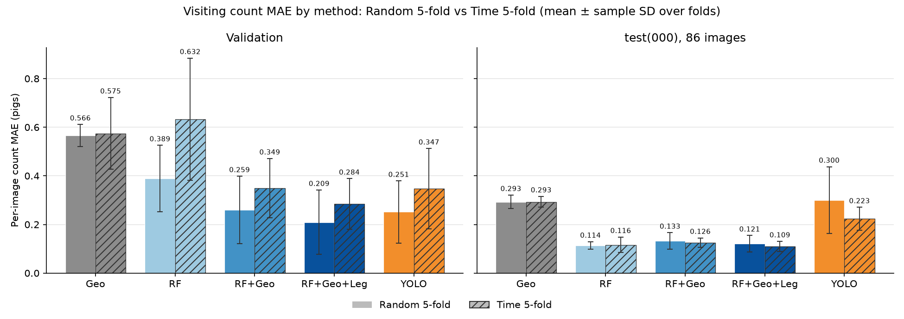

### 6-2. val 카운트 성능 (paper Table 2)

6-1 test 표와 같은 열임.

| 분할 | 방법 | MAE | RMSE | ME | Acc (%) | Acc±1 (%) | TCE (%) | 10초 MAE | Precision | Recall | F1 |
|---|---|---|---|---|---|---|---|---|---|---|---|
| Random 5-fold | Geo | 0.566 ± 0.045 | 0.883 ± 0.079 | −0.180 ± 0.128 | 53.8 ± 3.5 | 90.1 ± 3.8 | −11.3 ± 8.2 | – | 0.790 ± 0.042 | 0.700 ± 0.063 | 0.741 ± 0.044 |
| Random 5-fold | RF | 0.389 ± 0.136 | 0.696 ± 0.156 | +0.221 ± 0.133 | 66.8 ± 9.3 | 94.3 ± 5.1 | +13.1 ± 8.3 | – | 0.821 ± 0.033 | 0.928 ± 0.065 | 0.870 ± 0.038 |
| Random 5-fold | RF+Geo | 0.259 ± 0.139 | 0.524 ± 0.185 | +0.082 ± 0.097 | 76.2 ± 11.4 | 97.9 ± 3.5 | +4.5 ± 5.2 | – | 0.897 ± 0.043 | 0.937 ± 0.046 | 0.916 ± 0.038 |
| Random 5-fold | RF+Geo+Leg † | **0.209 ± 0.133** | **0.489 ± 0.175** | +0.009 ± 0.117 | **81.8 ± 11.0** | 97.3 ± 3.3 | −0.1 ± 7.0 | – | 0.932 ± 0.039 | 0.930 ± 0.054 | **0.930 ± 0.035** |
| Random 5-fold | YOLO | 0.252 ± 0.128 | 0.537 ± 0.152 | −0.098 ± 0.092 | 77.6 ± 10.9 | 97.2 ± 3.3 | −6.2 ± 5.7 | – | (재평가 후) | (재평가 후) | (재평가 후) |
| Time 5-fold | Geo | 0.575 ± 0.148 | 0.871 ± 0.157 | −0.212 ± 0.151 | 52.3 ± 9.7 | 90.8 ± 9.0 | −13.2 ± 8.2 | – | 0.769 ± 0.179 | 0.665 ± 0.147 | 0.712 ± 0.157 |
| Time 5-fold | RF | 0.632 ± 0.252 | 0.983 ± 0.275 | +0.454 ± 0.288 | 54.3 ± 10.5 | 84.5 ± 13.5 | +29.6 ± 18.5 | – | 0.694 ± 0.123 | 0.884 ± 0.081 | 0.774 ± 0.099 |
| Time 5-fold | RF+Geo | 0.349 ± 0.122 | 0.621 ± 0.161 | +0.140 ± 0.135 | 68.0 ± 8.5 | 97.1 ± 5.1 | +9.8 ± 7.9 | – | 0.816 ± 0.112 | 0.890 ± 0.084 | 0.851 ± 0.095 |
| Time 5-fold | RF+Geo+Leg † | **0.284 ± 0.104** | **0.552 ± 0.131** | +0.038 ± 0.061 | **73.3 ± 8.2** | 98.3 ± 2.6 | +2.7 ± 4.3 | – | 0.854 ± 0.087 | 0.876 ± 0.087 | **0.865 ± 0.086** |
| Time 5-fold | YOLO | 0.347 ± 0.166 | 0.642 ± 0.213 | −0.067 ± 0.128 | 70.4 ± 10.4 | 94.9 ± 6.3 | −5.5 ± 10.3 | – | (재평가 후) | (재평가 후) | (재평가 후) |

- val은 모든 방법이 조금 낙관적임. 포즈 best.pt와 YOLO best.pt · conf를 같은 valid로 골랐기 때문임.
- **10초 MAE는 val에서 "–"(정의되지 않음)**임. 1분 연속 영상인 test(000)를 프레임 번호로 6등분해서 구하는 지표인데, val 사진은 여러 클립에서 뽑은 것이라 연속 구간이 없음.
- YOLO val의 F1은 아직 빈칸임. 처음 평가할 때 개체 단위 진단을 test에서만 계산했기 때문임.
  - val 진단을 추가하도록 `yolo_det/scripts/evaluate.py`를 고쳤음.
  - YOLO 10개 모델을 재평가(`EVAL_ONLY=1`)하면 같은 방식(IoU ≥ 0.5 짝짓기)으로 채워짐.
  - 재평가는 재학습이 아니고 conf도 그대로라서, 기존 val · test 수치는 바뀌지 않음.

### 6-3. fold별 test MAE

| fold | Random Geo | Random RF | Random RF+Geo | Random RF+Geo+Leg | Random YOLO | Time Geo | Time RF | Time RF+Geo | Time RF+Geo+Leg | Time YOLO |
|---|---|---|---|---|---|---|---|---|---|---|
| f0 | 0.326 | 0.093 | 0.174 | 0.151 | 0.221 | 0.291 | 0.163 | 0.140 | 0.140 | 0.151 |
| f1 | 0.314 | 0.116 | 0.140 | 0.140 | 0.174 | 0.256 | 0.093 | 0.093 | 0.105 | 0.279 |
| f2 | 0.256 | 0.105 | 0.105 | 0.105 | 0.419 | 0.302 | 0.081 | 0.128 | 0.081 | 0.233 |
| f3 | 0.279 | 0.128 | 0.093 | 0.070 | 0.477 | 0.314 | 0.116 | 0.140 | 0.105 | 0.244 |
| f4 | 0.291 | 0.128 | 0.151 | 0.140 | 0.209 | 0.302 | 0.128 | 0.128 | 0.116 | 0.209 |

- 10개 fold 모두에서 RF+Geo · RF+Geo+Leg는 Geo · YOLO보다 좋음.
- 예외는 Time 5-fold f0의 RF 단독(0.163)으로, YOLO(0.151)보다 나쁨.

### 6-4. test MAE 95% bootstrap CI (paper Table 3)

| 방법 | Random 5-fold | Time 5-fold |
|---|---|---|
| Geo | 0.293 [0.200, 0.393] | 0.293 [0.205, 0.391] |
| RF | 0.114 [0.065, 0.170] | 0.116 [0.065, 0.174] |
| RF+Geo | 0.133 [0.074, 0.198] | 0.126 [0.070, 0.188] |
| RF+Geo+Leg | 0.121 [0.067, 0.181] | 0.109 [0.056, 0.170] |
| YOLO | 0.300 [0.240, 0.365] | 0.223 [0.158, 0.295] |

### 6-5. 사진 단위 짝비교 (Wilcoxon, n = 86, paper Table 4)

| 비교 (A vs B) | 분할 | ΔMAE (B − A) | A가 나음 / 같음 / B가 나음 (사진 수) | p |
|---|---|---|---|---|
| RF+Geo+Leg vs Geo | Random 5-fold | +0.172 | 24 / 58 / 4 | < 0.001 |
| RF+Geo+Leg vs RF | Random 5-fold | −0.007 | 4 / 75 / 7 | 0.580 |
| RF+Geo+Leg vs RF+Geo | Random 5-fold | +0.012 | 6 / 78 / 2 | 0.429 |
| RF+Geo+Leg vs YOLO | Random 5-fold | +0.179 | 54 / 29 / 3 | < 0.001 |
| RF+Geo+Leg vs Geo | Time 5-fold | +0.184 | 20 / 61 / 5 | 0.007 |
| RF+Geo+Leg vs RF | Time 5-fold | +0.007 | 6 / 78 / 2 | 0.449 |
| RF+Geo+Leg vs RF+Geo | Time 5-fold | +0.016 | 8 / 75 / 3 | 0.344 |
| RF+Geo+Leg vs YOLO | Time 5-fold | +0.114 | 27 / 56 / 3 | < 0.001 |
| Geo: Random vs Time | – | +0.000 | 6 / 73 / 7 | 0.859 |
| RF: Random vs Time | – | −0.002 | 6 / 73 / 7 | 0.861 |
| RF+Geo: Random vs Time | – | +0.007 | 5 / 78 / 3 | 0.696 |
| RF+Geo+Leg: Random vs Time | – | +0.012 | 9 / 70 / 7 | 0.713 |
| YOLO: Random vs Time | – | +0.077 | 42 / 35 / 9 | < 0.001 |

### 6-6. 실제로 센 마릿수 (fold당 평균 ± SD, 괄호 = 총 마릿수 오차 %)

| 분할 · 세트 | GT | Geo | RF | RF+Geo | RF+Geo+Leg | YOLO |
|---|---|---|---|---|---|---|
| Random 5-fold · val | 63.0 ± 10.6 | 56.2 ± 12.7 (−11.3%) | 71.4 ± 13.9 (+13.1%) | 66.2 ± 14.0 (+4.5%) | **63.4 ± 14.3 (−0.1%)** | 59.4 ± 12.8 (−6.2%) |
| Random 5-fold · test(000) | 133 | 108.2 ± 2.2 (−18.6%) | 130.0 ± 3.7 (−2.3%) | 127.2 ± 2.8 (−4.4%) | 128.6 ± 3.2 (−3.3%) | 127.6 ± 18.1 (−4.1%) |
| Time 5-fold · val | 63.0 ± 23.7 | 54.6 ± 19.8 (−13.2%) | 80.0 ± 24.4 (+29.6%) | 68.0 ± 20.6 (+9.8%) | **64.4 ± 22.8 (+2.7%)** | 60.6 ± 26.8 (−5.5%) |
| Time 5-fold · test(000) | 133 | 109.4 ± 1.8 (−17.7%) | 131.4 ± 1.5 (−1.2%) | 128.6 ± 2.1 (−3.3%) | 131.2 ± 1.9 (−1.4%) | 127.4 ± 2.1 (−4.2%) |

- YOLO Random 5-fold test(000)는 평균으로는 −4.1%이지만 fold마다 크게 다름: f2 101마리(−24.1%), f3 152마리(+14.3%).

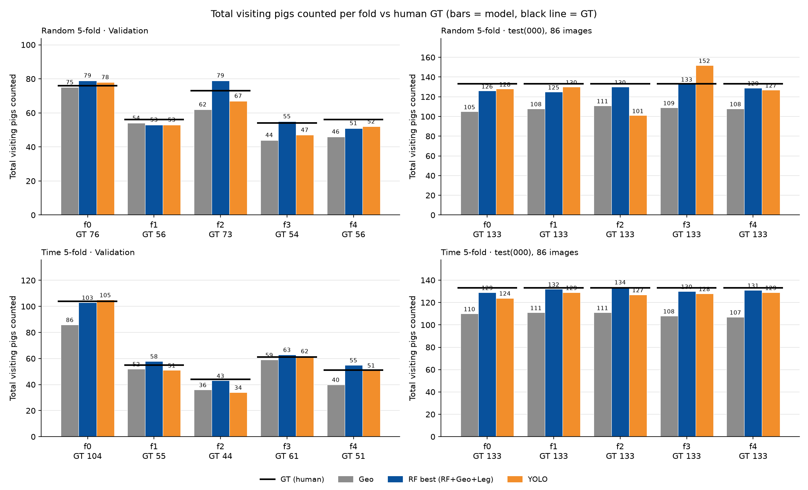

### 6-7. 오차 원인 분해 (test(000), fold당 마릿수, paper Table 5)

| 분할 | 방법 | 센 수 / GT | 못 찾음 | other로 판정 | other → visiting | 라벨 없는 검출 → visiting |
|---|---|---|---|---|---|---|
| Random 5-fold | Geo | 108.2 / 133 | 8.6 ± 5.4 | 20.0 ± 2.3 | 0.6 ± 0.5 | 3.2 ± 3.8 |
| Random 5-fold | RF | 130.0 / 133 | 8.6 ± 5.4 | 2.8 ± 2.0 | 3.4 ± 1.7 | 5.0 ± 4.8 |
| Random 5-fold | RF+Geo | 127.2 / 133 | 8.6 ± 5.4 | 4.6 ± 2.1 | 2.8 ± 0.8 | 4.6 ± 4.6 |
| Random 5-fold | RF+Geo+Leg | 128.6 / 133 | 8.6 ± 5.4 | 3.4 ± 2.3 | 3.0 ± 0.7 | 4.6 ± 4.6 |
| Random 5-fold | YOLO | 127.6 / 133 | 6.0 ± 0.7 | 13.0 ± 11.3 | 5.8 ± 1.1 | 7.8 ± 10.3 |
| Time 5-fold | Geo | 109.4 / 133 | 6.2 ± 2.8 | 20.6 ± 1.5 | 0.8 ± 0.4 | 2.4 ± 2.6 |
| Time 5-fold | RF | 131.4 / 133 | 6.2 ± 2.8 | 2.2 ± 1.6 | 4.0 ± 1.2 | 2.8 ± 2.9 |
| Time 5-fold | RF+Geo | 128.6 / 133 | 6.2 ± 2.8 | 4.4 ± 2.9 | 3.4 ± 0.5 | 2.8 ± 2.9 |
| Time 5-fold | RF+Geo+Leg | 131.2 / 133 | 6.2 ± 2.8 | 2.0 ± 1.2 | 3.6 ± 0.5 | 2.8 ± 2.9 |
| Time 5-fold | YOLO | 127.4 / 133 | 5.4 ± 1.8 | 10.8 ± 4.0 | 8.4 ± 3.6 | 2.2 ± 1.3 |

- Geo · RF 계열은 같은 포즈 모델을 쓰므로 "못 찾음"이 같은 값임.
- YOLO Random 5-fold f3는 "라벨 없는 검출 → visiting"이 26마리라서 152마리로 과대 집계됨. 다른 fold는 2\~5마리임.

### 6-8. test(000) 사진별 카운트

**5개 fold가 모두 정답인 사진 수** (86장 중, Random 5-fold / Time 5-fold)

| 방법 | Random 5-fold | Time 5-fold |
|---|---|---|
| Geo | 57 | 56 |
| RF | 67 | 66 |
| RF+Geo | 67 | 67 |
| RF+Geo+Leg | 68 | 71 |
| YOLO | 23 | 51 |

**공통으로 틀리는 사진**
- 56\~58번: GT 2, 대부분 모델이 1로 셈.
- 34번 · 65번: GT 1, RF 계열이 2로 셈.
- Geo는 54\~61번 · 64\~74번에서 계속 적게 셈.

**전체 표**
- 86장 × 모델 50개: [per_image_000.md](counting/reports/fold_study/per_image/per_image_000.md)
- 방법별 csv · 그림: `counting/reports/fold_study/per_image/by_model/`

**사람 정답 vs Geo · RF+Geo+Leg(RF 계열 대표) · YOLO** (그래프 J, H, I)
- 그래프 J: 한 칸에 사람 정답(굵은 회색)과 세 방법을 겹쳐 그림.
  - 맞게 센 구간은 세 선이 정답 위에 한 묶음으로 겹치고, 틀린 구간에서만 선이 갈라짐.
  - 겹친 선이 서로 가리지 않게 Geo −0.06, RF+Geo+Leg 0, YOLO +0.06만큼 세로로 띄움.

분할별로 한 장씩 (가로축 = 시간(초), 세로축 = visiting 돼지 수):

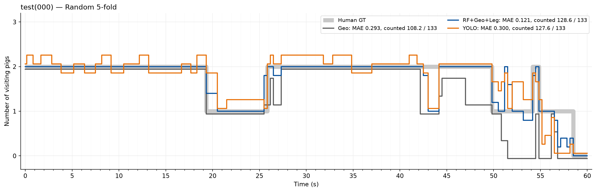
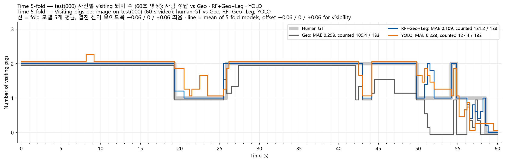

두 분할을 위아래로 묶은 한 장: `counting/reports/fold_study/graph_J_counts_overlay.png`

가로축을 test(000) 이미지 순번(frame 0\~85)으로 한 같은 그림:

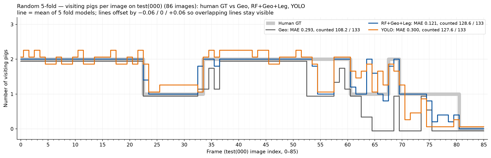
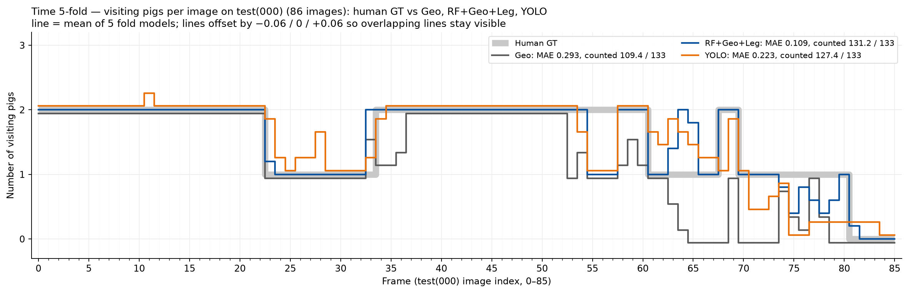

- 가로축은 000 영상의 시간(초)임. 프레임 번호 0\~1440을 24 fps로 환산해 0\~60초로 나타냄.
- 세로축은 카운팅 횟수(visiting 마릿수)임.
- 선은 fold 모델 5개의 평균이고, 띠는 최소\~최대 범위임.
- 그래프 H: 방법마다 칸을 나눠 사진별 카운트와 사진별 오차(예측 − 정답)를 보여 줌.
- 그래프 I: 60초 동안의 누적 카운트임.
- 그래프 H에서 읽을 수 있는 것:
  - Geo는 26초 이후, 특히 43\~59초 구간에서 계속 적게 셈.
  - RF+Geo+Leg는 정답과 거의 겹침. 어긋나는 곳은 몇 군데뿐임:
    - 43\~44초(#56\~58): 급이 파이프에 가린 돼지를 놓쳐 1마리 적게 셈.
    - 57\~58초: 적게 셈.
    - 25.7초(#34) · 51.3초(#65): 1마리 많이 셈.
  - YOLO는 Random 5-fold에서 0\~40초 동안 fold에 따라 1\~3마리로 흔들림.

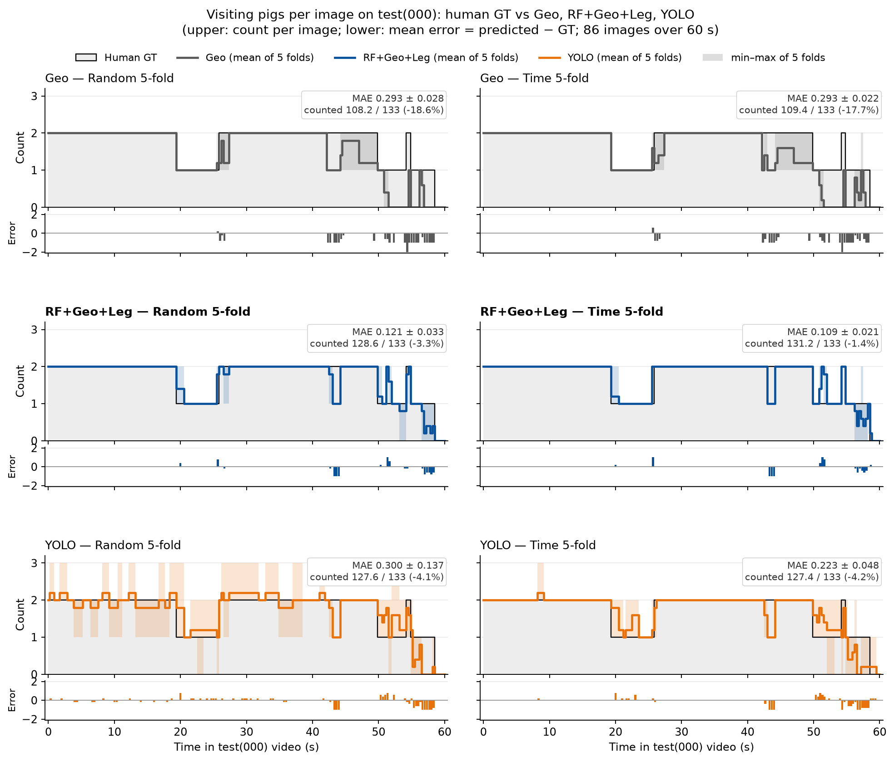
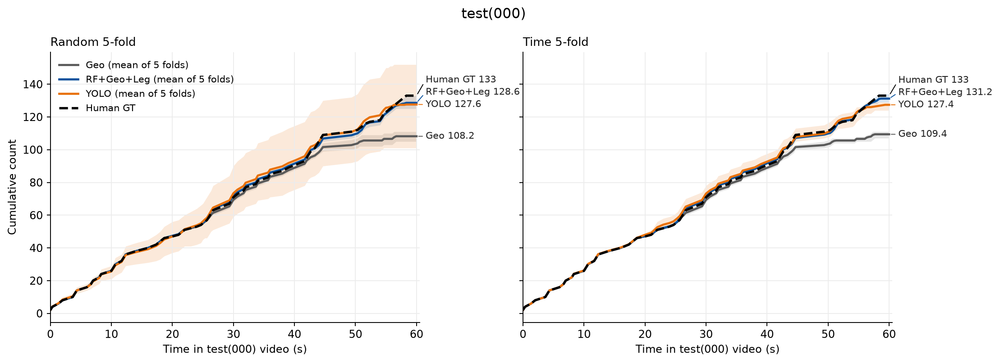

5가지 방법 전체를 그린 그래프 A · E와 모델 50개의 오차를 담은 그래프 F는 아래와 같음.

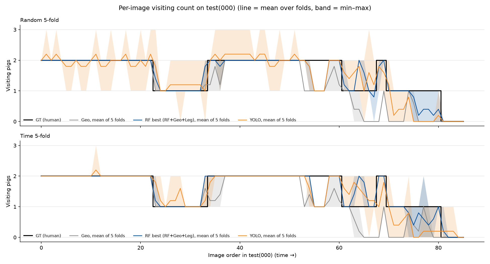
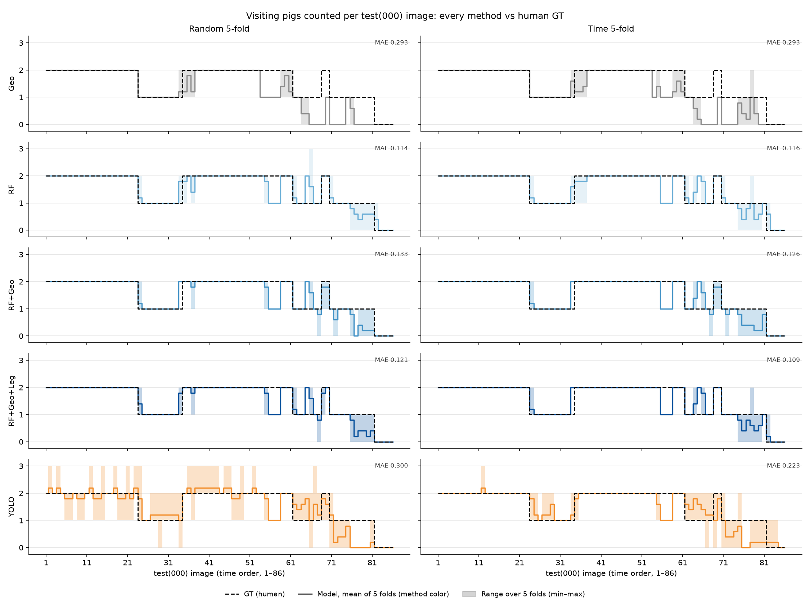
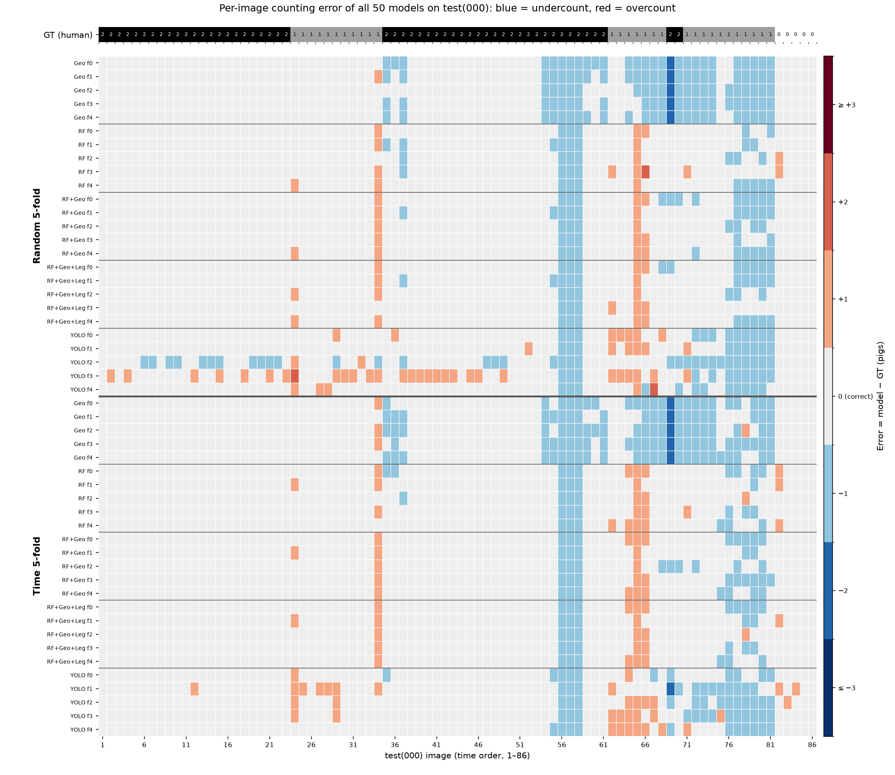

### 6-9. 포즈 모델 성능 (paper Table 6)

| 분할 | 세트 | box mAP50 | box mAP50-95 | pose mAP50 | pose mAP50-95 | PCK@0.05 | PCK@0.1 | PCK@0.2 |
|---|---|---|---|---|---|---|---|---|
| Random 5-fold | test(000) | 0.885 ± 0.008 | 0.652 ± 0.023 | 0.338 ± 0.062 | 0.111 ± 0.021 | 0.369 ± 0.042 | 0.691 ± 0.029 | 0.865 ± 0.009 |
| Random 5-fold | val | 0.986 ± 0.005 | 0.797 ± 0.011 | 0.742 ± 0.031 | 0.287 ± 0.024 | 0.518 ± 0.016 | 0.784 ± 0.018 | 0.923 ± 0.009 |
| Time 5-fold | test(000) | 0.884 ± 0.026 | 0.646 ± 0.023 | 0.274 ± 0.049 | 0.087 ± 0.010 | 0.373 ± 0.009 | 0.692 ± 0.024 | 0.865 ± 0.011 |
| Time 5-fold | val | 0.960 ± 0.019 | 0.694 ± 0.024 | 0.548 ± 0.046 | 0.167 ± 0.020 | 0.406 ± 0.011 | 0.695 ± 0.025 | 0.871 ± 0.026 |

- **관절별 test(000) PCK@0.1**:
  - 몸통 · 머리 관절(꼬리 · 엉덩이 · 옆구리 · 어깨 · 목 · 귀)은 0.72\~0.94로 높음.
  - 코는 0.70\~0.71임.
  - 발 · 앞발 · 귀 끝은 0.26\~0.69로 가장 낮음.
  - 표 전체는 paper Table 6에 있음.
- **분할 비교**: val은 Time 5-fold가 크게 낮음(pose mAP50-95 0.287 → 0.167). 그러나 test(000) PCK는 같음. 처음 보는 카메라에서의 성능은 분할 방식과 상관없음.

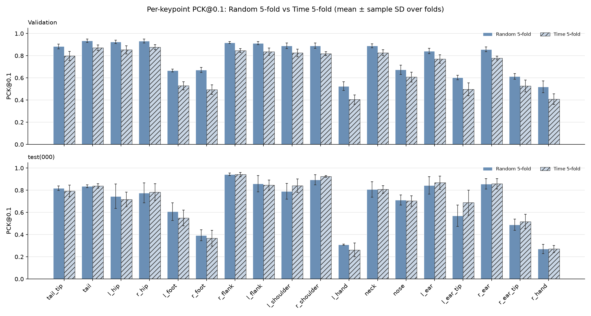

### 6-10. YOLO 검출 성능 (paper Table 7)

| 분할 | 세트 | conf | P | R | mAP50 | mAP50-95 | mAP50-95 visiting | mAP50-95 other |
|---|---|---|---|---|---|---|---|---|
| Random 5-fold | test(000) | 0.48 ± 0.15 | 0.899 ± 0.039 | 0.842 ± 0.036 | 0.867 ± 0.029 | 0.597 ± 0.024 | 0.536 ± 0.035 | 0.659 ± 0.016 |
| Random 5-fold | val | 0.48 ± 0.15 | 0.939 ± 0.019 | 0.924 ± 0.020 | 0.953 ± 0.009 | 0.713 ± 0.024 | 0.597 ± 0.042 | 0.829 ± 0.010 |
| Time 5-fold | test(000) | 0.49 ± 0.19 | 0.911 ± 0.032 | 0.859 ± 0.022 | 0.879 ± 0.008 | 0.601 ± 0.016 | 0.555 ± 0.045 | 0.646 ± 0.016 |
| Time 5-fold | val | 0.49 ± 0.19 | 0.921 ± 0.036 | 0.838 ± 0.066 | 0.899 ± 0.059 | 0.610 ± 0.042 | 0.516 ± 0.097 | 0.704 ± 0.043 |

- box mAP50-95는 두 분할 모두 약 0.60으로 안정적임. 그래서 Random 5-fold의 카운트 편차는 검출이 아니라 conf 임계값 · 판정에서 생김.
- visiting 클래스의 mAP50-95가 other보다 낮음.

### 6-11. 추론 시간 (paper Table 8, 같은 서버)

| 분할 | 장비 | 방법 | 중앙값 (ms) | p95 (ms) | 읽기 | 모델 | 특징 | RF | 1 fps | 30 fps |
|---|---|---|---|---|---|---|---|---|---|---|
| Random 5-fold | GPU | Geo | 23.8 ± 0.5 | 24.5 ± 0.3 | 13.0 | 10.1 | 0.8 | – | ✅ | ✅ |
| Random 5-fold | GPU | RF | 28.0 ± 0.5 | 28.6 ± 0.3 | 13.0 | 10.1 | 0.8 | 4.1 | ✅ | ✅ |
| Random 5-fold | GPU | RF+Geo | 27.9 ± 0.5 | 28.6 ± 0.3 | 13.0 | 10.1 | 0.8 | 4.1 | ✅ | ✅ |
| Random 5-fold | GPU | RF+Geo+Leg | 27.9 ± 0.5 | 28.6 ± 0.3 | 13.0 | 10.1 | 0.8 | 4.1 | ✅ | ✅ |
| Random 5-fold | GPU | YOLO | 21.3 ± 0.1 | 21.4 ± 0.2 | 12.6 | 8.6 | – | – | ✅ | ✅ |
| Time 5-fold | GPU | Geo | 23.7 ± 0.1 | 24.1 ± 0.3 | 13.0 | 10.0 | 0.8 | – | ✅ | ✅ |
| Time 5-fold | GPU | RF | 27.8 ± 0.1 | 28.2 ± 0.3 | 13.0 | 10.0 | 0.8 | 4.1 | ✅ | ✅ |
| Time 5-fold | GPU | RF+Geo | 27.8 ± 0.1 | 28.2 ± 0.2 | 13.0 | 10.0 | 0.8 | 4.1 | ✅ | ✅ |
| Time 5-fold | GPU | RF+Geo+Leg | 27.8 ± 0.1 | 28.2 ± 0.3 | 13.0 | 10.0 | 0.8 | 4.1 | ✅ | ✅ |
| Time 5-fold | GPU | YOLO | 21.3 ± 0.1 | 21.5 ± 0.1 | 12.6 | 8.6 | – | – | ✅ | ✅ |
| Random 5-fold | CPU | Geo | 185.8 ± 4.1 | 192.7 ± 4.6 | 12.9 | 171.5 | 1.0 | – | ✅ | ❌ |
| Random 5-fold | CPU | RF | 190.4 ± 4.0 | 197.4 ± 4.6 | 12.9 | 171.5 | 1.0 | 4.7 | ✅ | ❌ |
| Random 5-fold | CPU | RF+Geo | 190.0 ± 4.1 | 196.9 ± 4.6 | 12.9 | 171.5 | 1.0 | 4.2 | ✅ | ❌ |
| Random 5-fold | CPU | RF+Geo+Leg | 190.0 ± 4.1 | 196.8 ± 4.6 | 12.9 | 171.5 | 1.0 | 4.2 | ✅ | ❌ |
| Random 5-fold | CPU | YOLO | 179.5 ± 3.2 | 186.4 ± 2.3 | 13.0 | 166.5 | – | – | ✅ | ❌ |
| Time 5-fold | CPU | Geo | 191.6 ± 4.0 | 200.4 ± 8.1 | 12.9 | 177.3 | 1.1 | – | ✅ | ❌ |
| Time 5-fold | CPU | RF | 196.3 ± 4.0 | 205.2 ± 8.0 | 12.9 | 177.3 | 1.1 | 4.7 | ✅ | ❌ |
| Time 5-fold | CPU | RF+Geo | 195.9 ± 4.0 | 204.7 ± 8.1 | 12.9 | 177.3 | 1.1 | 4.2 | ✅ | ❌ |
| Time 5-fold | CPU | RF+Geo+Leg | 195.8 ± 4.0 | 204.6 ± 8.1 | 12.9 | 177.3 | 1.1 | 4.2 | ✅ | ❌ |
| Time 5-fold | CPU | YOLO | 183.3 ± 4.9 | 189.5 ± 2.6 | 13.1 | 169.9 | – | – | ✅ | ❌ |

GPU = NVIDIA RTX 6000 Ada, CPU = AMD EPYC 7513. 단계별 칸(읽기 · 모델 · 특징 · RF)은 fold 중앙값의 평균(ms)임.

### 6-12. 카메라별 val MAE (paper Table 10)

| 분할 | 방법 | CH005 (001, 아침) | CH010 (002, 낮\~저녁) |
|---|---|---|---|
| Random 5-fold | Geo | 0.423 ± 0.092 | 0.690 ± 0.097 |
| Random 5-fold | RF | 0.298 ± 0.159 | 0.472 ± 0.142 |
| Random 5-fold | RF+Geo | 0.255 ± 0.140 | 0.262 ± 0.141 |
| Random 5-fold | RF+Geo+Leg | 0.212 ± 0.146 | 0.203 ± 0.147 |
| Time 5-fold | Geo | 0.360 ± 0.093 | 0.765 ± 0.281 |
| Time 5-fold | RF | 0.253 ± 0.094 | 0.960 ± 0.455 |
| Time 5-fold | RF+Geo | 0.224 ± 0.069 | 0.452 ± 0.184 |
| Time 5-fold | RF+Geo+Leg | 0.218 ± 0.148 | 0.342 ± 0.148 |

Time 5-fold의 CH010(못 본 시간대)에서 RF 단독이 크게 나빠짐(0.960). Geo · Leg 특징을 더하면 이 오차가 0.452 → 0.342로 줄어듦.

### 6-13. RF+Geo+Leg 특징 중요도 (Gini, 모델 10개 평균, paper Table 11)

| 순위 | 특징 | 그룹 | 중요도 |
|---|---|---|---|
| 1 | geo_nose_dist_over_r | Geo | 0.270 ± 0.008 |
| 2 | nose_zone_dist_norm | RF | 0.211 ± 0.004 |
| 3 | nose_in_zone | RF | 0.172 ± 0.012 |
| 4 | leg_angle_deg | Leg | 0.098 ± 0.006 |
| 5 | paw_offset | Leg | 0.092 ± 0.005 |
| 6 | geo_aspect_ratio | Geo | 0.055 ± 0.006 |
| 7 | leg_side_bias | Leg | 0.045 ± 0.006 |
| 8 | leg_extension | Leg | 0.034 ± 0.007 |
| 9\~16 | 나머지 8개 | – | 각 0.007 이하 |

- 그룹 합계: RF 0.393 · Geo 0.332 · Leg 0.275.
- 판정은 주로 코와 사료통의 위치 관계로 이루어지고, Leg 특징은 누운 돼지를 거르는 보조 역할을 함.

### 6-14. 가림 · 밀집 오차 사례

- Geo · RF 계열에 남은 오차의 상당 부분은 포즈 단계에서 생김. test(000) 사람 visiting 133마리 중 fold당 6.2\~8.6마리를 포즈 모델이 찾지 못함.
- **#57**: 급이 파이프 아래로 머리를 넣은 돼지를 **10개 모델 모두** 검출하지 못함(no detection).
- **#76**: 10개 중 5개 모델에서 사료통 옆 겹친 돼지의 관절이 어긋남(keypoints off).
- 자세한 내용은 [error_cases.md](counting/reports/fold_study/error_cases/error_cases.md)에 있음.

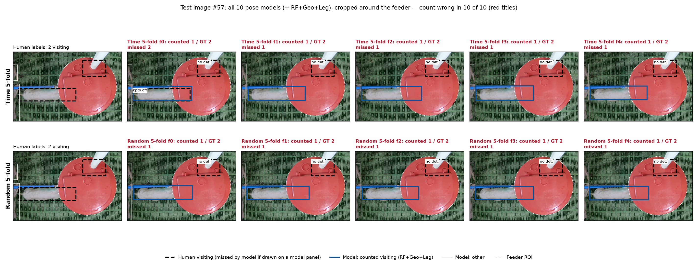
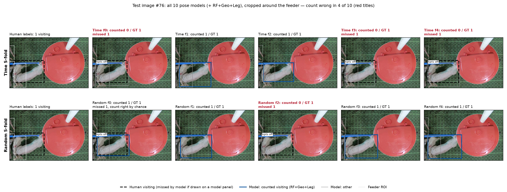

---

## 7. 논의에 쓸 내용 (주장 → 근거)

| 주장 | 근거 |
|---|---|
| 관절 + 사료통 위치를 쓰는 RF 계열이 사진만 보는 YOLO보다 visiting 판정이 정확함 | test MAE 0.109\~0.133 vs 0.223\~0.300 (6-1). Wilcoxon p < 0.001 (6-5). YOLO 판정 오류(other로 판정 + other → visiting)가 Time 5-fold 19.2 vs RF+Geo+Leg 5.6 (6-7). 검출 능력은 비슷함: 못 찾음 5.4\~6.0 vs 6.2\~8.6 |
| RF는 사람 관절로만 학습해도 모델 관절에 잘 적용됨 | test MAE 0.11 수준, Recall 0.91\~0.94 (6-1) |
| 규칙(Geo)은 카메라 · 자세 변화에 약함 | 방향 조건에서 fold당 약 20마리 탈락, TCE −18% (6-6, 6-7) |
| Geo · Leg 특징은 못 본 장면에서의 RF 과대 집계를 줄임 | Time 5-fold val TCE: RF +29.6% → RF+Geo +9.8% → RF+Geo+Leg +2.7% (6-6). CH010 val MAE 0.960 → 0.342 (6-12) |
| RF 계열 3가지의 test 순위는 확정할 수 없음 | 차이 ≤ 0.02, p > 0.3, fold별 순위가 바뀜 (6-3, 6-5) |
| 무작위 분할의 val은 실제 성능을 낙관적으로 보여 줌 | val MAE Random → Time: RF 0.389 → 0.632, 포즈 val mAP 0.287 → 0.167. 같은 기간 test(000)는 변화 없음(p > 0.69) |
| YOLO는 conf 임계값 선택에 민감함 | Random 5-fold conf 0.25\~0.65, f2 101마리 · f3 152마리, MAE SD 0.137 (6-6). box mAP는 0.60으로 안정적 (6-10) |
| 모든 방법이 실시간 카운팅에 충분히 빠름 | GPU p95 21\~29 ms(30 fps), CPU 약 0.2초(1 fps) (6-11). RF 추가 비용은 약 4 ms |
| 남은 오차는 판정보다 검출에서 나옴 | 포즈 미검출 fold당 6\~9마리, 파이프 가림 · 밀집 (6-14) |

---

## 8. 한계점

1. **데이터 규모가 작음**: train + valid가 190장뿐이라 fold 간 편차가 큼.
   - test MAE 범위: RF+Geo+Leg 0.070\~0.151, YOLO 0.151\~0.477.
   - val은 더 크게 흔들림: Time 5-fold RF 0.400\~1.054.
2. **test가 1분 영상 1개임**: 86장은 연속 프레임이라 서로 독립이 아님.
   - CI · p값은 낙관적임.
   - test에는 사진당 visiting이 0\~2마리뿐이라, 밀집 장면(3마리 이상)의 성능은 확인되지 않음(Table 9).
3. **촬영 조건이 치우침**: 날짜 2일, 카메라 2대, 밤 시간대 없음.
   - 001은 아침 1.5시간, 002는 낮\~저녁 8시간임.
   - 002는 클립마다 사진 수가 크게 다름(1\~26장).
4. **포즈 단계의 한계**: 급이 파이프 가림과 밀집된 돼지를 놓침. 발 관절 PCK가 낮아서(0.26\~0.69) Leg 특징의 효과가 제한됨.
5. **사료통 좌표는 카메라마다 수동으로 지정함**: 새 카메라를 붙일 때 보정이 필요함.
6. **학습 장비가 다름**: YOLO는 RTX 6000 Ada, 포즈 · RF는 RTX 5060임.
   - 결과 비교에는 영향이 거의 없음.
   - 추론 시간은 같은 서버에서 다시 잼.

---

## 9. 그림 목록

| 그림 | 파일 | 캡션 (영문) |
|---|---|---|
| A | `counting/reports/fold_study/graph_A_frame_counts_000.png` | Per-image visiting count on test(000): GT, Geo, RF best, YOLO (mean over 5 folds, band = min–max) |
| B | `counting/reports/fold_study/graph_B_mae_random_vs_time.png` | Per-image count MAE by method, Random 5-fold vs Time 5-fold (mean ± SD) |
| C | `counting/reports/fold_study/graph_C_total_counts.png` | Total visiting pigs counted per fold vs human GT |
| D | `counting/reports/fold_study/graph_D_keypoint_pck.png` | Per-keypoint PCK@0.1, Random 5-fold vs Time 5-fold |
| E | `counting/reports/fold_study/per_image/graph_E_per_image_counts.png` | Visiting pigs counted per test(000) image, every method vs GT |
| F | `counting/reports/fold_study/per_image/graph_F_per_image_error_heatmap.png` | Per-image counting error of all 50 models on test(000) |
| G | `counting/reports/fold_study/error_cases/all_models_57.png`, `all_models_76.png` | Occlusion / crowding error cases, all 10 pose models side by side |
| H | `counting/reports/fold_study/graph_H_counts_3methods.png` | Visiting count per image over the 60-s test(000) video: human GT vs Geo, RF+Geo+Leg, YOLO (mean of 5 fold models, band = min–max; lower strip = mean error) |
| I | `counting/reports/fold_study/graph_I_cumulative_3methods.png` | Cumulative visiting count over the 60-s test(000) video: human GT (133) vs Geo, RF+Geo+Leg, YOLO |
| J | `counting/reports/fold_study/graph_J_random_5fold.png`, `graph_J_time_5fold.png` (두 분할 한 장: `graph_J_counts_overlay.png`; 가로축 frame 0–85: `graph_J_*_5fold_frames.png`) | Visiting count per image over the 60-s test(000) video, human GT and Geo, RF+Geo+Leg, YOLO in one panel per split (mean of 5 folds; lines offset by −0.06 / 0 / +0.06 for visibility) |
| – | `training/reports/data/time_distribution.png` | Capture-time distribution of tasks 001 / 002 |
| – | `counting/reports/fold_study/per_image/by_model/<method>.png` | Per-method counts on test(000): GT row + 10 fold models |

---

## 10. 재현 방법 · 파일 위치

```powershell
# 1) 분할 목록 + valid 평가용 사진
cd training; python scripts\make_study_splits.py --export-images ..\counting\data\raw\train_img
# 2) 포즈 모델 10개 (ep200, patience 0, seed 42, best = val pose mAP50-95)
powershell -ExecutionPolicy Bypass -File scripts\run_split_study.ps1 -Splits k5_f0,k5_f1,k5_f2,k5_f3,k5_f4,rk5_f0,rk5_f1,rk5_f2,rk5_f3,rk5_f4
# 3) Geo / RF 계열 val + test 평가 → fold_study 표 · 그래프 A~D
cd ..\counting; powershell -ExecutionPolicy Bypass -File scripts\run_split_eval.ps1 -Valid -Splits k5_f0,k5_f1,k5_f2,k5_f3,k5_f4,rk5_f0,rk5_f1,rk5_f2,rk5_f3,rk5_f4
# 4) 논문 표 · 사진별 카운트(그래프 E · F) · 오차 사례(그래프 G) · 3방법 비교(그래프 H · I · J)
python scripts\paper_tables.py; python scripts\per_image_000.py; python scripts\error_cases.py; python scripts\plot_counts_3methods.py
# 5) 추론 시간 (같은 장비에서 5가지 방법, YOLO 가중치 경로를 함께 줌)
python scripts\benchmark_speed.py --yolo-weights "../yolo_det/models/ep200_{split}/m/weights/best.pt"
```

- YOLO 학습 · 평가 명령은 [yolo_det/README.md](yolo_det/README.md)에 있음(`SPLIT=kfold|rkfold bash yolo_det/scripts/run_kfold.sh`).
- 사진 · 라벨 · 가중치는 농장 데이터라 레포에 없음.

| 내용 | 파일 |
|---|---|
| 논문 표 1\~11 + 그림 목록 | `counting/reports/fold_study/paper/paper_metrics.md` (+ csv: count_metrics, bootstrap_ci, wilcoxon, pose_metrics, val_mae_by_camera, rf_feature_importance) |
| fold별 전체 표 · fold 구성 · 포즈 관절별 | `counting/reports/fold_study/fold_study.md`, `fold_metrics.csv`, `fold_summary.csv`, `fold_composition.csv`, `pose_folds.csv`, `pose_keypoints.csv` |
| 사진별 카운트 | `counting/reports/fold_study/per_image/`, `per_frame_000/`, `frames/ep200_<split>/<방법>_<val\|test>.csv` |
| 오차 사례 | `counting/reports/fold_study/error_cases/` |
| 추론 시간 | `counting/reports/speed/NVIDIA_RTX_6000_Ada_Generation/` (`speed.md`, `speed_summary.csv`, `speed_folds.csv`, `speed_raw.csv`) |
| YOLO 원자료 | `yolo_det/reports/ep200_<fold>/m/summary.json`, `test_frames.csv` |
| 포즈 모델 지표 | `training/reports/metrics/ep200_<split>/m/` |
| 결과 해석 · 진행 기록 | [RESULTS.md](RESULTS.md), [PROGRESS.md](PROGRESS.md) |
