# 진행 상황 (요일별)

이번 주 목표: **Geo 결과 완성 + RF 추가** → 미팅 (11/09 월 → **11/11 수로 연기**)

| 날짜 | 요일 | 한 일 | 상태 |
|---|---|---|---|
| 11/04 | 수 | pose 모델 학습(n/s/m) → 추론용 가중치, 영상 시각·fps 확인, 레포 생성 | ✅ 완료 |
| 11/05 | 목 | 25분 클립 추론, 레포 정리, 평가 도구 준비, 주간 추론(1시간), Geo 조건별 비교, 주간 Geo 그래프 | ✅ 완료 |
| 11/06 | 금 | 휴무 | — |
| 11/07 | 토 | 카메라 ROI, 남은 주간 추론(총 3시간), 수아 라벨(001) → 4가지 방법 비교, 주간 방법별 그래프, 장면 확인, 라벨 일치도, Geo 60° 확정 | ✅ 완료 |
| 11/08 | 일 | 수아 라벨 000·002 추가(총 226장) → 4가지 방법 2차 비교(일반/strict), 90장 vs 226장 비교, 주간 방법별 그래프 2차 | ✅ 완료 (슬라이드 남음) |
| 11/09 | 월 | 미팅 → 11/11(수)로 연기 | — |
| 11/10 | 화 | 평가 50장 40:10 분할로 4가지 방법 비교, pose large 학습 시작 | ✅ 완료 (large 학습 중) |
| 11/11 | 수 | 미팅 | ⏳ 예정 |

**표시 규칙** — ✅ **정답 평가 완료**: 사람이 직접 만든 정답과 비교한 결과 / ⚠️ **정답 확인 필요**: 모델이 센 추정치(사람 정답 없음) <- DM 프로젝트 인원들과 수동 확인 예정

---

## 0. 전체 방법 한눈에 보기

### 0-1. 처리 흐름

```
CCTV 영상 ─(1초에 1장)→ 포즈 모델(YOLOv8m-pose) ─→ 돼지마다 관절 18개 좌표
                                                      │
                     ┌────────────────────────────────┤
                     ▼                                ▼
          판정: 이 돼지가 사료통을 visiting 중인가?   (_dets.csv에 모든 검출 저장 → YOLO 재실행 없이 방법만 바꿔 재계산)
                     │
                     ▼
          1초마다 visiting 돼지 수 → 1분 / 10분 평균 → 시간대별 그래프
```

### 0-2. 판정 방법 4가지

| 방법 | 어떻게 판정하나 | 학습 |
|---|---|---|
| **Geo (규칙 기반)** | ① 코·목 관절 신뢰도 ≥ 0.5 ② 코가 사료통 원 안(중심 거리 ≤ r) ③ 목→코 방향이 사료통 중심에서 60° 이내 → 모두 만족하면 visiting | 없음 |
| **RF** | 자세 특징 6개 → RandomForest | 사람 라벨 |
| **RF+Geo** | RF 특징 + Geo 값 5개 → RandomForest | 사람 라벨 |
| **RF+Geo+Leg** | RF+Geo 특징 + 다리 모양 누움 특징 5개 → RandomForest | 사람 라벨 |

- **RF 특징 6개**: 코가 사료통 구역 안인지, 코-구역 거리(돼지 박스 대각선으로 나눔), 머리 숙임 각도, 척추 기울기, 목 상대 높이, 주요 관절 신뢰도
- **Geo 값 5개**: 코-사료통 중심 거리 ÷ 사료통 반지름 r, 목→코 방향과 사료통 중심 사이 각도, confidence 기반 누움 신호 3개
- **Leg 특징 5개** (관절 **위치**만 사용, confidence 안 씀):
  - `leg_angle_deg` 다리(어깨→앞발, 엉덩이→뒷발)와 척추 사이 각도 — 누우면 90°에 가까움
  - `leg_extension` 다리 길이 ÷ 몸통 길이 — 누우면 길어짐
  - `paw_offset` 발이 척추 선에서 떨어진 거리 ÷ 몸통 길이 — 누우면 멀어짐
  - `leg_side_bias` 네 발이 척추의 같은 쪽에 몰린 정도(0~1) — "ㄷ" 자로 누우면 1
  - `body_bend_deg` 목-몸통 중간-꼬리 각도 — 몸을 말면 작아짐
- RandomForest 설정: 나무 100개, `class_weight=balanced`(visiting이 적어서), seed 42. 계산이 안 되는 특징은 −1로 채움.
- **카메라 차이 보정**: 픽셀 거리를 그대로 쓰는 특징이 없음 — 사료통 거리는 r로, 다리·몸 길이는 몸통 길이로 나누고, 나머지는 각도.
  사료통 원(cx, cy, r)은 채널마다 따로 잡아 `configs/eval_cameras.yaml`로 연결(사진 이름의 `CHxxx`로 자동 선택, 없으면 SAMPLE).

### 0-3. 평가 방법 (2단계)

| | Stage 1 | Stage 2 |
|---|---|---|
| 질문 | 관절이 정확할 때 어느 판정 방법이 나은가 | 실제 운용(모델 관절)에서 마릿수가 얼마나 맞나 |
| 데이터 | 수아 State 라벨 (pose 학습 사진 위에 visiting/other) | 평가 50장 (`training/eval_frames.txt`, pose 학습에 **안 쓴** CH010 사진) |
| 관절 | 사람이 찍은 관절 | **포즈 모델이 찍은 관절** |
| 학습/시험 | **클립 단위 StratifiedGroupKFold** — 같은 영상 클립의 사진이 학습·시험에 동시에 들어가지 않게, 클립을 묶어서 나눔 (클립 수가 5보다 적으면 클립 수만큼 fold) | RF는 Stage 1 라벨 전체로 학습 → 평가 50장에 적용 |
| 지표 | visiting F1 (precision, recall) | visiting F1 + **사진당 마릿수 오차(MAE)**, 치우침(bias), 마릿수 정확히 맞힌 사진 비율 |

- **Stage 2 매칭**: 모델이 찾은 돼지와 사람이 라벨한 돼지를 짝지어야 정답을 비교할 수 있음.
  비용 = 사람 관절과 모델 관절의 평균 거리 ÷ 사람 박스 대각선 → 헝가리안 알고리즘으로 1:1 매칭, 비용 0.25 초과는 짝 아님.
  - 모델이 못 찾은 사람 돼지 → "visiting 아님"으로 예측한 것으로 계산 (실제 운용과 동일)
  - 마릿수는 모델이 visiting이라고 한 검출 수 전체(짝 없는 검출 포함) vs 사람 visiting 수
- **지표 뜻**: F1 = 한 마리씩 visiting/other를 맞힌 정도(1이 만점) · MAE = 사진 한 장당 몇 마리 틀렸나(낮을수록 좋음) ·
  bias = 평균(모델 − 사람), **+면 과대 집계 / −면 과소 집계**

### 0-4. 영상 추론 방식 (`count_day.py` → `count_full_video.py`)

- 영상 파일명 시각은 **UTC** → 한국 시간(KST) = +9시간으로 변환해 기록.
- 헤더와 관계없이 **fps = 200**으로 계산 (ffmpeg로 확인).
- **1초에 1장**: 영상을 처음부터 읽지 않고 1초 위치(프레임 번호 = 초 × 200)로 바로 이동(seek)해 한 장씩 추론.
  ultralytics의 연속 읽기가 이 DVR 파일에서 중간에 멈추는 문제를 피하기 위함. 대신 추적(ID)은 없음.
- 포즈 모델 설정: imgsz 640, conf 0.4, iou 0.5.
- `--save-dets`: 모든 검출의 박스·관절 좌표를 `_dets.csv`에 저장 → 판정 방법을 바꿔도 YOLO를 다시 돌리지 않음.
- 클립 단위로 이어서 실행 가능: 이미 `_1s.csv`가 있는 클립은 건너뜀.

---

## 11/04 (수) — pose 모델 학습

### ① 학습 데이터 준비
- **방법**: CVAT에서 export한 task 4개(000~003)를 `ingest_raw_zips.py`로 병합 → `split_dataset.py`로 8:1:1 분할.
  평가 50장(`training/eval_frames.txt`)은 판정 평가용으로 남겨 두려고 **학습에서 제외**.
- **결과**: **287장** — CH005 90 · CH010 50 · CH002 61 · 채널 미표기(1분 샘플) 86 → train 230 / valid 29 / test 28.

### ② YOLOv8-pose 학습
- **방법**: `train.py --sizes n s m --epochs 100`. COCO 사전학습 가중치에서 시작, imgsz 640, 100 epoch.
  8GB GPU에서 밤새 돌려 11/05 00:49 종료. large(l)는 **학습 예정**.
- **평가**: test 28장에서 pose mAP(관절 위치까지 맞힌 검출 정확도)와 PCK(관절 점이 정답 근처에 들어온 비율).

> ✅ **정답 평가 완료** — 사람이 직접 관절을 찍은 test 28장과 비교한 결과.

| 모델 | pose mAP50 | pose mAP50-95 | box mAP50-95 | PCK@0.1 | PCK@0.2 |
|---|---|---|---|---|---|
| nano | 0.703 | 0.377 | 0.836 | 0.800 | 0.923 |
| small | 0.790 | 0.420 | 0.861 | 0.808 | 0.923 |
| **medium** | **0.795** | **0.436** | **0.870** | **0.828** | **0.934** |
| large | 학습 예정 | | | | |

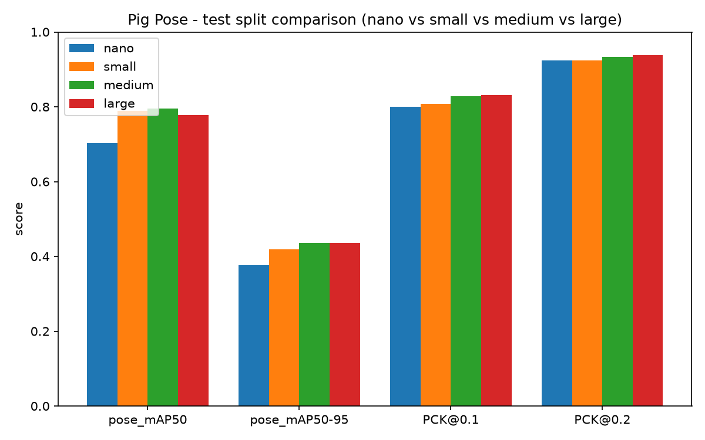

**그래프 읽는 법**
- 막대 4묶음: "모델이 돼지 관절(코·목·다리 등 18개)을 얼마나 정확히 찍는가"를 재는 점수로 **1에 가까울수록 좋음.**
  - **pose mAP50 / mAP50-95**: 돼지를 찾고 관절 위치까지 맞힌 정도 (50-95는 더 엄격한 기준이라 점수가 낮게 나옴)
  - **PCK@0.1 / @0.2**: 관절 점이 정답에서 돼지 크기의 10% / 20% 안에 들어온 비율
- 색은 모델 크기: 파랑 nano(가장 작음) → 주황 small → 초록 medium.

**결론**: 모델이 클수록 조금씩 좋아지고, **medium이 4개 지표 모두 가장 높아 추론에 medium 사용**
(`counting/models/pig_pose_ch010_m_best.pt`). 다만 test가 28장뿐이라 small과 medium의 0.01~0.02 차이는 오차 범위.

### ③ 영상 시각·fps 확인
- **방법**: 시각을 알고 있는 클립과 파일명을 대조, ffmpeg로 실제 프레임 수 확인.
- **결과**: 파일명은 **UTC (KST = +9h)**, 헤더와 무관하게 **fps = 200**. → 추론 스크립트에 반영.

### ④ 레포·Release
- training + counting을 한 레포로 합침. Release `1.0.0`에 가중치·학습 산출물·25분 영상 첨부. 데이터셋은 비공개.
- 산출물: `training/models/results/<size>/`, 지표 `training/reports/metrics/<size>/`

---

## 11/05 (목) — PC

### ① 추론 스크립트 수정
- `count_day.py` / `count_full_video.py`: RF 모델(`--model`)을 **선택 사항**으로 변경, `--save-dets`(검출별 관절 좌표 저장) 추가.

### ② 25분 클립 추론 (KST 10:26~10:51)
- **방법**: 0-4의 1초 샘플링 추론 + Geo 규칙(60°). `plot_1min.py`로 1초 값을 1분 평균으로 다시 묶어 그래프.
- **결과**: 1초 샘플 1,474개(읽기 실패 7개), 약 12분 소요. 1분 평균 0~2.4마리, 10분 평균 0.95 → 1.19 → 1.59마리.

> ⚠️ **정답 확인 필요** — 모델이 센 추정치로, 이 영상의 시간대별 마릿수를 사람이 센 정답은 없음(DM 프로젝트 팀원들과 셀 예정)
> (같은 방법의 정확도는 아래 "Geo 조건별 비교"의 평가 50장으로 간접 확인: 사진당 오차 0.56마리, 치우침 +0.04)

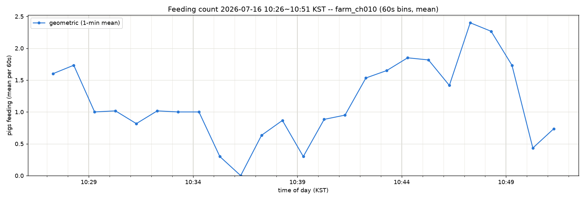

**그래프 읽는 법**: 가로축은 시각(한국 시간), 세로축은 **그 1분 동안 사료통에서 먹고 있던 돼지 수의 평균.**
1초마다 "지금 몇 마리가 먹는 중인가"를 센 뒤 1분씩 평균 냄. 1.5는 "그 1분 동안 평균 1~2마리가 먹고 있었다"는 뜻.
10:36쯤 아무도 안 먹다가 10:42부터 늘어나 10:47~10:48에 평균 2마리 넘게 몰리는 흐름 발견.

### ③ 레포 정리
- 현재 CH010 연구 파일만 남기고 이전 연구 파일은 `counting/past/`, `training/past/`로 보관(각 README에 다시 쓰는 방법 정리).
- README에 연구 계획(Geo / RF / RF+Geo 비교, visiting F1, 클립 단위 교차검증) 추가.
- 추론 결과(`counting/outputs/`)는 git에서 제외하고 Release에만 첨부. 커밋 기록 정리(Contributors에 본인만).

### ④ 평가 도구 준비
- `scripts/evaluate_methods.py` (0-3의 Stage 1 / Stage 2), `configs/eval_cameras.yaml` (이 시점엔 CH010만),
  `configs/ablation/`(Geo 조건 5종) + `scripts/run_geo_ablation.ps1`.
- `counting/.gitignore`에 `data/labels/` 추가 → 라벨 XML·평가 이미지가 공개 레포에 올라가지 않게.
- 데이터 위치 (모두 git 제외):

| 내용 | 위치 |
|---|---|
| 평가 50장 정답 XML (스켈레톤 + State) | `counting/data/labels/ch010_eval50.xml` (원래 이름 `annotations.xml`) |
| 평가 50장 이미지 | `counting/data/labels/eval50_img/` |
| CH010 7/16 영상 8개 (KST 10:26~13:32) | `counting/data/raw/CH010_20260716/` |

- 평가 50장 = 사람 라벨 **495마리** (visiting 82 / other 413).

### ⑤ Geo 조건별 비교 (Stage 2)

- **목적**: Geo 규칙의 어떤 조건이 마릿수 정확도에 도움이 되는지 확인.
- **방법**: Geo 규칙의 조건만 바꾼 설정 5개를 평가 50장(Stage 2, 모델 관절)에 각각 적용.
  - **dir 60° / 90°**: 머리 방향이 사료통 중심에서 60° / 90° 안쪽이면 인정 (각도가 클수록 느슨함)
  - **dir off**: 방향은 안 보고 코 위치만 봄 (180°)
  - **+ lying**: confidence 기반 누움 조건(다리가 보이는 정도, 박스 비율, 좌우 confidence 비대칭)을 켜서 누운 돼지 제외
- 매칭: 사람 돼지 495마리 중 **455마리(91.9%)**를 모델 검출과 짝지음(80% 이상이라 매칭 기준 0.25 그대로 사용). 못 찾은 40마리는 "아님"으로 계산.

> ✅ **정답 평가 완료** — 사람이 직접 라벨링한 평가 50장(돼지 495마리)과 비교한 결과.

| 설정 | visiting F1 | precision | recall | 마릿수 MAE | 치우침(bias) |
|---|---|---|---|---|---|
| 방향 60° (현재) | 0.675 | 0.679 | 0.671 | **0.56** | **+0.04** |
| 방향 90° | **0.706** | 0.629 | 0.805 | 0.68 | +0.52 |
| 방향 조건 끔 | 0.682 | 0.543 | 0.915 | 1.26 | +1.22 |
| 60° + 누움 조건 | 0.000 | – | 0.000 | 1.64 | −1.64 |
| 방향 끔 + 누움 조건 | 0.000 | – | 0.000 | 1.64 | −1.64 |

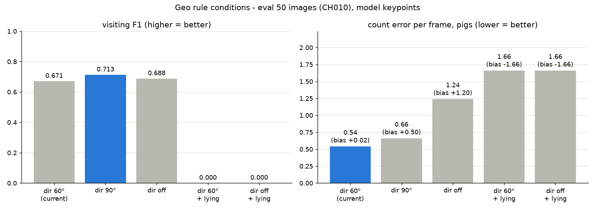

**그래프 읽는 법** (파란 막대 = 그 지표에서 1등)
- **왼쪽 F1** — 돼지 한 마리씩 "먹는 중 / 아님"을 얼마나 맞혔나. **높을수록 좋음** (1이 만점).
- **오른쪽 마릿수 오차** — 사진 한 장마다 "먹는 돼지 수"를 정답과 비교해 몇 마리 틀렸나. **낮을수록 좋음**.
  괄호 안 bias가 **+면 실제보다 많이 셈, −면 적게 셈**.

**결론**
- 개별 판정(F1)은 **90°**가 가장 좋지만, 사진당 평균 0.5마리를 **더 세는** 경향이 있음.
- 그래프로 보여 줄 **마릿수는 60°(현재)가 가장 정확**함 (평균 0.56마리 오차, 거의 치우침 없음).
- 방향을 끄면 사료통 근처에 있기만 해도 세서 1.2마리씩 **과대 집계** → 방향 조건이 필요하다는 근거.
- 누움 조건을 켜면 **한 마리도 "먹는 중"으로 안 나옴**(F1 0). 이 조건은 관절 **confidence**로 누움을 판단하는데,
  CH010처럼 위에서 내려다본 화면에서는 이 신호가 제대로 동작하지 않음. 기준값만 다시 맞추면 해결되는지는 확인되지 않았고,
  → **관절 위치로 계산하는 각도 기반 누움 특징(Leg)으로 교체** (11/07 진행).

상세: `counting/outputs/eval/geo_ablation/<설정>/summary.md` · 그림: `scripts/plot_geo_ablation.py`

### ⑥ 주간 추론 1차 + Geo 10분 그래프 (KST 10:26~11:23)
- **방법**: `count_day.py --limit 3`으로 앞쪽 3개 클립(약 57분)만 처리(25분 클립은 기존 결과 재사용).
  `plot_day.py`로 클립별 `_1s.csv`를 시간순으로 이어 붙여 시계 기준 10분 구간(10:20, 10:30, …)으로 평균.

> ⚠️ **정답 확인 필요** — 모델이 센 추정치. DM 팀원들과 확인 예정.
> (같은 방법의 정확도는 위 "Geo 조건별 비교"의 평가 50장으로 간접 확인: 사진당 오차 0.56마리, 치우침 +0.04)

| 시간 (KST) | 평균 마릿수 | 최대 | 비고 |
|---|---|---|---|
| 10:20–10:30 | 1.42 | 2 | 부분 구간 (10:26~) |
| 10:30–10:40 | 0.69 | 2 | |
| 10:40–10:50 | **1.65** | 4 | 최고 |
| 10:50–11:00 | 1.14 | 3 | |
| 11:00–11:10 | 0.23 | 2 | |
| 11:10–11:20 | 0.91 | 2 | |
| 11:20–11:30 | 0.05 | 1 | 부분 구간 (~11:23) |

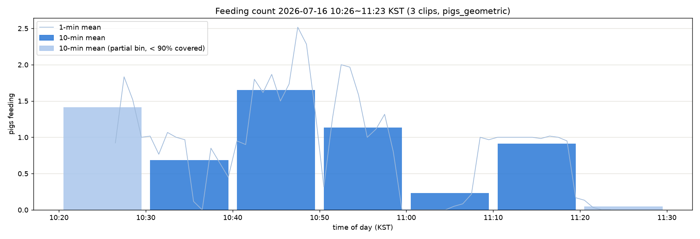

**그래프 읽는 법**
- 가로축은 시각(한국 시간), 세로축은 **사료통에서 먹고 있던 돼지 수**.
- **진한 파란 막대** = 10분 평균 마릿수. 예: 10:40~10:50 막대 1.65 → 그 10분 동안 평균 1.65마리가 먹고 있었음.
- **연한 막대** = 영상이 10분의 90%를 채우지 못한 구간 (시작 10:26, 끝 11:23) → 참고만.
- **얇은 선** = 1분 평균. 10분 막대 안에서 실제로 얼마나 오르내렸는가.

**보이는 것**: 10:40~11:00에 먹는 돼지가 가장 많고(최대 4마리 동시), 11:00~11:10에는 거의 안 먹다가
11:10~11:20에 1마리 정도가 꾸준히 먹음. **먹는 시간대가 몰렸다 비었다를 반복.**
(3시간 전체·방법별 비교는 11/07 결과 참고)

---

## 11/07 (토) — PC

### ① 새 스크립트 반영
- `src/feeding_monitor/leg_features.py`: Leg 누움 특징 5개 (0-2 참고).
- `src/feeding_monitor/method_features.py`: 모든 방법의 특징 계산을 한 곳에 모음 → 평가와 주간 그래프가 같은 숫자를 씀.
- `scripts/evaluate_methods.py`: 비교 방법에 **RF+Geo+Leg** 추가, `--stage2-exclude-shared-clips` 옵션 추가
  (Stage 2용 RF 학습에서 평가 50장과 **같은 클립**의 사진을 빼는 옵션 — 아래 ③ 참고).
- `scripts/apply_methods.py`: 주간 `_dets.csv`에 모든 방법을 적용해 방법별 10분 그래프 (YOLO 재실행 없음).

### ② 카메라별 사료통 ROI 설정
- **방법**:
  1. 카메라마다 사진 한 장을 꺼내 `calibrate_feeder.py --source <사진.jpg> --at-sec 0`으로 빨간 원형 사료통을 자동 검출.
  2. 결과 그림에서 원이 **뚜껑 테두리와 겹치는지 눈으로 확인**. CH005는 첫 클립·마지막 클립 사진 두 장으로 확인
     → (908.3, 529.1, 338.0) vs (909.5, 527.0, 339.5), 1~2px 차이 → 카메라 고정.
  3. `farm_ch010.yaml`을 복사해 `farm_ch005.yaml`, `farm_sample.yaml` 생성 — 원(cx, cy, r)과 이름만 바꾸고
     규칙은 CH010과 동일(링 0.0~1.0 = 뚜껑 전체, 방향 60°, confidence 누움 조건 끔).
  4. `make_circle_zone.py`로 같은 원을 48각형 구역 파일로 변환(RF 특징용) → `eval_cameras.yaml`에서 CH005·SAMPLE 활성화.
- **CH002(003) 제외 이유**: 금속 원형 급이기가 화면 아래쪽에 잘려 있어 원을 제대로 잡을 수 없고 사료통 형태도 달라,
  "빨간 원형 사료통" ROI 조건이 같지 않음. 003 61장은 State 라벨링 불필요(pose 학습에는 이미 사용).

| 폴더(task) | 카메라 | Stage 1 장수 | 클립 수 | 사료통 원 (cx, cy, r) |
|---|---|---|---|---|
| 000 | 1분 샘플 (960×720) | 86 | 1 | 453.4, 354.3, 169.2 |
| 001 | CH005 (1920×1080) | 90 | 4 | 908.3, 529.1, 338.0 |
| 002 | CH010 (51~100번) | 50 | 11 | 925.3, 535.1, 337.8 |
| 003 | CH002 | 61 → **제외** | | 금속 급이기가 화면 아래에 잘림 |
| 합계 | | **226장** | **16개** | |

### ③ 같은 클립 문제 확인
- 002(CH010 51~100번) 50장 중 **33장이 평가 50장과 같은 영상 클립**에서 나온 사진(2초 간격으로 거의 같은 장면).
- Stage 2용 RF를 이 사진까지 넣어 학습하면 시험지와 비슷한 장면을 미리 본 셈이라 점수가 부풀 수 있음.
- → 002 라벨이 들어오면 `--stage2-exclude-shared-clips` **있이/없이 두 번** 돌려 차이를 비교 (차이가 작으면 누수 영향이 작다는 근거).

### ④ 수아 라벨 001 (CH005) 정리
- `001_label.zip`의 `annotations.xml` → `counting/data/labels/state_001.xml`로 이름 변경. zip은 삭제.
- `001_label_backup.zip`(CVAT 작업 백업, 사진 90장 + json) → `counting/data/labels/cvat_backup/`에 보관.
  사진은 학습 데이터(`training/data/raw/data/001.zip`)와 이름이 모두 같은 중복.
- **확인한 것**: CVAT 1.1 형식, 90장 모두 라벨 있음(Unlabeling 0), 돼지 **899마리 = visiting 136 / other 763**,
  관절 18개, 클립 4개, 평가 50장과 겹치는 사진 0장.

### ⑤ 4가지 방법 비교 — 1차 (Stage 1 = 001만)

- **방법**: `evaluate_methods.py --stage1-xml state_001.xml ...` (명령은 맨 아래).
  - Stage 1: CH005 클립 4개를 돌아가며 **3개로 학습, 1개로 시험**(4-fold) → 모든 사진이 한 번씩 시험됨.
  - Stage 2: Stage 1 라벨 전체(899마리)로 RF를 학습 → **CH010 평가 50장**에 모델 관절로 적용.
    학습(CH005)과 시험(CH010)이 **다른 카메라**.
- 로그 확인: 평가용 제외 0, ROI 미설정 카메라 제외 0, 사용 899마리.

> ✅ **정답 평가 완료** — Stage 1은 수아 라벨 90장(돼지 899마리), Stage 2는 사람 라벨 평가 50장(돼지 495마리)과 비교.

| 방법 | Stage 1 F1 | Stage 2 F1 | Stage 2 사진당 오차 (bias) | 마릿수 정확히 맞힌 사진 |
|---|---|---|---|---|
| Geo (규칙) | 0.772 | 0.675 | 0.56 (+0.04) | 46% |
| RF | 0.930 | 0.685 | 1.24 (+1.20) | 18% |
| RF+Geo | 0.930 | 0.698 | 1.12 (+1.04) | 22% |
| **RF+Geo+Leg** | **0.949** | **0.900** | **0.22 (−0.02)** | **78%** |

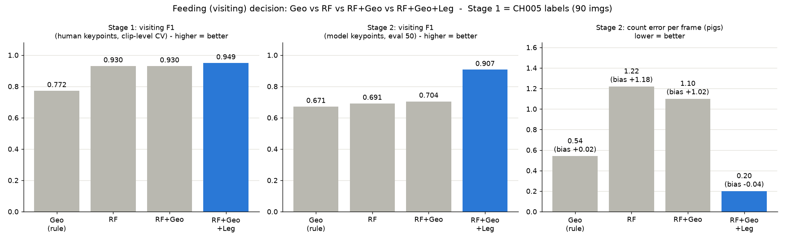

**그래프 읽는 법** (파란 막대 = 그 칸의 1등)
- **왼쪽 (Stage 1)**: 사람이 찍은 관절로, CH005 클립을 돌아가며 시험한 F1. 높을수록 좋음.
- **가운데 (Stage 2)**: 실제 운용처럼 **모델이 찍은 관절**로 CH010 평가 50장을 판정한 F1. 높을수록 좋음.
- **오른쪽 (Stage 2)**: 사진 한 장마다 먹는 돼지 수를 몇 마리 틀렸나. 낮을수록 좋음. bias +는 과대 집계.

**결론**
- **RF+Geo+Leg가 세 칸 모두 1등.** Stage 2에서 F1 0.900, **사진당 오차 0.22마리**(Geo 0.56의 절반 이하), 78%의 사진에서 마릿수를 정확히 맞힘.
- RF·RF+Geo는 Stage 1에서는 좋지만 Stage 2에서 **1마리 이상 과대 집계** → 사료통 근처에 **누워 있는 돼지**를 먹는 중으로 셈.
  다리 특징을 넣자 이 오류가 거의 사라짐(잘못 센 수 56 → 6).
- Geo 규칙이 놓친 visiting 43마리는 **모두 방향 조건(60°) 탈락** — 머리가 사료통 중심을 비스듬히 향한 경우.
- RF+Geo+Leg 특징 중요도 상위: 코-사료통 거리/r 0.29, 코-구역 거리 0.25, 코가 구역 안 0.19, 다리 길이 0.08, 발 거리 0.07.
- 다리 특징 중앙값 (Stage 1, 사람 관절):

  | 특징 | visiting | other |
  |---|---|---|
  | 다리-척추 각도 | 13° | 60° |
  | 다리 길이 ÷ 몸통 | 0.18 | 0.46 |
  | 발-척추 거리 ÷ 몸통 | 0.13 | 0.38 |
  | 발 한쪽 쏠림 | 0.0 | 1.0 |

  → visiting 돼지는 다리가 척추와 나란하고 양쪽으로 나뉨(서 있음), other는 다리를 한쪽으로 뻗고 누운 **"ㄷ" 자세**.
- **CH005로만 학습했는데 CH010에서 잘 맞음** → 카메라가 바뀌어도 쓸 수 있다는 근거.
  CH010 라벨이 학습에 없으므로 ③의 "같은 클립 누수"는 이번 결과에 해당 없음.
- **한계**: Stage 1 라벨이 한 카메라 90장(클립 4개)뿐. 000·002 라벨이 들어오면 다시 확인.

상세: `counting/outputs/eval_001/summary.md` · 그림: `scripts/plot_methods.py <결과폴더>`

### ⑥ 남은 주간 영상 추론 (KST 11:23~13:32)
- **방법**: 같은 `count_day.py` 명령을 `--limit` 없이 재실행 → 끝난 3개 클립은 자동으로 건너뛰고 나머지 5개만 처리.
- **결과**: **8개 클립, KST 10:26~13:32 (11,063초, 약 3시간)** 완료. 실패 클립 없음, 클립마다 못 읽은 프레임 7~9개(건너뜀).
  클립당 4~6분 소요.

### ⑦ 주간 그래프 — 방법별 비교 1차 (KST 10:26~13:32)

- **방법**: `apply_methods.py`
  1. Stage 1 라벨(현재 001, 899마리) 전체로 RF / RF+Geo / RF+Geo+Leg 학습 → `rf_models.joblib` 저장.
  2. 8개 클립의 `_dets.csv`(검출 약 108,000개)마다 특징을 계산해 각 방법으로 visiting 여부 판정. Geo는 60°·90° 두 설정.
  3. 1초마다 visiting 수를 더해 → 시계 기준 10분 구간 평균.

> ⚠️ **정답 확인 필요** — 영상 전체에 대한 모델 추정치. DM 확인 필요.
> (RF 계열은 CH005 라벨 90장으로 학습)

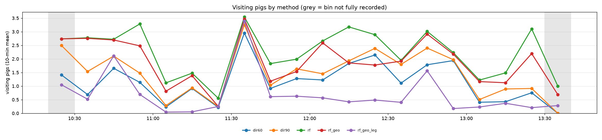

**그래프 읽는 법**
- 가로축은 시각(한국 시간), 세로축은 **10분 동안 사료통에서 먹고 있던 돼지 수의 평균**. 선 하나가 방법 하나.
- 회색 띠 = 영상이 10분을 다 채우지 못한 구간(처음·끝) → 참고만.
- 파랑 dir60 = Geo 규칙(현재), 주황 dir90 = Geo 90°, 초록 rf, 빨강 rf_geo, **보라 rf_geo_leg = 평가에서 가장 좋았던 방법**.

| 방법 | 1초 평균 | 1초 최대 | 10분 평균의 최대 |
|---|---|---|---|
| Geo 60° | 1.19 | 5 | 2.95 |
| Geo 90° | 1.49 | 5 | 3.26 |
| RF | 2.27 | 7 | 3.54 |
| RF+Geo | 1.90 | 6 | 3.47 |
| **RF+Geo+Leg** | **0.71** | 5 | 3.39 |

방법끼리 1초 마릿수가 같은 비율: Geo 60°↔90° 73%, RF↔RF+Geo 69%, RF+Geo+Leg↔Geo 60° 40%, RF+Geo+Leg↔RF 20%.

**보이는 것**
- **11:30~11:40에는 모든 방법이 3마리 안팎으로 일치** → 실제로 여러 마리가 몰려 먹은 시간대로 보임.
- **11:40~12:40에는 RF+Geo+Leg만 0.5마리 안팎으로 낮음** → 아래 ⑧에서 장면을 직접 확인.
- 평가 50장에서는 Geo 60°의 치우침이 거의 0이었는데 영상에서는 과대 집계가 보임.
  평가 50장보다 영상에 "사료통 옆에서 자는" 장면이 더 많기 때문으로 보임 → **평가 사진 구성의 한계**로 미팅에서 논의.

원본: `counting/outputs/ch010_20260716_day/day_methods_10min_001.csv`, `day_methods_1s_001.csv` (2차 결과는 11/08 ④)

### ⑧ 방법 간 차이가 큰 장면 확인

- **방법**: 1초 결과에서 **Geo 60° − RF+Geo+Leg ≥ 2마리**인 초를 찾아, 11:47~12:14 클립에서 3장, 12:40~13:05 클립에서 2장을
  고르게 뽑음 → 영상에서 그 프레임을 꺼내 검출마다 두 방법의 판정을 색으로 표시.

> ⚠️ 사람 라벨이 아니라 눈으로 본 확인. DM 팀원들과 실측 값 확인 예정.

**사진 읽는 법**
- 빨간 원 = 사료통 판정 영역(뚜껑 전체).
- 상자 색: **주황 = Geo 60°만 "먹는 중"**, 초록 = 두 방법 모두, 보라 = RF+Geo+Leg만, 회색 = 둘 다 "아님".
- 동그란 점 = 코 위치, 선 = 목→코(머리 방향)와 목→꼬리(척추).
- 상자 위 글자: `leg_ang` = 다리-척추 각도(서 있으면 작고, 옆으로 누우면 90°에 가까움),
  `side` = 다리가 한쪽으로 몰린 정도(누우면 1). `-1`은 다리 점이 안 보여 계산 못 함.

| 11:53:31 | 12:11:59 |
|---|---|
| 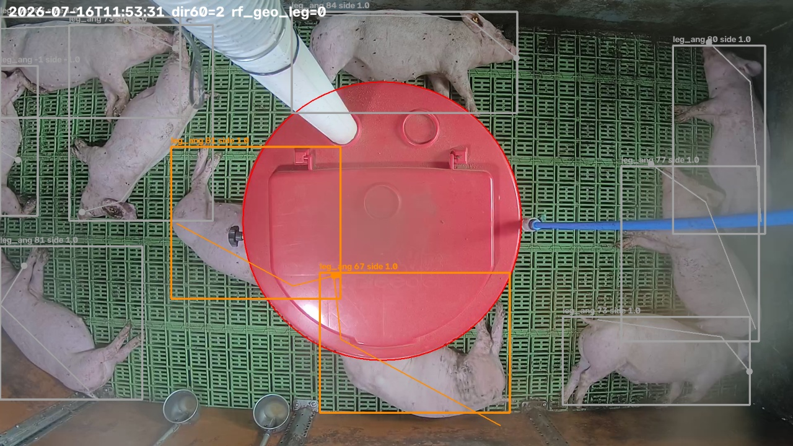 | 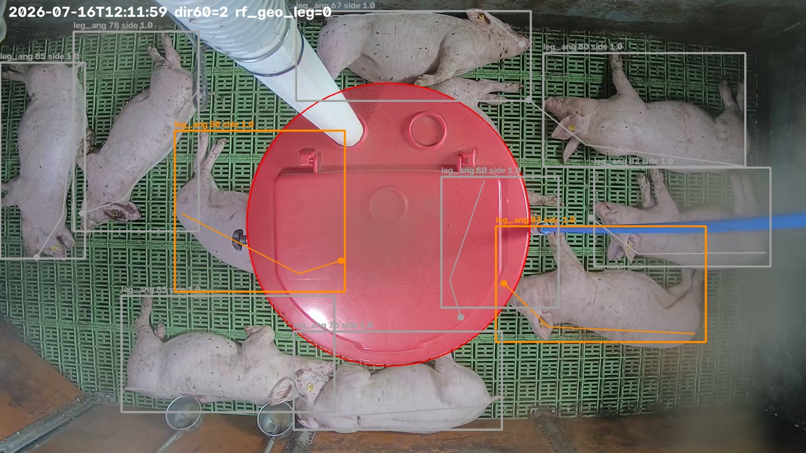 |
| **12:14:08** | **12:43:38** |
| 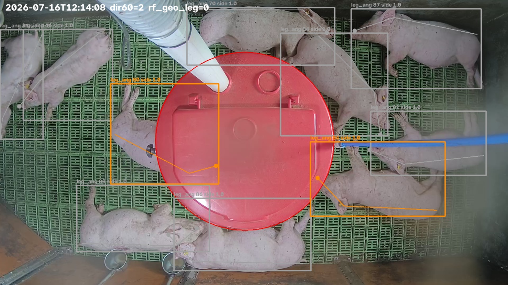 | 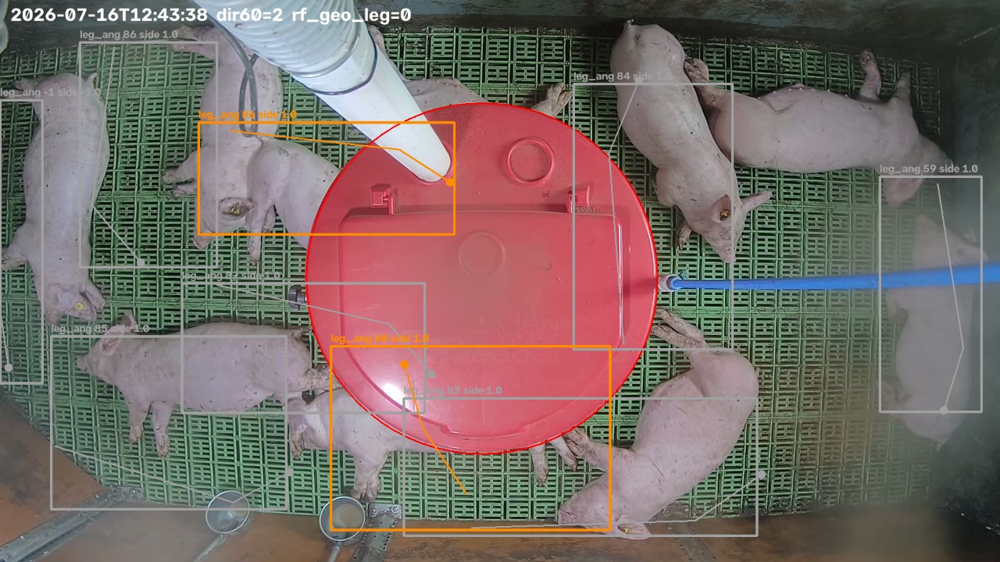 |
| **12:59:20** | |
| 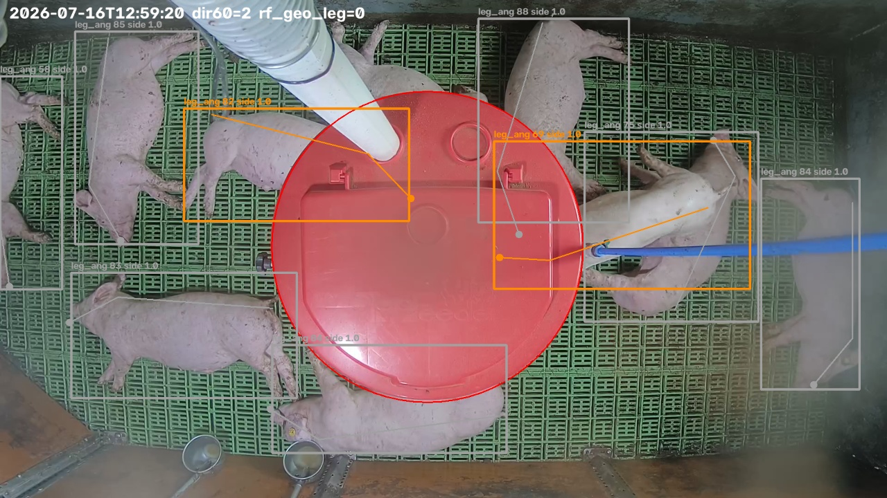 | |

**보이는 것**: 주황 상자 돼지(10마리)는 대부분 **사료통 가장자리에 머리를 대고 옆으로 누운 자세.**
코가 원 안에 있고 머리도 사료통 쪽이라 Geo 규칙은 "먹는 중"으로 세지만, 다리를 한쪽으로 뻗고 있어
(`leg_ang` 60~88°, `side` 1.0) RF+Geo+Leg는 "아님"으로 판정.
→ 한낮 휴식 시간에 Geo·RF·RF+Geo는 **자는 돼지를 먹는 중으로 과대 집계**하고, 다리 특징이 이를 걸러 냄.
12:59:20 오른쪽 돼지는 사진 한 장만으로는 서 있는지 누웠는지 애매.

### ⑨ 라벨 일치도 확인
- **방법**: 수아가 라벨링한 20장을 검토자(본인)가 한 장씩 확인.
- **결과**: State(visiting / other) **20장 모두 일치 (100%)**.
- 참고: 두 사람이 따로 라벨링해 비교한 것(독립 이중 라벨링)이 아니라 **검토 방식**의 일치도.
  독립 kappa가 필요하면 같은 10장을 서로 안 보고 라벨링해 비교.

### ⑩ Geo 설정 결정 — 방향 60°로 확정
- **근거** (⑤ 11/05 Geo 조건별 비교, 평가 50장):
  - 60°: 사진당 마릿수 오차 **0.56**, 치우침 **+0.04** — 그래프에 쓰이는 마릿수가 가장 정확.
  - 90°: F1은 0.706으로 조금 높지만 오차 0.68, 치우침 **+0.52**(사진당 0.5마리 과대 집계).
- **적용**: `configs/farm_ch010.yaml`·`farm_ch005.yaml`·`farm_sample.yaml` 모두 60°(변경 없음).
  앞으로 비교 그래프의 Geo 선은 60°만 그림(`apply_methods.py`에서 `--geo dir90=...` 생략).
- README 연구 계획도 4가지 방법·60° 확정·현재 결과로 갱신.

### 11/07 체크리스트
- [x] 라벨 일치도 확인 (20장, 100%)
- [x] Geo 설정 60° 확정, README 연구 계획 갱신
- 추가 라벨로 다시 돌리는 작업은 11/08로 이어짐

### 실행 명령 (counting 폴더에서)

```powershell
cd C:\ETRI\2026_Project\counting
$py = "C:\ETRI\Piggy_Feeding_Counting\.venv\Scripts\python"

# Stage 1 + Stage 2 (라벨이 늘면 --stage1-xml 에 파일 추가)
& $py scripts\evaluate_methods.py --cameras configs\eval_cameras.yaml `
    --stage1-xml data\labels\state_000.xml data\labels\state_001.xml data\labels\state_002.xml `
    --stage1-exclude ..\training\eval_frames.txt `
    --stage2-xml data\labels\ch010_eval50.xml --stage2-images data\labels\eval50_img `
    --stage2-only-list ..\training\eval_frames.txt --out outputs\eval_all
# 같은 명령 + --stage2-exclude-shared-clips --out outputs\eval_all_strict
& $py scripts\plot_methods.py outputs\eval_all
# 90장 vs 226장 비교 그림
& $py scripts\plot_compare_runs.py --run "90 imgs (CH005 only)=outputs/eval_001" `
    --run "226 imgs (3 cameras)=outputs/eval_all" --run "226 imgs, strict=outputs/eval_all_strict" `
    --out ..\docs\figures\compare_runs.png

# 주간 방법별 그래프 (RF 재학습, Geo는 60°만)
& $py scripts\apply_methods.py outputs\ch010_20260716_day --config configs\farm_ch010.yaml `
    --zones configs\zones\feeder_zones_ch010.yaml `
    --geo dir60=configs\ablation\farm_ch010_dir60.yaml `
    --cameras configs\eval_cameras.yaml `
    --stage1-xml data\labels\state_000.xml data\labels\state_001.xml data\labels\state_002.xml `
    --stage1-exclude ..\training\eval_frames.txt
# 그래프만 다시: 위 명령에서 --stage1-xml/--stage1-exclude 대신 --load-models <학습된 rf_models.joblib>
# 결과는 day_methods_10min.* 이름으로 나오므로, 1차/2차 비교용으로 _001 / _all 을 붙여 보관
```

---

## 11/08 (일) — 추가 라벨로 2차 실행 (90장 → 226장)

**목적**: Stage 1 라벨을 한 카메라 90장에서 세 카메라 226장으로 늘렸을 때 각 방법의 성능이 어떻게 바뀌는지 **비교**.
1차 결과(11/07, 90장)는 그대로 두고 2차 결과를 따로 저장.

| | 1차 (11/07) | 2차 (11/08) |
|---|---|---|
| Stage 1 라벨 | 001 (CH005) 90장 | 000 + 001 + 002 = **226장** (실제 사용 219장) |
| 카메라 / 클립 | CH005 / 4 | CH005·CH010·SAMPLE / **16** |
| 돼지 수 (visiting) | 899 (136) | **2,129 (344)** |
| 교차검증 | 4-fold | 5-fold |
| 결과 폴더 | `outputs/eval_001/` | `outputs/eval_all/`, `outputs/eval_all_strict/` |
| 주간 그래프 | `day_methods_*_001.*` | `day_methods_*_all.*` |

### ① 수아 라벨 000·002 정리
- **방법**: zip 안의 `annotations.xml`을 이름만 바꿔 `counting/data/labels/`에 둠. CVAT 백업 zip은 `cvat_backup/`에 보관, 라벨 zip은 삭제.
  - `000_label.zip` → `state_000.xml` (1분 샘플, 86장, 960×720)
  - `002_051-100_label.zip` → `state_002.xml` (CH010 51~100번, 50장)
- **확인한 것**:

| task | 사진 | 돼지 | visiting | other | Unlabeling | 클립 | 평가 50장과 겹침 |
|---|---|---|---|---|---|---|---|
| 000 | 86 | 860 | 111 | 625 | **124** | 1 | 0 |
| 002 | 50 | 495 | 97 | 397 | 1 | 11 | 0 |

- 000의 Unlabeling 124마리는 **13장에 몰려 있음**(사진당 10마리 중 9~10마리) → 스크립트가 Unlabeling을 자동 제외하므로
  그 중 7장은 통째로 빠져 Stage 1 사진은 226장 중 **219장**이 사용됨.

### ② 4가지 방법 비교 — 2차 (Stage 1 = 226장)

- **방법**: 11/07 ⑤와 같은 `evaluate_methods.py`에 `--stage1-xml`로 XML 3개를 넣어 실행.
  - Stage 1: 클립 16개를 5묶음으로 나눠 돌아가며 시험(5-fold, 같은 클립은 같은 묶음).
  - Stage 2: 226장 라벨 전체로 RF 학습 → CH010 평가 50장. **일반**과 **strict** 두 번:
    - **일반**: Stage 1 라벨 전체로 학습.
    - **strict** (`--stage2-exclude-shared-clips`): 평가 50장과 **같은 클립**에서 나온 라벨 사진의 돼지 **325마리를 빼고**(남은 1,804마리) 학습
      → 시험지와 비슷한 장면을 미리 본 효과(누수)를 없앤 결과.
- 로그 확인: 카메라 CH005·CH010·SAMPLE 모두 사용, 평가용 제외 0, ROI 미설정 제외 0, 사용 2,129마리.

> ✅ **정답 평가 완료** — Stage 1은 수아 라벨 219장(돼지 2,129마리), Stage 2는 사람 라벨 평가 50장(돼지 495마리)과 비교.

**Stage 1 (사람 관절, 5-fold)**

| 방법 | F1 | precision | recall | fold별 F1 평균 ± 표준편차 |
|---|---|---|---|---|
| Geo | 0.782 | 0.863 | 0.715 | 0.743 ± 0.193 |
| RF | 0.876 | 0.796 | 0.974 | 0.870 ± 0.148 |
| RF+Geo | 0.933 | 0.881 | 0.991 | 0.921 ± 0.089 |
| **RF+Geo+Leg** | **0.986** | **0.977** | **0.994** | **0.984 ± 0.012** |

카메라별 Stage 1 F1:

| 카메라 | Geo | RF | RF+Geo | RF+Geo+Leg |
|---|---|---|---|---|
| CH005 (899마리) | 0.772 | 0.935 | 0.938 | **0.975** |
| CH010 (494마리) | 0.670 | 0.738 | 0.864 | **0.990** |
| SAMPLE (736마리) | 0.897 | 0.963 | **0.996** | **0.996** |

**Stage 2 (모델 관절, CH010 평가 50장)**

| 방법 | 일반 F1 | 일반 사진당 오차 (bias) | strict F1 | strict 사진당 오차 (bias) |
|---|---|---|---|---|
| Geo | 0.675 | 0.56 (+0.04) | 0.675 | 0.56 (+0.04) |
| RF | 0.749 | 0.82 (+0.70) | 0.685 | 1.24 (+1.20) |
| RF+Geo | 0.859 | 0.34 (+0.18) | 0.762 | 0.72 (+0.56) |
| **RF+Geo+Leg** | **0.892** | **0.26 (+0.10)** | **0.899** | **0.22 (−0.06)** |

마릿수를 정확히 맞힌 사진: RF+Geo+Leg 일반 74% / strict 78%, Geo 46%.

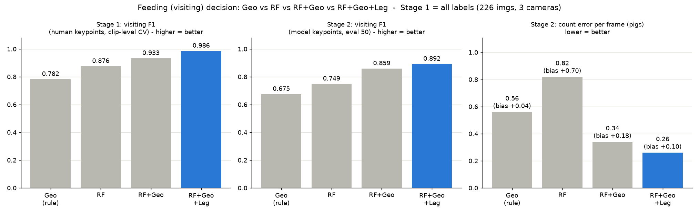

**그래프 읽는 법**: 11/07 ⑤와 같음 — 왼쪽 Stage 1 F1, 가운데 Stage 2 F1(높을수록 좋음), 오른쪽 Stage 2 사진당 마릿수 오차(낮을수록 좋음), 파란 막대 = 1등.
strict 그림: `docs/figures/methods_all_strict.png`

**결론**
- **RF+Geo+Leg가 여전히 모든 칸 1등.** Stage 1 F1 **0.986**, fold 간 차이도 가장 작음(±0.012) → 클립·카메라가 바뀌어도 안정적.
- **CH010에서 차이가 가장 큼**: Geo 0.670 → RF+Geo+Leg 0.990. CH010에서 Geo의 precision이 0.70으로 낮아(누운 돼지까지 셈) 다리 특징이 걸러 낼 몫이 큰 것으로 보임.
- **누수 확인**: strict로 바꿔도 RF+Geo+Leg는 그대로(F1 0.892 → 0.899, 오차 0.26 → 0.22) → **같은 클립 누수 영향 없음**.
  반대로 RF+Geo는 0.859 → 0.762, 오차 0.34 → 0.72로 크게 나빠짐 → RF+Geo의 일반 점수는 **같은 클립 장면을 미리 본 덕분에 부풀려진 것**.
- Geo 규칙이 놓친 visiting 98마리는 모두 방향 조건(60°) 탈락.
- 다리 특징 중앙값 (226장): 다리-척추 각도 visiting **13°** vs other **67°**, 다리 길이 비율 0.17 vs 0.50, 발 쏠림 0 vs 1 → 1차와 같은 경향이 더 뚜렷.

### ③ 90장 vs 226장 비교

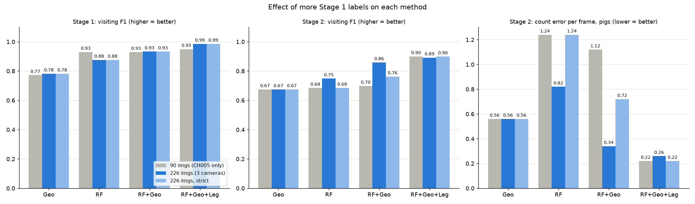

**그래프 읽는 법**: 방법마다 막대 3개 — 회색 = 1차(90장, CH005만), 진한 파랑 = 2차 일반(226장), 연한 파랑 = 2차 strict.
왼쪽·가운데는 F1(높을수록 좋음), 오른쪽은 사진당 마릿수 오차(낮을수록 좋음). Geo는 학습이 없어 세 막대가 같음.

| 방법 | Stage 1 F1 (90 → 226) | Stage 2 F1 (90 → 226 → strict) | Stage 2 오차 (90 → 226 → strict) |
|---|---|---|---|
| Geo | 0.772 → 0.782 | 0.675 → 0.675 → 0.675 | 0.56 → 0.56 → 0.56 |
| RF | 0.930 → 0.876 | 0.685 → 0.749 → 0.685 | 1.24 → 0.82 → 1.24 |
| RF+Geo | 0.930 → 0.933 | 0.698 → 0.859 → 0.762 | 1.12 → 0.34 → 0.72 |
| **RF+Geo+Leg** | 0.949 → **0.986** | 0.900 → 0.892 → 0.899 | 0.22 → 0.26 → 0.22 |

**달라진 점**
- **RF+Geo+Leg**: Stage 1은 0.949 → 0.986으로 좋아졌고, Stage 2(CH010 실제 운용)는 90장 때와 거의 같음(0.89~0.90, 오차 0.22~0.26).
  → **CH005 90장만으로도 이미 CH010에서 충분히 동작**했고, 라벨을 늘려도 결과가 흔들리지 않음.
- **RF+Geo**: Stage 2가 크게 좋아진 것처럼 보이지만(오차 1.12 → 0.34) strict에서는 0.72 → 개선의 상당 부분이 **평가 클립과 같은 장면** 덕분.
- **RF 단독**: 카메라가 섞이자 Stage 1이 오히려 떨어짐(0.930 → 0.876). 픽셀 기반 자세 특징만으로는 카메라 차이를 흡수하기 어려움.
- **Geo**: 학습이 없어 Stage 2는 그대로. Stage 1이 조금 오른 것은 SAMPLE(0.897)이 섞인 영향.

### ④ 주간 그래프 — 방법별 비교 2차 (226장으로 학습)

- **방법**: 11/07 ⑦과 같은 `apply_methods.py`, Stage 1 라벨 226장 전체로 RF 계열을 다시 학습. Geo는 확정한 **60°만**.
  1차 파일은 `_001`, 2차 파일은 `_all`을 붙여 둘 다 보관.

> ⚠️ **정답 확인 필요** — 영상 전체에 대한 모델 추정치로, DM 프로젝트에서 실측값 측정 필요.
> (RF 계열은 수아 라벨 226장으로 학습)

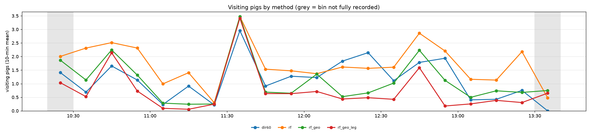

**그래프 읽는 법**: 가로축 시각(한국 시간), 세로축 10분 평균 visiting 마릿수. 회색 띠 = 10분을 다 채우지 못한 구간.
**색이 1차 그림과 다름** — 파랑 dir60 = Geo 60°, 주황 rf, 초록 rf_geo, **빨강 rf_geo_leg**(Geo 90° 선을 빼서 색 순서가 바뀜).

| 방법 | 1초 평균 (1차 → 2차) | 10분 평균의 최대 (2차) |
|---|---|---|
| Geo 60° | 1.19 → 1.19 | 2.95 |
| RF | 2.27 → **1.77** | 3.47 |
| RF+Geo | 1.90 → **1.07** | 3.47 |
| **RF+Geo+Leg** | 0.71 → **0.74** | 3.41 |

방법끼리 1초 마릿수가 같은 비율 (2차): RF+Geo↔RF+Geo+Leg **69%**(1차 27%), Geo↔RF+Geo+Leg 40%, RF↔RF+Geo+Leg 32%.

**보이는 것**
- **RF+Geo+Leg는 1차와 거의 같음**(0.71 → 0.74) → 학습 라벨이 바뀌어도 그래프가 안정적.
- RF·RF+Geo는 라벨이 늘면서 과대 집계가 줄어 RF+Geo+Leg 쪽으로 가까워짐(RF+Geo 1.90 → 1.07).
  CH010 라벨이 들어가면서 "사료통 옆에서 자는 돼지"를 일부 배운 것으로 보임. 그래도 12:40~12:50 등에서는 여전히 더 많이 셈.
- **11:30~11:40에 모든 방법이 3마리 안팎으로 일치**하는 것은 1차와 같음.
- Geo 60°는 11:40~12:40에 여전히 RF+Geo+Leg보다 1마리 이상 많음 → 11/07 ⑧의 장면 확인 결과(자는 돼지 과대 집계)와 같은 경향.

원본: `counting/outputs/ch010_20260716_day/day_methods_10min_all.csv`, `day_methods_1s_all.csv`, `rf_models_all.joblib`

### ⑤ 레포 정리 — 이전 연구(ETRI) 파일 삭제
- **삭제**: `counting/past/`, `training/past/`(이전 연구 보관 폴더 전체), `src/feeding_monitor/posture_classifier.py`
  (이전 연구 RF 모델 불러오기), 쓰지 않는 빈 폴더(`training/video_result/`, `training/runs/`, `training/data/past_train/`,
  `training/data/raw/annotations/`), `__pycache__`. 지운 파일은 git 기록에 남아 있어 필요하면 되살릴 수 있음.
- `count_day.py` / `count_full_video.py`: 이전 연구 RF 옵션(`--model`, `--rf-threshold`) 제거, `--zones` 생략 가능.
  `_1s.csv`에서 비어 있던 `pigs_randomforest` 열 제거 → `elapsed_sec, wall_time, pigs_geometric`.
  확인: 5분 클립을 다시 추론해 270초 모두 기존 결과와 같은 마릿수.
- 단위 테스트가 `eval_cameras.yaml`까지 채널 설정으로 읽어 실패하던 것을 `farm_*.yaml`만 보도록 수정 → 7개 통과.
- README(루트·counting) 폴더 구조와 명령을 현재 스크립트 기준으로 갱신.
- DM 정답지용 스크립트 추가: `extract_dm_frames.py`(모델과 같은 프레임으로 1초 1장 + 기록 시트),
  `make_dm_examples.py`(사람 라벨 기준 예시 사진). A 구간(10:30~10:40) 600장 추출 완료(레포에는 올리지 않음).
- **정리 후 검증**
  - 지운 모듈·폴더·옵션 이름을 레포 전체에서 검색 → 코드에는 참조 없음(기록 문서에만 남음).
  - 스크립트 21개·모듈 12개 모두 불러오기 정상.
  - 학습: training 폴더를 임시 복사해 병합(287장) → 분할(230/29/28) → nano 1 epoch 학습 → train·valid·test 평가 → 비교까지 정상.
    실제 학습 결과는 건드리지 않음.
  - 추론·평가: 다시 돌린 Stage 1·2(226장), Geo 60° 조건 비교, 주간 방법별 판정(5분 클립)이 **기존 결과와 완전히 같음**.
    그림·사료통 원·DM 추출 스크립트 모두 정상, 단위 테스트 7개 통과.
- **검증 중 고친 것 (원래 있던 문제)**
  - `training_status.py`: 설정 파일의 200 epoch 기준이라 100 epoch로 끝난 n·s·m이 "50%, 중단 의심"으로 나옴
    → 실제 학습 설정(`args.yaml`)의 epoch를 먼저 읽도록 수정, 이제 "완료"로 표시.
  - `launch_detached.py`: Python 경로가 다른 PC 경로로 고정되어 있어 이 PC에서 실행 불가
    → 실행 중인 Python을 쓰도록 수정, 로그는 `train_full_detached.log`(git 제외). 실제 실행 확인은 large 학습 때.

### 11/08 체크리스트
- [x] 수아 라벨 000·002 정리 (총 226장)
- [x] 전체 라벨로 Stage 1 + Stage 2 — 일반 / strict 두 번
- [x] 90장 vs 226장 비교 그림
- [x] 주간 방법별 그래프 2차 (Geo 60°만)
- [x] PROGRESS.md·README 갱신 (1차는 보존, 2차를 추가)
- [ ] 슬라이드 작성

---

## 11/10 (화) — 평가 50장 40:10 비교

### ① 평가 50장을 40:10으로 나눠 4가지 방법 비교

- **목적**: pose 학습에 쓰지 않은 평가 50장(CH010, 사람 State 라벨) 안에서 RF를 학습(40장)하고 시험(10장)해,
  **같은 카메라 라벨만으로** 4가지 방법을 비교.
- **방법** (`counting/scripts/eval_split50.py`):
  1. 50장 전부에 포즈 모델을 돌려 **모델 keypoint**를 얻고, 사람 스켈레톤과 짝지음(Stage 2와 같은 헝가리안 매칭).
  2. **클립 단위로 40:10 분할** — 같은 클립 사진은 2초 간격 비슷한 장면이라 사진 단위로 섞으면 시험 장면을 미리 보게 됨.
     정확히 10장이 되는 클립 조합 중 visiting 비율이 전체(16.6%)와 가장 비슷한 조합을 시험용으로 선택
     → 클립 7개, 10장, 돼지 99마리(visiting 16마리, 16.2%).
  3. 학습 40장: 모델 검출 중 사람 라벨과 짝지어진 368개(visiting 60)로 RF / RF+Geo / RF+Geo+Leg 학습.
     학습과 시험 모두 모델 keypoint(실제 운용과 같은 조건).
  4. 시험 10장 채점은 Stage 2와 같음 — 모델이 못 찾은 돼지는 "아님", 사진당 마릿수는 모델 검출 전체로 계산.
  5. 시험 10장이 작아서, 정확히 10장이 되는 다른 클립 조합(231개 중 50개)으로도 반복해 평균 ± 표준편차를 함께 냄.

> ✅ **정답 평가 완료** — 사람이 라벨링한 평가 사진(CH010)과 비교한 결과.

**시험 10장 결과**

| 방법 | visiting F1 | precision | recall | TP / FP / FN | 사진당 오차 (bias) | 마릿수 맞힌 사진 |
|---|---|---|---|---|---|---|
| Geo (60°) | 0.529 | 0.500 | 0.562 | 9 / 9 / 7 | 0.80 (+0.40) | 30% |
| RF | 0.778 | 0.700 | 0.875 | 14 / 6 / 2 | 0.70 (+0.50) | 40% |
| RF+Geo | 0.815 | **1.000** | 0.688 | 11 / 0 / 5 | 0.50 (−0.30) | 60% |
| **RF+Geo+Leg** | **0.857** | **1.000** | 0.750 | 12 / 0 / 4 | **0.40 (−0.20)** | 60% |

**다른 40:10 조합 50개 평균 ± 표준편차**

| 방법 | visiting F1 | precision | recall | 사진당 오차 | bias |
|---|---|---|---|---|---|
| Geo (60°) | 0.548 ± 0.143 | 0.572 ± 0.163 | 0.531 ± 0.135 | 0.63 ± 0.19 | −0.01 ± 0.25 |
| RF | 0.715 ± 0.102 | 0.676 ± 0.097 | 0.766 ± 0.133 | 0.69 ± 0.23 | +0.30 ± 0.30 |
| RF+Geo | 0.885 ± 0.053 | 0.962 ± 0.036 | 0.827 ± 0.095 | 0.42 ± 0.17 | −0.14 ± 0.19 |
| **RF+Geo+Leg** | **0.896 ± 0.044** | **0.968 ± 0.029** | **0.838 ± 0.083** | **0.38 ± 0.15** | −0.13 ± 0.17 |

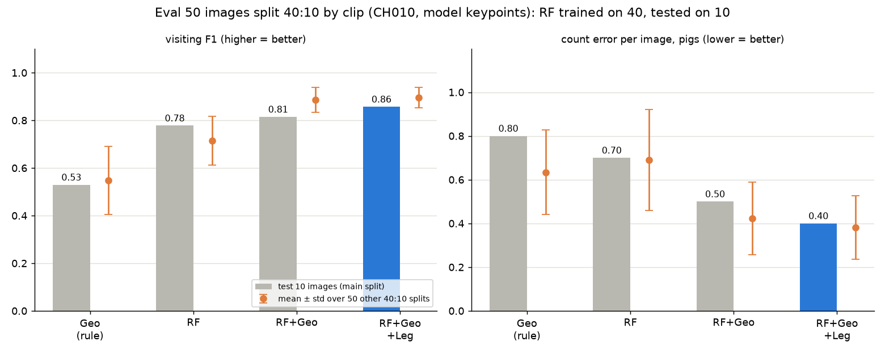

**그래프 읽는 법**: 막대 = 시험 10장(위 첫 번째 표), 주황 점과 선 = 다른 40:10 조합 50개의 평균 ± 표준편차.
왼쪽 F1은 높을수록, 오른쪽 사진당 마릿수 오차는 낮을수록 좋음. 파란 막대 = 시험 10장에서 1등.

**결론**
- **RF+Geo+Leg가 시험 10장과 50개 조합 평균 모두에서 1등**(F1 0.857 / 평균 0.896, 오차 0.40 / 평균 0.38마리).
  표준편차도 가장 작아 어떤 클립으로 나눠도 안정적.
- RF+Geo와 RF+Geo+Leg의 차이는 작음(F1 평균 0.885 vs 0.896). 같은 카메라(CH010) 40장으로 학습하면 RF+Geo도 누운 돼지를 어느 정도
  배우기 때문으로 보임. 11/08 결과(다른 카메라 포함 226장 학습)에서 차이가 더 컸던 것과 비교할 만함.
- Geo 규칙은 10장 기준 F1 0.53으로 가장 낮음 — visiting 16마리 중 7마리를 놓치고, visiting이 아닌 돼지 9마리를 visiting으로 셈.
- 이번 결과는 **CH010 같은 날·같은 카메라 안에서만** 학습·시험한 것이고, 시험이 10장(99마리)이라 표본이 작음
  → 50개 조합 평균을 함께 보는 것이 더 믿을 만함.

상세: `counting/outputs/eval_split50/summary.md`, `split_main_metrics.csv`(시험 10장), `split_repeats.csv`(조합별), `split_main_test_images.csv`(시험 사진 목록)

---

## 11/10~11 — pose 모델 large 학습

- **시작**: 11/10 23:46 (epoch당 약 17초, 백그라운드 실행)
- **방법**: n/s/m과 같은 데이터·분할(287장 → train 230 / valid 29 / test 28, seed 42)로 `train.py --sizes l --epochs 100`.
  로컬 `data/raw/img`, `data/processed`가 비어 있어 `ingest_raw_zips.py` → `split_dataset.py --seed 42`로 다시 만든 뒤 학습(같은 230/29/28).
- **결과**: (학습 중 — 끝나면 기록)

---

## 11/11 (수) — 미팅 (11/09 월에서 연기)

- [ ] 발표 순서(안): pose 모델 결과 → Geo 조건별 비교(60° 확정) → 4가지 방법 비교(Stage 1·2) → 90장 vs 226장, strict
  → 평가 50장 40:10 (같은 카메라 학습) → 주간 3시간 방법별 그래프 → 장면 확인 → pose large 결과
- 핵심 메시지: **RF+Geo+Leg** — Stage 1 F1 0.986, Stage 2 F1 0.89~0.90, 사진당 오차 0.22~0.26마리.
  같은 클립을 빼도(strict) 그대로 → 누수 영향 없음. 다리 특징이 "사료통 옆에서 자는 돼지" 과대 집계를 막음.
- 한계점으로 적을 것:
  - 평가 50장 규모, 평가 사진에 "사료통 옆에서 자는" 장면이 적어 영상 결과와 차이
  - 주간 그래프는 CH010 하루 KST 10:26~13:32 (약 3시간)만, 사람 정답 없음
  - Stage 1 라벨 226장(실제 사용 219장, 클립 16개). SAMPLE은 클립이 1개라 교차검증에서 한 묶음에만 들어감
  - 라벨 일치도는 검토 방식(20장 100%), 독립 이중 라벨링 kappa는 아님
  - confidence 기반 누움 조건은 CH010에서 동작 안 함 → Leg 특징으로 대체
