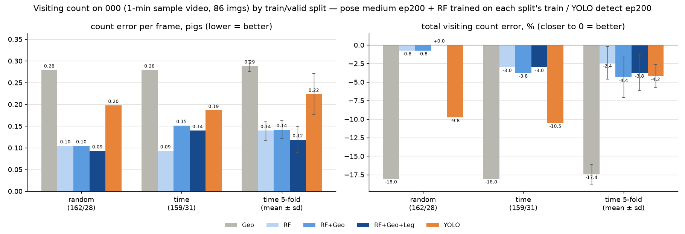

# 결과 — visiting 판정 5가지 방법 비교 (동일 조건)

돈방 CCTV 사진에서 사료통을 차지한(visiting) 돼지 수를 세는 방법 5가지를 **같은 train 사진, 같은 test(000)**로 비교한 결과.
진행 과정 전체 기록은 [PROGRESS.md](PROGRESS.md).

---

## 1. 데이터

| task | 카메라 | 사진 | 돼지 (visiting / other) | 용도 |
|---|---|---|---|---|
| 001 | CH005 (1920×1080) | 90 | 899 (136 / 763) | train / valid |
| 002 | CH010 (1920×1080) | 100 | 990 (179 / 811) | train / valid |
| 000 | 1분 샘플 영상 (960×720) | 86 | 860 (133 / 727) | **test** (학습·선택에 전혀 안 씀) |

- 모든 돼지에 사람이 CVAT로 관절 18개 스켈레톤과 State(visiting / other)를 라벨링함.
- test(000)는 학습 카메라(CH005·CH010)와 다른 카메라·해상도임 → 처음 보는 화면에서의 성능.
- 000은 사진당 visiting 0\~2마리(평균 1.55).

## 2. 분할 (train / valid / test)

test는 세 분할 모두 **000 86장으로 고정**. 001+002 190장만 train / valid로 나눔.
분할 목록은 YOLO 실험(`yolo_det/scripts/prepare_data.py`)과 같은 함수로 만들어(`training/scripts/make_study_splits.py`), 포즈 모델·RF·YOLO가 **한 장까지 같은 train 사진**으로 학습함.

| 분할 | 나누는 방법 | train : valid (장) | 비율 |
|---|---|---|---|
| 랜덤 | 001+002를 seed 42로 섞어 15%를 valid | 162 : 28 | 85 : 15 |
| 시간대 | 001·002 각각 마지막 클립을 통째로 valid | 159 : 31 | 84 : 16 |
| 시간대 5-fold | 001·002 각각 시간순 5구간, fold마다 한 구간이 valid (5번 학습) | 148\~155 : 34\~42 | 78\~82 : 18\~22 |

- 랜덤 분할은 같은 클립의 비슷한 사진이 train과 valid에 갈림. 시간대 분할은 이를 막으려고 클립 단위로 뗌.
- **5-fold 평균을 최종 비교 기준으로 씀**: 모델 5개의 평균이라 train 사진에 따른 흔들림이 반영됨.

각 모델이 사진을 쓰는 방식:

| 모델 | train | valid | test (000) |
|---|---|---|---|
| 포즈 모델 (Geo · RF 계열이 사용) | 학습 | best.pt(가장 좋은 epoch) 선택 | 채점 |
| RF 계열 | 학습 | **쓰지 않음** (고를 하이퍼파라미터가 없음) | 채점 |
| YOLO | 학습 | best.pt 선택 + conf 임계값 선택 | 채점 |

## 3. 진행 방법

### 3-1. 포즈 모델 (YOLOv8-pose)

Geo와 RF 계열은 돼지마다 찍힌 관절 좌표로 판정하므로 포즈 모델이 먼저 필요함. **분할마다 따로 학습**함(랜덤 1개, 시간대 1개, 5-fold 5개, 모두 7개).

| 항목 | 값 |
|---|---|
| 모델 | YOLOv8m-pose (medium), 관절 18개 |
| 시작 가중치 | COCO 사전학습 `yolov8m-pose.pt` |
| epoch | 200, 조기 종료 끔 (`--patience 0`) |
| 입력 크기 / batch | 640 / 8 |
| 옵티마이저 | `auto` → AdamW (lr 0.002) |
| best.pt | valid pose mAP50-95가 가장 높은 epoch |
| 추론 | 검출 conf 0.4, imgsz 640 |

- **medium · epoch 200을 고른 이유**: 랜덤 분할에서 nano / small / medium / large × epoch 100 / 200 / 300을 비교함. medium ep200이 test PCK@0.1(0.710)·PCK@0.2(0.870)·box mAP50-95(0.672)에서 가장 좋았음. epoch 300은 valid만 오르고 000에서는 이득이 없었음. 비교표는 [PROGRESS.md](PROGRESS.md) 2장.

분할별 포즈 모델 성능 (test = 000):

| 분할 | train : valid | pose mAP50-95 | PCK@0.1 | PCK@0.2 | box mAP50-95 |
|---|---|---|---|---|---|
| 랜덤 | 162 : 28 | 0.100 | 0.710 | 0.870 | 0.672 |
| 시간대 | 159 : 31 | 0.079 | 0.652 | 0.839 | 0.657 |
| 5-fold 평균 (f0\~f4) | 148\~155 : 34\~42 | 0.108 | 0.696 | 0.859 | 0.641 |

- PCK@0.1 / 0.2 = 찍은 관절이 정답에서 돼지 박스 긴 변의 10% / 20% 안에 들어온 비율.
- 관절별로는 목·몸통이 가장 정확하고(PCK@0.2 0.95 이상), 코 0.87, 발이 가장 부정확함(앞발 PCK@0.1 약 0.27, 랜덤 분할 모델 기준).

### 3-2. 판정 방법 5가지

| 방법 | 입력 | 판정 | 학습 |
|---|---|---|---|
| **Geo** | 포즈 관절 + 사료통 원 | 규칙: ① 코·목 관절 신뢰도 ≥ 0.5 ② 코가 사료통 원 안 ③ 목→코 벡터와 코→사료통 중심 벡터 사이 각도 ≤ 60° | 없음 |
| **RF** | 포즈 관절 + 사료통 구역 | 자세 특징 6개 → RandomForest | train 사진 |
| **RF+Geo** | 〃 | RF 특징 6개 + Geo 값 5개 → RandomForest | train 사진 |
| **RF+Geo+Leg** | 〃 | RF+Geo 특징 11개 + 다리 특징 5개 → RandomForest | train 사진 |
| **YOLO** | 사진만 | YOLOv8m detect가 돼지를 visiting / other 클래스로 바로 검출 | train 사진 (수아, `yolo_det/`) |

- **RF 특징 6개**: 코가 사료통 구역 안인지, 코-구역 거리(박스 대각선으로 나눔), 머리 숙임 각도, 척추 기울기, 목 상대 높이, 주요 관절 신뢰도.
- **Geo 값 5개**: 코-사료통 중심 거리 ÷ 반지름 r, 머리 방향 각도(Geo 규칙 ③의 각도), confidence 기반 누움 신호 3개.
- **Leg 특징 5개**: 다리-척추 각도, 다리 길이 ÷ 몸통 길이, 발-척추 거리 ÷ 몸통 길이, 네 발이 한쪽에 몰린 정도, 목-몸통-꼬리 각도.
- **RandomForest**: 나무 100개, `class_weight="balanced"`, seed 42, 판정 기준 확률 0.5. 하이퍼파라미터 튜닝은 하지 않음.
  - train 사진의 **사람이 찍은 관절과 라벨**로 학습함. 000에서는 포즈 모델이 찍은 관절에 적용함.
- **YOLO**: YOLOv8m detect, COCO 사전학습 `yolov8m.pt`, epoch 200, 조기 종료 끔, imgsz 640, batch 8, seed 42, NMS class-agnostic(IoU 0.7). 사진당 마릿수 = conf ≥ 임계값인 visiting 박스 수.
  - conf 임계값은 valid에서 사진당 MAE가 가장 작은 값: 랜덤 0.55, 시간대 0.85, 5-fold f0\~f4 0.65 / 0.50 / 0.35 / 0.25 / 0.70.
- 사료통 원(cx, cy, r)은 카메라마다 따로 지정함(`counting/configs/eval_cameras.yaml`). 000은 (453.4, 354.3, 169.2).

### 3-3. 평가 (`counting/scripts/evaluate_methods.py`, `count_metrics()`)

- **정답**: 000의 사람 라벨. 연구의 최종 출력이 "사진마다 visiting 몇 마리"라서 **마릿수**로 채점함.
- Geo · RF 계열: 포즈 모델이 찾은 돼지 전체를 판정해서 셈. 포즈 모델이 못 찾은 돼지는 visiting이 아닌 것으로 처리함(실제 운용과 같음).
- YOLO: 같은 000 사진, 같은 `count_metrics()`로 채점함.

| 지표 | 뜻 |
|---|---|
| **사진당 MAE** | 사진마다 \|모델 마릿수 − 사람 마릿수\|의 평균. 기본 지표. 86장이라 **0.012 ≈ 사진 1장이 1마리 틀림** |
| bias | 모델 − 사람의 평균. + 면 많이 셈, − 면 적게 셈 |
| 정확 일치 | 마릿수가 정확히 맞은 사진 비율 |
| 1분 총 점유량 오차 | 86장 visiting 합의 차이 ÷ 사람 합 |
| 10초 구간 오차 | 1분을 6구간으로 나눠 구간별 평균 마릿수의 차이(MAE) |

- 오차 원인은 개체 단위로 셈: 모델 돼지와 사람 돼지를 관절 거리로 짝지음(헝가리안, 기준 0.25). YOLO는 박스 IoU ≥ 0.5로 짝지음(헝가리안).

```powershell
cd training; python scripts\make_study_splits.py                                   # 분할 목록
powershell -ExecutionPolicy Bypass -File scripts\run_split_study.ps1              # 포즈 모델 (시간대, 5-fold)
cd ..\counting; powershell -ExecutionPolicy Bypass -File scripts\run_split_eval.ps1  # Geo·RF 계열 평가 + YOLO와 합쳐 비교
```

YOLO 학습·평가 명령은 [yolo_det/README.md](yolo_det/README.md).

---

## 4. 결과 (test = 000, 86장, 사람 visiting 133마리)

### 4-1. 사진당 마릿수

5-fold는 fold 5개의 평균 ± 표준편차.

| 분할 | 방법 | 사진당 MAE | bias | 정확 일치 | 1분 총 점유량 오차 | 10초 구간 오차 |
|---|---|---|---|---|---|---|
| **시간대 5-fold** | Geo | 0.288 ± 0.013 | −0.270 | 72.3 ± 1.3% | −17.4 ± 1.3% | 0.220 ± 0.018 |
| | RF | 0.140 ± 0.022 | −0.037 | 86.0 ± 2.2% | −2.4 ± 2.2% | 0.084 ± 0.027 |
| | RF+Geo | 0.142 ± 0.021 | −0.067 | 85.8 ± 2.1% | −4.4 ± 2.7% | 0.087 ± 0.014 |
| | **RF+Geo+Leg** | **0.119 ± 0.030** | −0.058 | **88.1 ± 3.0%** | −3.8 ± 2.4% | **0.081 ± 0.014** |
| | YOLO | 0.223 ± 0.048 | −0.065 | 77.9 ± 4.4% | −4.2 ± 1.6% | 0.111 ± 0.042 |
| 랜덤 | Geo | 0.279 | −0.279 | 73.3% | −18.0% | 0.234 |
| | RF | 0.105 | −0.012 | 89.5% | −0.8% | 0.062 |
| | RF+Geo | 0.105 | −0.012 | 89.5% | −0.8% | 0.062 |
| | **RF+Geo+Leg** | **0.093** | **0.000** | **90.7%** | **0.0%** | 0.069 |
| | YOLO | 0.198 | −0.151 | 80.2% | −9.8% | 0.150 |
| 시간대 | Geo | 0.279 | −0.279 | 73.3% | −18.0% | 0.217 |
| | **RF** | **0.093** | −0.047 | **90.7%** | −3.0% | 0.069 |
| | RF+Geo | 0.151 | −0.058 | 84.9% | −3.8% | 0.075 |
| | RF+Geo+Leg | 0.140 | −0.047 | 86.0% | −3.0% | 0.069 |
| | YOLO | 0.186 | −0.163 | 81.4% | −10.5% | 0.130 |



5-fold의 fold별 사진당 MAE:

| fold | Geo | RF | RF+Geo | RF+Geo+Leg | YOLO |
|---|---|---|---|---|---|
| f0 | 0.302 | 0.174 | 0.174 | 0.163 | **0.151** |
| f1 | 0.302 | 0.140 | 0.128 | **0.116** | 0.279 |
| f2 | 0.279 | 0.140 | 0.128 | **0.105** | 0.233 |
| f3 | 0.279 | 0.128 | 0.151 | **0.081** | 0.244 |
| f4 | 0.279 | **0.116** | 0.128 | 0.128 | 0.209 |

### 4-2. 오차 원인 (개체 단위, 5-fold는 평균 마릿수)

| 분할 | 방법 | 못 찾은 visiting | 찾았지만 other로 판정 | other를 visiting으로 | 라벨 없는 검출을 visiting으로 |
|---|---|---|---|---|---|
| 시간대 5-fold | Geo | 6.4 | 19.2 | 1.0 | 1.4 |
| | RF | 6.4 | 3.2 | 4.0 | 2.4 |
| | RF+Geo | 6.4 | 4.0 | 3.0 | 1.6 |
| | RF+Geo+Leg | 6.4 | 3.0 | 2.4 | 2.0 |
| | YOLO | 5.4 | 10.8 | 8.4 | 2.2 |
| 랜덤 | Geo | 9 | 18 | 0 | 3 |
| | RF | 9 | 1 | 4 | 5 |
| | RF+Geo | 9 | 0 | 4 | 4 |
| | RF+Geo+Leg | 9 | 0 | 4 | 5 |
| | YOLO | 8 | 11 | 2 | 4 |
| 시간대 | Geo | 4 | 21 | 0 | 1 |
| | RF | 4 | 4 | 3 | 1 |
| | RF+Geo | 4 | 6 | 4 | 1 |
| | RF+Geo+Leg | 4 | 5 | 4 | 1 |
| | YOLO | 14 | 3 | 2 | 1 |

- "못 찾은 visiting"은 Geo · RF 계열이 같은 포즈 모델을 쓰므로 4개 방법이 같은 값임. YOLO는 자기 검출기라 값이 다름.

### 4-3. 방법을 바꿨을 때 MAE 변화

"A → B"는 A 대신 B를 썼을 때를 뜻함. 칸 값은 B의 MAE − A의 MAE. − 면 좋아짐. fold별은 5-fold의 fold 5개 중 B가 좋아짐 / 같음 / 나빠짐인 횟수.

| 비교 | 랜덤 | 시간대 | 5-fold 평균 | fold별 |
|---|---|---|---|---|
| Geo → RF | −0.174 | −0.186 | −0.148 | 5 / 0 / 0 |
| RF → RF+Geo | 0.000 | +0.058 | +0.002 | 2 / 1 / 2 |
| RF+Geo → RF+Geo+Leg | −0.012 | −0.011 | −0.023 | 4 / 1 / 0 |
| YOLO → RF+Geo+Leg | −0.105 | −0.046 | −0.104 | 4 / 0 / 1 |

---

## 5. 결론

- **오차 순서는 모든 분할에서 RF 계열 < YOLO < Geo.** 5-fold 평균 사진당 MAE는 RF+Geo+Leg 0.119, RF 0.140, RF+Geo 0.142, YOLO 0.223, Geo 0.288.
- **RF+Geo+Leg가 가장 좋고 안정적임.** 5-fold 평균 1위, 랜덤 1위, 시간대 2위. RF+Geo에 Leg를 더하면 나빠진 fold가 없음(4 / 1 / 0).
  - 다만 RF / RF+Geo와의 차이는 사진 1\~3장 수준(MAE 0.01\~0.03)임. 5-fold 표준편차(±0.02\~0.03)와 비슷해서 분할 하나만 보면 순위가 바뀜(시간대 분할에서는 RF가 1위).
- **YOLO는 돼지를 찾는 능력은 비슷하지만 visiting / other 구분에서 많이 틀림.** 5-fold에서 판정 오류(찾았지만 other로 10.8 + other를 visiting으로 8.4)가 RF+Geo+Leg(3.0 + 2.4)의 약 3.5배임. 사료통 위치를 쓰지 않고 사진만 보고 판정하기 때문으로 보임. train 사진에 따른 흔들림도 가장 큼(±0.048).
- **Geo(60° 규칙)는 항상 약 18% 적게 셈.** 찾은 visiting 중 18\~21마리를 방향 조건에서 탈락시킴. 학습이 없어서 분할과 상관없이 결과가 거의 같음.
- **Geo · RF 계열에 남은 오차의 상당 부분은 포즈 모델 단계에서 생김**(못 찾은 visiting 4\~9마리, 라벨 없는 검출). 판정보다 검출을 개선하는 것이 다음 과제임.
- **한계**: test가 1분 영상 하나(000, 86장)라 장면이 다양하지 않음. 학습 사진도 190장이라 train이 조금만 바뀌어도 결과가 흔들림.

결과 파일: `counting/reports/split_comparison/` (`split_comparison.csv` / `.md` / `.png`, `split_folds.csv`, `pose_by_split.csv`), YOLO는 `yolo_det/reports/ep200*/m/summary.json`.
