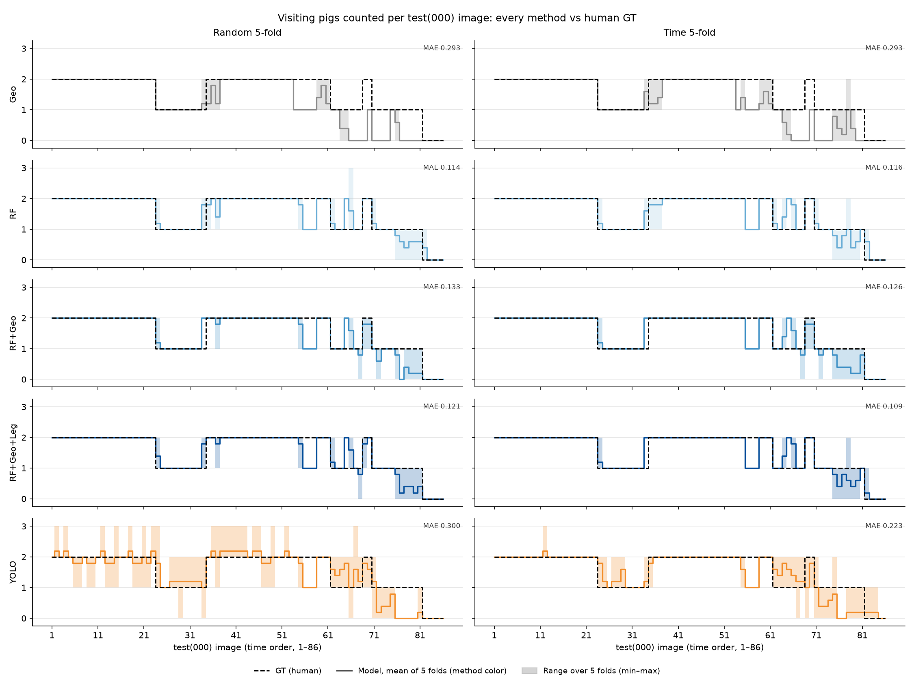
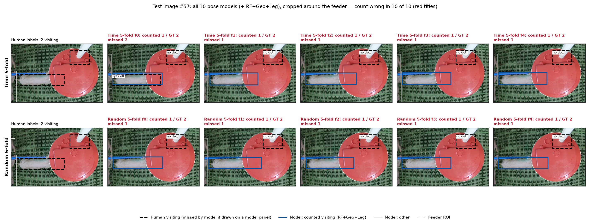

# 결과 — visiting 판정 5가지 방법 비교 (Random 5-fold · Time 5-fold, 동일 조건)

돈방 CCTV 사진에서 사료통을 차지한(visiting) 돼지 수를 세는 방법 5가지(Geo / RF / RF+Geo / RF+Geo+Leg / YOLO)를 **같은 train 사진, 같은 선택 기준, 같은 test(000)**로 비교한 결과.
11/16 랩미팅 통일 기준으로 **Random 5-fold와 Time 5-fold**를 모두 학습 · 평가함(Geo · RF 계열 = 포즈 추정 + 판정 파이프라인 `training/` · `counting/`, YOLO = 사진에서 바로 검출하는 `yolo_det/`).
모든 결과는 **Random 5-fold · Time 5-fold의 fold 5개 평균 ± 표본 표준편차**임(fold별 표는 fold 단위 값). 진행 과정과 통일 기준 전 실험 기록은 [PROGRESS.md](PROGRESS.md).

---

## 1. 데이터

| task | 카메라 | 사진 | 돼지 (visiting / other) | 용도 |
|---|---|---|---|---|
| 001 | CH005 (1920×1080) | 90 | 899 (136 / 763) | train / valid |
| 002 | CH010 (1920×1080) | 100 | 990 (179 / 811) | train / valid |
| 000 | 1분 샘플 영상 (960×720) | 86 | 860 (133 / 727) | **test** (학습·선택에 전혀 안 씀) |

- 모든 돼지에 사람이 CVAT로 관절 18개 스켈레톤과 State(visiting / other)를 라벨링함.
- test(000)는 학습 카메라(CH005·CH010)와 다른 카메라·해상도임 → 처음 보는 화면에서의 성능.
- 000은 사진당 visiting 0\~2마리(평균 1.55).

## 2. 분할 — Random 5-fold · Time 5-fold

test는 모든 fold에서 **000 86장으로 고정**. 001+002 190장만 train / valid로 나눔.
분할 목록은 YOLO(`yolo_det/scripts/prepare_data.py --split kfold|rkfold`)와 포즈 · RF(`training/scripts/make_study_splits.py`)가 **같은 함수**로 만들어, 세 모델이 **한 장까지 같은 train 사진**으로 학습함(목록 해시 10개 일치).

| 분할 | 나누는 방법 |
|---|---|
| **Time 5-fold** `k5_f0~f4` | 001 · 002를 각각 촬영 시각순으로 정렬해 5개 연속 구간으로 나누고, fold i는 i번째 구간이 valid. 경계가 클립 중간이면 가까운 클립 경계로 옮기고, 그래도 클립 중간이면 valid 바로 옆 같은 클립 사진 1장을 train에서 뺌(거의 같은 장면이 train으로 새지 않게) |
| **Random 5-fold** `rk5_f0~f4` | 001 · 002를 각각 이름순 정렬 후 `random.Random(42)`로 섞음. fold i의 valid 장수 = Time 5-fold fold i의 valid 장수(task별), 섞인 순서에서 연속으로 자름 → 190장이 정확히 한 번씩 valid. train 장수도 Time 5-fold와 같게(Time 5-fold에서 뺀 장수만큼 valid 바로 뒤 사진을 뺌) |

| fold | train (001 / 002) | valid (001 / 002) |
|---|---|---|
| f0 | 148 (68 / 80) | 42 (22 / 20) |
| f1 | 155 (75 / 80) | 34 (14 / 20) |
| f2 | 151 (70 / 81) | 37 (18 / 19) |
| f3 | 151 (73 / 78) | 37 (16 / 21) |
| f4 | 149 (70 / 79) | 40 (20 / 20) |

- 두 분할은 장수 · 학습 설정 · 평가가 모두 같고 **valid를 고르는 방식만 다름**. Time 5-fold는 학습 때 못 본 시간대가 valid가 되고, Random 5-fold는 같은 클립의 비슷한 프레임이 train과 valid에 갈림.
- 결과는 fold 5개의 **평균 ± 표본 표준편차**. fold별 valid 시각 범위는 [fold_study.md 4장](counting/reports/fold_study/fold_study.md).

각 모델이 사진을 쓰는 방식:

| 모델 | train | valid | test (000) |
|---|---|---|---|
| 포즈 모델 (Geo · RF 계열이 사용) | 학습 | best.pt 선택 (val pose mAP50-95 최고) | 채점 |
| RF 계열 | 학습 | RF 하나를 학습할 때는 쓰지 않음. RF 3종 중 **RF best**(5-fold 평균 val MAE 최소)를 고를 때만 사용 | 채점 |
| YOLO | 학습 | best.pt 선택 + conf 임계값 선택 (val MAE 최소) | 채점 |

## 3. 진행 방법

### 3-1. 포즈 모델 (YOLOv8-pose)

Geo와 RF 계열은 돼지마다 찍힌 관절 좌표로 판정하므로 포즈 모델이 먼저 필요함. **fold마다 따로 학습**함(Time 5-fold 5개 `ep200_k5_f*` + Random 5-fold 5개 `ep200_rk5_f*`, 11/18).

| 항목 | 값 |
|---|---|
| 모델 | YOLOv8m-pose (medium), 관절 18개 |
| 시작 가중치 | COCO 사전학습 `yolov8m-pose.pt` (매번 처음부터) |
| epoch | 200, 조기 종료 끔 (`--patience 0`) |
| 입력 크기 / batch / seed | 640 / 8 / 42 |
| 옵티마이저 | `auto` → AdamW (lr 0.002) |
| best.pt | **valid pose mAP50-95 최고** epoch (Ultralytics 기본인 pose + box 합 대신). 10개 모두 `best.pt` 안의 지표 = `results.csv`의 pose mAP50-95 최댓값 epoch로 확인 |
| 추론 | 검출 conf 0.4, NMS IoU 0.5, imgsz 640 (세 카메라 설정 동일) |

- 모델 크기(medium) · epoch(200)는 연구 전 사이즈 · epoch 비교 실험에서 정함([PROGRESS.md](PROGRESS.md) 2장). 이 문서의 결과에는 쓰지 않음.

포즈 모델 성능 (fold 5개 평균 ± 표본 표준편차):

| 분할 | val pose mAP50-95 | val PCK@0.1 | test pose mAP50-95 | test PCK@0.1 | test PCK@0.2 | test box mAP50-95 |
|---|---|---|---|---|---|---|
| Random 5-fold | 0.287 ± 0.024 | 0.784 ± 0.018 | 0.111 ± 0.021 | 0.691 ± 0.029 | 0.865 ± 0.009 | 0.652 ± 0.023 |
| Time 5-fold | 0.167 ± 0.020 | 0.695 ± 0.025 | 0.087 ± 0.010 | 0.692 ± 0.024 | 0.865 ± 0.011 | 0.646 ± 0.023 |

- PCK@0.1 / 0.2 = 찍은 관절이 정답에서 정답 박스 긴 변(max(w, h))의 10% / 20% 안에 들어온 비율 (`training/scripts/utils/pck.py`). 학습 평가 스크립트 기준이라 검출 conf 0.25, 사람 박스와 IoU ≥ 0.5로 짝지은 돼지만 계산함(카운팅에 쓰는 conf 0.4와 다름).
- 관절별(test PCK@0.1): 꼬리 · 엉덩이 · 옆구리 · 어깨 · 목 · 귀 0.72\~0.94, 코 0.70\~0.71, 발 · 앞발 · 귀 끝 0.26\~0.69. 표는 [fold_study.md 7장](counting/reports/fold_study/fold_study.md).
- val은 Time 5-fold가 크게 낮지만(0.287 → 0.167) test PCK는 같음 → 못 본 시간대(valid)보다 못 본 카메라(000)에서의 성능은 분할 방식과 무관함.


### 3-2. 판정 방법 5가지

| 방법 | 입력 | 판정 | 학습 |
|---|---|---|---|
| **Geo** | 포즈 관절 + 사료통 원 | 규칙: ① 코·목 관절 신뢰도 ≥ 0.5 ② 코가 사료통 원 안 ③ 목→코 벡터와 코→사료통 중심 벡터 사이 각도 ≤ 60° | 없음 |
| **RF** | 포즈 관절 + 사료통 구역 | 자세 특징 6개 → RandomForest | train 사진 |
| **RF+Geo** | 〃 | RF 특징 6개 + Geo 값 5개 → RandomForest | train 사진 |
| **RF+Geo+Leg** | 〃 | RF+Geo 특징 11개 + 다리 특징 5개 → RandomForest | train 사진 |
| **YOLO** | 사진만 | YOLOv8m detect가 돼지를 visiting / other 클래스로 바로 검출 | train 사진 (`yolo_det/`) |

- **RF 특징 6개**: 코가 사료통 구역 안인지, 코-구역 거리(박스 대각선으로 나눔), 머리 숙임 각도, 척추 기울기, 목 상대 높이, 주요 관절 신뢰도.
- **Geo 값 5개**: 코-사료통 중심 거리 ÷ 반지름 r, 머리 방향 각도(Geo 규칙 ③의 각도), confidence 기반 누움 신호 3개.
- **Leg 특징 5개**: 다리-척추 각도, 다리 길이 ÷ 몸통 길이, 발-척추 거리 ÷ 몸통 길이, 네 발이 한쪽에 몰린 정도, 목-몸통-꼬리 각도.
- **RandomForest**: 나무 100개, `class_weight="balanced"`, seed 42, 판정 기준 확률 0.5. 하이퍼파라미터 튜닝은 하지 않음.
  - 그 fold train 사진의 **사람이 찍은 관절과 라벨**로 학습하고, val · test에서는 포즈 모델이 찍은 관절에 적용함.
- **YOLO**: YOLOv8m detect, COCO 사전학습 `yolov8m.pt`, epoch 200, 조기 종료 끔, imgsz 640, batch 8, seed 42, NMS class-agnostic(IoU 0.7). 사진당 마릿수 = conf ≥ 임계값인 visiting 박스 수. best.pt = val box mAP50-95 최고.
  - conf 임계값 = 그 fold valid에서 사진당 MAE가 가장 작은 값: Time 5-fold f0\~f4 0.65 / 0.50 / 0.35 / 0.25 / 0.70, Random 5-fold f0\~f4 0.25 / 0.45 / 0.50 / 0.55 / 0.65.
- 사료통 원(cx, cy, r)은 카메라마다 따로 지정함(`counting/configs/eval_cameras.yaml`). 000은 (453.4, 354.3, 169.2).

### 3-3. 평가 (`counting/scripts/evaluate_methods.py`, `count_metrics()`)

- **정답**: 사람 라벨. 연구의 최종 출력이 "사진마다 visiting 몇 마리"라서 **마릿수**로 채점함.
- **val** = 그 fold의 valid 사진(001+002), **test** = 000 86장.
- Geo · RF 계열: 포즈 모델이 찾은 돼지 전체를 판정해서 셈. 포즈 모델이 못 찾은 돼지는 visiting이 아닌 것으로 처리함(실제 운용과 같음).
- YOLO: 같은 사진, 같은 `count_metrics()`(YOLO `evaluate.py`가 import)로 채점함.

| 지표 | 뜻 |
|---|---|
| **사진당 MAE** | 사진마다 \|모델 마릿수 − 사람 마릿수\|의 평균. 기본 지표. test 86장이라 **0.012 ≈ 사진 1장이 1마리 틀림** |
| RMSE | 사진당 오차 제곱 평균의 제곱근 (크게 틀린 사진에 민감) |
| bias | 모델 − 사람의 평균. + 면 많이 셈, − 면 적게 셈 |
| 정확 일치 / ±1 이내 | 마릿수가 정확히 맞은 / 1마리 이내인 사진 비율 |
| 1분 총 점유량 오차 | 86장 visiting 합의 차이 ÷ 사람 합 |
| 10초 구간 오차 | 1분을 프레임 번호로 6구간으로 나눠 구간별 평균 마릿수의 차이(MAE) |

- 오차 원인은 개체 단위로 셈: Geo · RF 계열은 사람 관절과의 평균 거리 ÷ 사람 박스 대각선 ≤ 0.25, YOLO는 박스 IoU ≥ 0.5로 짝지음(둘 다 헝가리안).

### 3-4. 같은 조건 확인

| 항목 | YOLO (`yolo_det/`) | 포즈 모델 → Geo · RF 계열 (`training/` · `counting/`) | 확인 방법 |
|---|---|---|---|
| 분할 목록 | `prepare_data.py --split kfold\|rkfold` | `make_study_splits.py` (같은 함수 import) | 정렬된 `<task>__<사진>` 목록의 SHA-256 앞 12자리, 10개 fold 모두 일치 |
| test 정답 | 000 86장 | 000 86장 | YOLO 쪽 000 사진별 csv의 gt가 Geo · RF 쪽 라벨과 86장 모두 일치 |
| 모델 크기 · 시작 | YOLOv8m detect, COCO `yolov8m.pt` | YOLOv8m-pose, COCO `yolov8m-pose.pt` | 같은 크기, 둘 다 COCO에서 처음부터 |
| epoch / 조기 종료 | 200 / 끔 | 200 / 끔 | YOLO: 10개 모델 `summary.json`의 `env_train`(epochs 200, patience 0, imgsz 640, batch 8, seed 42, COCO `yolov8m.pt`) 직접 확인. 포즈: 10개 모델의 `args.yaml` 직접 확인 |
| imgsz / batch / seed / optimizer | 640 / 8 / 42 / auto | 640 / 8 / 42 / auto | 〃 |
| train 사진 | 그 fold train 목록 | 포즈 · RF 모두 그 fold train 목록 | 포즈 학습 개체 수(1470, 1541, …)가 RF 학습 개체 수와 10개 fold 모두 같음 |
| val로만 고르는 것 | best.pt, conf 임계값 | best.pt, RF best | test는 선택에 미사용 |
| 지표 | `count_metrics()` | `count_metrics()` | YOLO `evaluate.py`가 같은 함수를 import |
| 라이브러리 | torch 2.11.0+cu128, ultralytics 8.4.108 | 같음 | |

**방법이 달라서 생기는 차이 (맞출 대상이 아님)**

| 항목 | YOLO | Geo · RF 계열 |
|---|---|---|
| 판정에 쓰는 정보 | 사진만 | 포즈 관절 18개 + 카메라별 사료통 좌표 |
| 학습 라벨 | 스켈레톤 점의 최소 · 최대 좌표로 만든 박스 + visiting / other | 관절 18개 (포즈), visiting / other (RF). 같은 CVAT 라벨에서 만듦 |
| 판정기 학습 입력 | 사진 (학습 · test 같음) | RF는 사람이 찍은 관절로 학습, val · test에서는 포즈 모델이 찍은 관절에 적용 |
| 임계값 | conf를 val에서 고름 | 포즈 검출 conf 0.4, RF 기준 확률 0.5 고정 |
| NMS | class-agnostic, IoU 0.7 (Ultralytics 기본) | IoU 0.5 (카메라 설정 파일, 클래스 1개) |
| best.pt 기준 | box mAP50-95 최고 (Ultralytics detect 기본) | pose mAP50-95 최고 (box 제외하도록 바꿈) |

**실행 환경**: YOLO는 RTX 6000 Ada · Python 3.10.12, 포즈 · RF는 RTX 5060 8GB · Python 3.14. GPU가 달라 seed가 같아도 비트 단위로 같은 결과는 아님(결과 비교에는 영향 거의 없음).

- YOLO Time 5-fold `ep200_k5_f*`는 11/14\~15 학습 후 11/17 재평가, Random 5-fold `ep200_rk5_f*`는 11/17 학습 · 평가(git 커밋 c1df046, 미커밋 변경 없음). 값은 YOLO 결과 PR #4(11/19 main에 합침)의 `yolo_det/reports/ep200_<fold>/m/summary.json` · `test_frames.csv`. 이전에 쓰던 노션 값(`counting/reports/fold_study/inputs/`)과 반올림 범위(±0.0005) 안에서 모두 일치함.
- val 확인 완료: Random 5-fold f2 · f3 · f4와 Time 5-fold f2 · f3 · f4의 val MAE · RMSE가 같은 것은 우연임. val GT(73 / 44, 54 / 61, 56 / 51)와 YOLO가 센 마릿수가 서로 달라 각 fold의 valid 사진으로 제대로 평가됐고, GT는 Geo · RF 쪽 fold별 valid GT와 일치함.

```powershell
cd training; python scripts\make_study_splits.py --export-images ..\counting\data\raw\train_img   # 분할 목록 + valid 평가용 사진
powershell -ExecutionPolicy Bypass -File scripts\run_split_study.ps1 -Splits k5_f0,k5_f1,k5_f2,k5_f3,k5_f4,rk5_f0,rk5_f1,rk5_f2,rk5_f3,rk5_f4   # 포즈 10개
cd ..\counting; powershell -ExecutionPolicy Bypass -File scripts\run_split_eval.ps1 -Valid -Splits k5_f0,k5_f1,k5_f2,k5_f3,k5_f4,rk5_f0,rk5_f1,rk5_f2,rk5_f3,rk5_f4   # val + test → compare_folds.py
python scripts\paper_tables.py; python scripts\per_image_000.py; python scripts\error_cases.py   # 논문 표 · 사진별 · 오차 사례
```

YOLO 학습·평가 명령은 [yolo_det/README.md](yolo_det/README.md).

---

## 4. 결과

> 논문용 지표 전체(MAE · RMSE · ME · Acc · Acc±1 · TCE · 10초 구간 MAE · visiting Precision / Recall / F1, test MAE 95% bootstrap CI, Wilcoxon 짝비교, 오류 분해, 포즈 · YOLO 검출 지표)는 **[paper_metrics.md](counting/reports/fold_study/paper/paper_metrics.md)**, fold별 표 전체는 **[fold_study.md](counting/reports/fold_study/fold_study.md)**.

### 4-1. 사진당 마릿수 (val · test)

| 방법 | Random 5-fold val MAE | Random 5-fold test MAE | Random 5-fold test RMSE | Random 5-fold test 정확 일치 | Time 5-fold val MAE | Time 5-fold test MAE | Time 5-fold test RMSE | Time 5-fold test 정확 일치 |
|---|---|---|---|---|---|---|---|---|
| Geo | 0.566 ± 0.045 | 0.293 ± 0.028 | 0.562 ± 0.025 | 71.9 ± 2.8% | 0.575 ± 0.148 | 0.293 ± 0.022 | 0.562 ± 0.020 | 71.9 ± 2.2% |
| RF | 0.389 ± 0.136 | **0.114 ± 0.015** | **0.343 ± 0.032** | **88.8 ± 1.3%** | 0.632 ± 0.252 | 0.116 ± 0.032 | 0.338 ± 0.046 | 88.4 ± 3.2% |
| RF+Geo | 0.259 ± 0.139 | 0.133 ± 0.033 | 0.362 ± 0.047 | 86.7 ± 3.3% | 0.349 ± 0.122 | 0.126 ± 0.019 | 0.353 ± 0.028 | 87.4 ± 1.9% |
| **RF+Geo+Leg** (RF best) | **0.209 ± 0.133** | 0.121 ± 0.033 | 0.345 ± 0.051 | 87.9 ± 3.3% | **0.284 ± 0.104** | **0.109 ± 0.021** | **0.329 ± 0.032** | **89.1 ± 2.1%** |
| YOLO | 0.252 ± 0.128 | 0.300 ± 0.137 | 0.545 ± 0.125 | 70.5 ± 13.6% | 0.347 ± 0.166 | 0.223 ± 0.048 | 0.475 ± 0.059 | 77.9 ± 4.4% |

- RF best(RF 3종 중 5-fold 평균 val MAE 최소, test는 보지 않음) = 두 분할 모두 **RF+Geo+Leg**.
- val은 모든 방법이 조금씩 낙관적임: 포즈 best.pt(Geo · RF 계열)와 YOLO best.pt · conf를 같은 valid로 골랐음. test(000)는 어떤 선택에도 쓰지 않아 이 문제가 없음.
- 그 밖의 test 지표(bias, ±1 이내, 1분 총 점유량 오차, 10초 구간 오차)는 [fold_study.md 3장](counting/reports/fold_study/fold_study.md).


### 4-2. fold별 test MAE

| fold | Random 5-fold Geo | Random 5-fold RF | Random 5-fold RF+Geo | Random 5-fold RF+Geo+Leg | Random 5-fold YOLO | Time 5-fold Geo | Time 5-fold RF | Time 5-fold RF+Geo | Time 5-fold RF+Geo+Leg | Time 5-fold YOLO |
|---|---|---|---|---|---|---|---|---|---|---|
| f0 | 0.326 | **0.093** | 0.174 | 0.151 | 0.221 | 0.291 | 0.163 | **0.140** | **0.140** | 0.151 |
| f1 | 0.314 | **0.116** | 0.140 | 0.140 | 0.174 | 0.256 | **0.093** | **0.093** | 0.105 | 0.279 |
| f2 | 0.256 | **0.105** | **0.105** | **0.105** | 0.419 | 0.302 | **0.081** | 0.128 | **0.081** | 0.233 |
| f3 | 0.279 | 0.128 | 0.093 | **0.070** | 0.477 | 0.314 | 0.116 | 0.140 | **0.105** | 0.244 |
| f4 | 0.291 | **0.128** | 0.151 | 0.140 | 0.209 | 0.302 | 0.128 | 0.128 | **0.116** | 0.209 |

- 10개 fold 모두에서 RF+Geo · RF+Geo+Leg는 Geo · YOLO보다 좋고, RF 계열 3가지는 모두 Geo보다 좋음. 예외는 Time 5-fold f0의 RF 단독(0.163)으로 YOLO(0.151)보다 나쁨.

### 4-3. 실제로 센 마릿수 (fold당 평균 ± 표본 표준편차, GT = 사람)

괄호 = 총 마릿수 오차 (모델 − GT) / GT의 fold 평균 ± 표본 표준편차.

| 분할 · 세트 | GT | Geo | RF | RF+Geo | RF+Geo+Leg | YOLO |
|---|---|---|---|---|---|---|
| Random 5-fold · val | 63.0 ± 10.6 | 56.2 ± 12.7 (−11.3 ± 8.2%) | 71.4 ± 13.9 (+13.1 ± 8.3%) | 66.2 ± 14.0 (+4.5 ± 5.2%) | **63.4 ± 14.3 (−0.1 ± 7.0%)** | 59.4 ± 12.8 (−6.2 ± 5.7%) |
| Random 5-fold · test | 133 | 108.2 ± 2.2 (−18.6 ± 1.6%) | 130.0 ± 3.7 (−2.3 ± 2.8%) | 127.2 ± 2.8 (−4.4 ± 2.1%) | 128.6 ± 3.2 (−3.3 ± 2.4%) | 127.6 ± 18.1 (−4.1 ± 13.6%) |
| Time 5-fold · val | 63.0 ± 23.7 | 54.6 ± 19.8 (−13.2 ± 8.2%) | 80.0 ± 24.4 (+29.6 ± 18.5%) | 68.0 ± 20.6 (+9.8 ± 7.9%) | **64.4 ± 22.8 (+2.7 ± 4.3%)** | 60.6 ± 26.8 (−5.5 ± 10.3%) |
| Time 5-fold · test | 133 | 109.4 ± 1.8 (−17.7 ± 1.4%) | 131.4 ± 1.5 (−1.2 ± 1.1%) | 128.6 ± 2.1 (−3.3 ± 1.6%) | 131.2 ± 1.9 (−1.4 ± 1.4%) | 127.4 ± 2.1 (−4.2 ± 1.6%) |

- val GT는 fold마다 valid 사진이 달라 fold마다 다름(5-fold valid 합 = 190장의 visiting 315마리).
- YOLO Random 5-fold test는 평균으로는 −4.1%지만 fold마다 크게 흔들림: f2 101마리(−24.1%), f3 152마리(+14.3%).
- fold별 값은 [fold_study.md 6장](counting/reports/fold_study/fold_study.md), 그래프 C는 fold별 막대.


### 4-4. test 사진별 카운트

[per_image_000.md](counting/reports/fold_study/per_image/per_image_000.md) — 86장마다 사람 정답과 모델 50개(5방법 × 2분할 × 5 fold)가 센 마릿수 (`counting/scripts/per_image_000.py`).
- 모델별 csv · 그림: `counting/reports/fold_study/per_image/by_model/<geo|rf|rf_geo|rf_geo_leg|yolo>.csv` · `.png` (칸 숫자 = 센 마릿수, 칸 색 = 오차, 맨 위 = GT). 방법별 한 파일(열 = k5_f0\~f4, rk5_f0\~f4)은 `counting/reports/fold_study/per_frame_000/`.
- 5개 fold 모두 정답인 사진 (86장 중, Random 5-fold / Time 5-fold): Geo 57 / 56, RF 67 / 66, RF+Geo 67 / 67, RF+Geo+Leg 68 / 71, YOLO 23 / 51.
- 공통으로 틀리는 사진: 56\~58번(GT 2, 대부분 모델이 1로 셈), 34번 · 65번(GT 1, RF 계열이 2로 셈). Geo는 54\~61번 · 64\~74번에서 계속 덜 셈.





### 4-5. 오차 원인 (test, 개체 단위, fold당 평균 마릿수)

| 분할 | 방법 | 못 찾은 visiting | 찾았지만 other로 판정 | other를 visiting으로 | 라벨 없는 검출을 visiting으로 |
|---|---|---|---|---|---|
| Random 5-fold | Geo | 8.6 | 20.0 | 0.6 | 3.2 |
| | RF | 8.6 | 2.8 | 3.4 | 5.0 |
| | RF+Geo | 8.6 | 4.6 | 2.8 | 4.6 |
| | RF+Geo+Leg | 8.6 | 3.4 | 3.0 | 4.6 |
| | YOLO | 6.0 | 13.0 | 5.8 | 7.8 |
| Time 5-fold | Geo | 6.2 | 20.6 | 0.8 | 2.4 |
| | RF | 6.2 | 2.2 | 4.0 | 2.8 |
| | RF+Geo | 6.2 | 4.4 | 3.4 | 2.8 |
| | RF+Geo+Leg | 6.2 | 2.0 | 3.6 | 2.8 |
| | YOLO | 5.4 | 10.8 | 8.4 | 2.2 |

- "못 찾은 visiting"은 Geo · RF 계열이 같은 포즈 모델을 쓰므로 4개 방법이 같은 값임. YOLO는 자기 검출기라 값이 다름. YOLO Random 5-fold f3는 라벨 없는 검출을 visiting으로 26마리 세서(나머지 fold 2\~5) 152마리로 과대 집계됨.
- 표준편차 · visiting Precision / Recall / F1은 [paper_metrics.md](counting/reports/fold_study/paper/paper_metrics.md) Table 1 · 5.

### 4-6. 방법을 바꿨을 때 test MAE 변화

"A → B"는 A 대신 B를 썼을 때. 칸 값 = B의 5-fold 평균 MAE − A의 것(− 면 좋아짐). fold별 = fold 5개 중 B가 좋아짐 / 같음 / 나빠짐.

| 비교 | Random 5-fold | fold별 | Time 5-fold | fold별 | Wilcoxon p (사진 86장, Random 5-fold / Time 5-fold) |
|---|---|---|---|---|---|
| Geo → RF | −0.179 | 5 / 0 / 0 | −0.177 | 5 / 0 / 0 | – |
| RF → RF+Geo | +0.019 | 1 / 1 / 3 | +0.009 | 1 / 2 / 2 | – |
| RF+Geo → RF+Geo+Leg | −0.012 | 3 / 2 / 0 | −0.016 | 3 / 1 / 1 | 0.429 / 0.344 |
| Geo → RF+Geo+Leg | −0.172 | 5 / 0 / 0 | −0.184 | 5 / 0 / 0 | < 0.001 / 0.007 |
| YOLO → RF+Geo+Leg | −0.179 | 5 / 0 / 0 | −0.114 | 5 / 0 / 0 | < 0.001 / < 0.001 |

- Wilcoxon은 사진별 |오차|(fold 5개 평균)를 짝지어 비교(paper Table 4). 86장이 연속 프레임이라 p값은 참고용.

### 4-7. Random 5-fold vs Time 5-fold

| 방법 | test MAE Random 5-fold − Time 5-fold | Wilcoxon p | val MAE Random 5-fold → Time 5-fold |
|---|---|---|---|
| Geo | +0.000 | 0.859 | 0.566 → 0.575 |
| RF | −0.002 | 0.861 | 0.389 → 0.632 |
| RF+Geo | +0.007 | 0.696 | 0.259 → 0.349 |
| RF+Geo+Leg | +0.012 | 0.713 | 0.209 → 0.284 |
| YOLO | +0.077 | < 0.001 | 0.252 → 0.347 |

- **test(000)에서는 Geo · RF 계열의 분할 방식 차이가 없음.** YOLO만 Random 5-fold에서 나빠짐(fold 2개에서 크게 틀림).
- **val은 Time 5-fold가 나쁘고 fold마다 크게 흔들림**(Time 5-fold RF val 0.400\~1.054). 학습 때 못 본 시간대를 valid로 두기 때문임.

### 4-8. 논문 근거 표 (추가)

[paper_metrics.md](counting/reports/fold_study/paper/paper_metrics.md)에 정리, 모두 Random 5-fold · Time 5-fold 기준.

- **Table 7 · YOLO 클래스별 검출**: test(000) mAP50-95 visiting 0.536 / 0.555, other 0.659 / 0.646 (Random 5-fold / Time 5-fold) → YOLO는 visiting 박스가 other보다 정확도가 낮음.
- **Table 9 · 사진당 visiting 분포**: train + valid 190장은 0 \~ 3마리 이상이 고르게 섞여 있음(평균 1.66 ± 1.44, 3마리 이상 47장), test(000)는 0 \~ 2마리뿐(평균 1.55 ± 0.61, 2마리 52장) → test가 학습 분포보다 좁음.
- **Table 10 · 카메라별 val MAE**: Time 5-fold에서 CH010(002, 낮\~저녁)이 CH005(001, 아침)보다 크게 나쁨(RF 0.960 vs 0.253, RF+Geo+Leg 0.342 vs 0.218). Random 5-fold에서는 RF+Geo+Leg가 두 카메라 모두 약 0.21 → 못 본 시간대의 CH010 장면에서 RF 단독이 무너지고 Geo · Leg 특징이 이를 줄임.
- **Table 11 · RF+Geo+Leg 특징 중요도(fold 10개 평균)**: 코-사료통 거리 ÷ r(Geo) 0.270, 코-구역 거리(RF) 0.211, 코가 구역 안인지(RF) 0.172, 다리 각도(Leg) 0.098, 발 위치(Leg) 0.092 순. 그룹 합계 RF 0.393 · Geo 0.332 · Leg 0.275 → 판정은 주로 코와 사료통의 위치 관계로 하고, Leg 특징은 누운 돼지를 거르는 보조 역할.

---

## 5. 결론

- **RF 계열 3가지가 가장 좋음.** test 사진당 MAE 0.11\~0.13(사진 86장 중 약 10장이 1마리 틀림), 1분 총 점유량 오차 −1\~−4%. RF best인 **RF+Geo+Leg**는 Random 5-fold 0.121, Time 5-fold 0.109로 Geo · YOLO보다 사진 단위로 유의하게 좋음.
- **RF / RF+Geo / RF+Geo+Leg 사이 차이는 확정할 수 없음.** test MAE 차이 0.02 이하, Wilcoxon p > 0.3, fold별 순위도 바뀜. val 기준으로는 RF+Geo+Leg가 두 분할 모두 가장 좋고(0.209 / 0.284), 실제 센 마릿수도 GT와 가장 가까움(fold 평균 −0.1% / +2.7%). RF 단독은 val에서 13\~30% 많이 셈.
- **YOLO는 돼지를 찾는 능력은 비슷하지만 visiting / other 구분에서 많이 틀림.** Time 5-fold에서 판정 오류(찾았지만 other로 10.8 + other를 visiting으로 8.4)가 RF+Geo+Leg(2.0 + 3.6)의 약 3.4배. 사료통 위치를 쓰지 않고 사진만 보고 판정하기 때문으로 보임. Random 5-fold에서는 conf 임계값에 따라 fold 2개가 크게 틀려(101 · 152마리) MAE 0.300 ± 0.137로 Geo와 비슷해짐. box mAP50-95는 두 분할 모두 0.60으로 안정적이라 흔들림은 검출이 아니라 임계값 · 판정에서 생김.
- **Geo(60° 규칙)는 test에서 약 18% 적게 셈.** 찾은 visiting 중 fold당 약 20마리를 방향 조건에서 탈락시킴. 학습이 없어 분할과 상관없이 결과가 거의 같음(0.293 / 0.293).
- **분할 방식(Random 5-fold vs Time 5-fold)은 test 성능을 바꾸지 않음**(Geo · RF 계열 p > 0.69). 대신 val은 Time 5-fold에서 크게 나빠져, Random 5-fold val은 실제(새 장면) 성능을 낙관적으로 보여 줌.
- **Geo · RF 계열에 남은 오차의 상당 부분은 포즈 모델 단계에서 생김**(못 찾은 visiting fold당 6\~9마리, 급이 파이프 가림 · 밀집). 판정보다 검출을 개선하는 것이 다음 과제임(7장).

결과 파일: `counting/reports/fold_study/` (`fold_study.md`, `fold_metrics.csv`, `fold_summary.csv`, `pose_folds.csv`, `pose_keypoints.csv`, `fold_composition.csv`, `frames/ep200_<split>/<방법>_<val|test>.csv`, 그래프 A\~D, `paper/`, `per_image/`, `error_cases/`), YOLO 원자료는 `yolo_det/reports/ep200_<fold>/m/` (PR #4).

---

## 6. 추론 시간 (YOLO 측정 완료, Geo · RF 계열은 같은 장비에서 측정 예정)

| 분할 | 방법 | 장비 | 중앙값 (ms) | p95 (ms) | 1 fps (≤1000 ms) | 30 fps (≤33.3 ms) |
|---|---|---|---|---|---|---|
| Random 5-fold | YOLO | NVIDIA RTX 6000 Ada | 22.1 ± 0.2 | 24.0 ± 0.2 | ✅ | ✅ |
| Time 5-fold | YOLO | NVIDIA RTX 6000 Ada | 21.6 ± 0.3 | 23.4 ± 0.7 | ✅ | ✅ |
| Random 5-fold · Time 5-fold | Geo · RF 계열 | (같은 장비에서 측정 예정) | – | – | – | – |

- YOLO: YOLO 학습 서버에서 측정(`summary.json`의 `timing`), fold마다 그 fold 모델로 재서 fold 5개 평균 ± 표본 표준편차. 사진 읽기 → 예측(conf 0.01로 예측 후 그 fold conf로 거름, agnostic NMS IoU 0.7) → visiting 마릿수.

추론 시간 측정 · 실시간 판정 · Discussion은 YOLO 실험 쪽이 맡음(11/16 랩미팅 분담). 측정 조건(통일): 같은 장비 한 대에서 5가지 방법 모두, batch 1, imgsz 640, 예열 5장 제외, 000 86장 × 3회, 사진 읽기부터 마릿수까지 end-to-end, 중앙값 · p95(ms). 실시간 기준: p95 ≤ 1000 ms(1초 1프레임), ≤ 33.3 ms(30 fps).

- Geo · RF 계열 측정 도구: `counting/scripts/benchmark_speed.py` — Random 5-fold · Time 5-fold 모델 10개를 fold마다 재서 분할 방식별 fold 5개 평균 ± 표본 표준편차로 냄. `--yolo-weights "yolo_det/models/ep200_{split}/m/weights/best.pt"`를 주면 YOLO도 같은 장비 · 같은 fold · 그 fold conf로 함께 잼.
- 측정에 필요한 포즈 · RF 쪽 파일(포즈 가중치 10개, 라벨, 000 사진, 분할 목록)은 git 밖에서 측정 담당에게 따로 전달.

---

## 7. 한계점 근거

**데이터 규모와 fold 간 분산**
- 학습 + valid 190장(001 90 + 002 100)뿐이라 train 사진이 조금만 바뀌어도 결과가 흔들림. test MAE의 fold 간 범위(최소\~최대):

| 방법 | Random 5-fold | Time 5-fold |
|---|---|---|
| Geo | 0.256\~0.326 | 0.256\~0.314 |
| RF | 0.093\~0.128 | 0.081\~0.163 |
| RF+Geo | 0.093\~0.174 | 0.093\~0.140 |
| RF+Geo+Leg | 0.070\~0.151 | 0.081\~0.140 |
| YOLO | 0.174\~0.477 | 0.151\~0.279 |

- val은 더 흔들림: Time 5-fold RF 0.400\~1.054, Time 5-fold RF+Geo+Leg 0.167\~0.441.
- 포즈 test PCK@0.1: Random 5-fold 0.650\~0.726, Time 5-fold 0.657\~0.719. val pose mAP50-95는 Random 5-fold 0.287, Time 5-fold 0.167 (못 본 시간대에서 크게 떨어짐).
- RF / RF+Geo / RF+Geo+Leg 사이 차이(test MAE 0.02 이하)는 fold 간 범위보다 작고 Wilcoxon p > 0.3 → 셋의 순위는 확정할 수 없음.

**test가 1분 영상 1개**
- 000 86장, 학습에 없는 카메라(SAMPLE, 960×720). 장면 하나라 다양한 상황을 대표하지 못함.
- 사진끼리 연속 프레임이라 독립이 아님 → 95% CI · p값은 낙관적(paper Table 3 · 4).

**촬영 시간대 · 카메라 편중** ([time_distribution.md](training/reports/data/time_distribution.md))
- 001 = CH005, 7/8 아침 06:15\~07:44(클립 4개, 약 1.5시간), 002 = CH010, 7/16 10:26\~18:32(클립 17개, 약 8시간).
- 002는 클립 17개 중 11개가 사진 1\~4장이고, 17:34 클립 하나가 26장 → 사진 수가 클립마다 크게 다름. 밤 시간대와 다른 날짜는 없음.
- 카메라별 val MAE(Table 10): Time 5-fold에서 CH010이 CH005보다 크게 나쁨(RF 0.960 vs 0.253) → 못 본 시간대 · 장면으로의 일반화가 약함.
- test(000)는 사진당 visiting 0\~2마리뿐(학습 데이터는 3마리 이상이 47장, Table 9) → 밀집 장면에서의 성능은 test로 확인되지 않음.

**가림 · 밀집 오차** ([error_cases.md](counting/reports/fold_study/error_cases/error_cases.md), `counting/scripts/error_cases.py`)
- Geo · RF 계열의 남은 오차 상당 부분은 포즈 단계: test에서 사람 visiting 133마리 중 fold당 6.2\~8.6마리를 포즈 모델이 매칭하지 못함.
- 가장 많이 놓친 사진은 56\~58번(사람 visiting 2마리, Time 5-fold · Random 5-fold 모델 10개 합 20개 중 11개 놓침). 사료통 급이 파이프 아래로 머리를 넣은 돼지는 검출 자체가 안 되고(no detection), 사료통 옆에 누운 · 겹친 돼지는 검출은 되지만 keypoint가 어긋나 매칭 실패(keypoints off).

Time 5-fold · Random 5-fold 모델 10개 나란히 (사료통 주변 확대, 위 = Time 5-fold f0\~f4, 아래 = Random 5-fold f0\~f4):
- #57: 파이프 아래 돼지는 **10개 모델 모두 검출 못 함**(no det.) → 10개 모두 1 / 2로 셈. 놓친 20개 중 11개 = 이 돼지 10 + Time 5-fold f0의 왼쪽 돼지 keypoint 어긋남 1. 분할 방식과 상관없는 포즈 모델 공통 한계.
- #76: 10개 중 5개 모델이 keypoint 어긋남. 그중 4개(Time 5-fold f0 · f3 · f4, Random 5-fold f2)는 0 / 1로 틀리고, Random 5-fold f0은 어긋난 검출을 visiting으로 세서 마릿수만 우연히 맞음.




**향후 계획 근거**
- 데이터 추가: 다른 날짜 · 밤 시간대 · 다른 카메라 (val pose mAP 0.287 → 0.167, Time 5-fold val RF 0.632).
- 검출 개선: 급이 파이프 가림 · 밀집 상황 (포즈 단계 미검출 fold당 6\~9마리).
- YOLO conf 임계값 안정화: conf가 fold마다 0.25\~0.70으로 바뀌고 Random 5-fold rk5_f3는 152마리(+14.3%)로 과대 집계.

