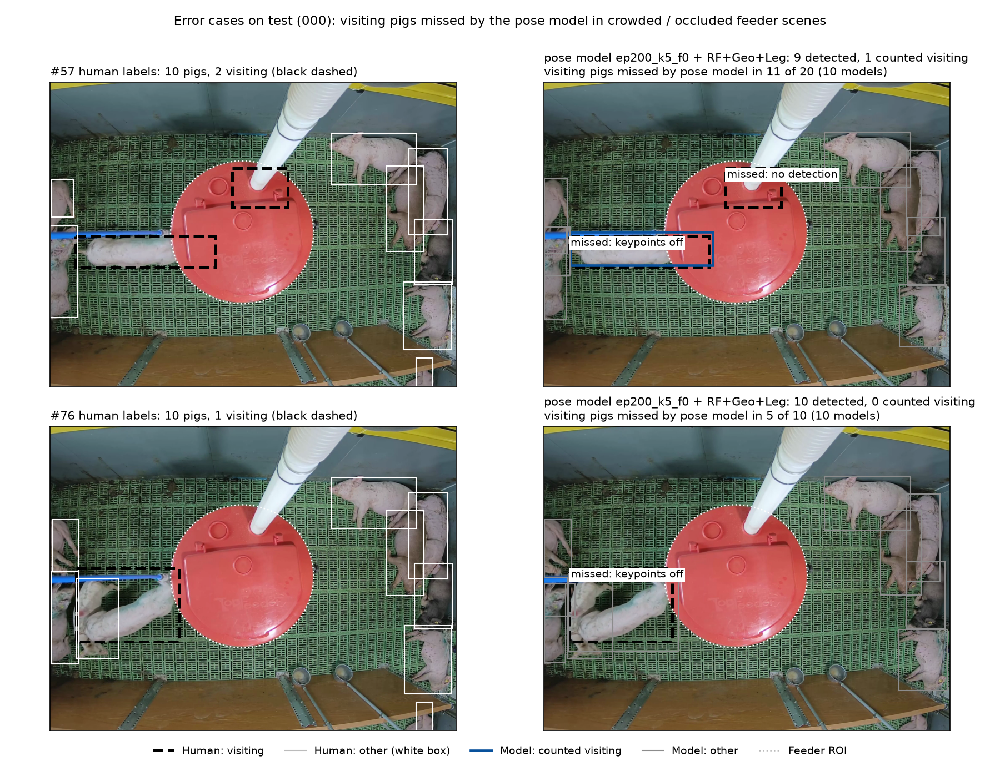

# 가림 · 밀집 오차 사례 (test 000)

사람 visiting 개체를 포즈 모델이 못 찾은 횟수 (10개 분할 모델 합계, 사진별): `missed_visiting_by_image.csv`

| # | 사람 visiting | 못 찾음 (10개 모델 합) | 찾았지만 RF+Geo+Leg가 other로 판정 |
|---|---|---|---|
| 56 | 2 | 11 / 20 | 0 |
| 57 | 2 | 11 / 20 | 0 |
| 58 | 2 | 11 / 20 | 0 |
| 76 | 1 | 5 / 10 | 0 |
| 69 | 2 | 3 / 20 | 1 |
| 51 | 2 | 3 / 20 | 0 |
| 55 | 2 | 3 / 20 | 0 |
| 61 | 2 | 3 / 20 | 0 |
| 75 | 1 | 3 / 10 | 0 |
| 30 | 1 | 2 / 10 | 0 |

'못 찾음' = 평가 코드(keypoint 평균거리 / 박스 대각선 ≤ 0.25로 매칭)에서 매칭되지 않은 사람 visiting. 그림에서는 박스 IoU ≥ 0.5인 검출이 있으면 'keypoints off'(검출은 했지만 keypoint가 어긋나 매칭 실패, 그 검출은 '라벨 없는 검출'로 따로 셈), 없으면 'no detection'(아예 못 찾음)으로 나눔.

## 그림

- #57 (0057_0057_frame_001048): 사람 10마리 중 visiting 2, 포즈 모델(ep200_k5_f0) 검출 9, visiting으로 셈 1. 10개 분할 모델에서 visiting을 못 찾은 횟수 11 / 20. 그림의 못 찾은 visiting: no detection, keypoints off.
- #76 (0076_0076_frame_001360): 사람 10마리 중 visiting 1, 포즈 모델(ep200_k5_f0) 검출 10, visiting으로 셈 0. 10개 분할 모델에서 visiting을 못 찾은 횟수 5 / 10. 그림의 못 찾은 visiting: keypoints off.

